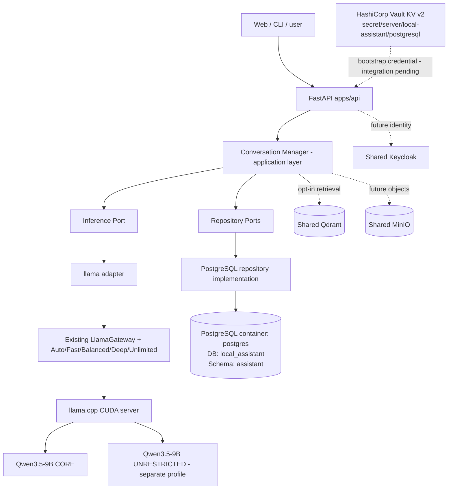
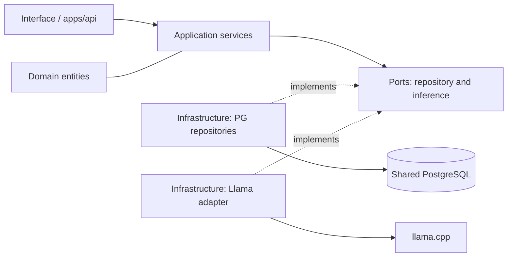
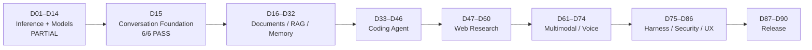
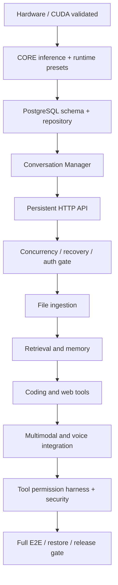
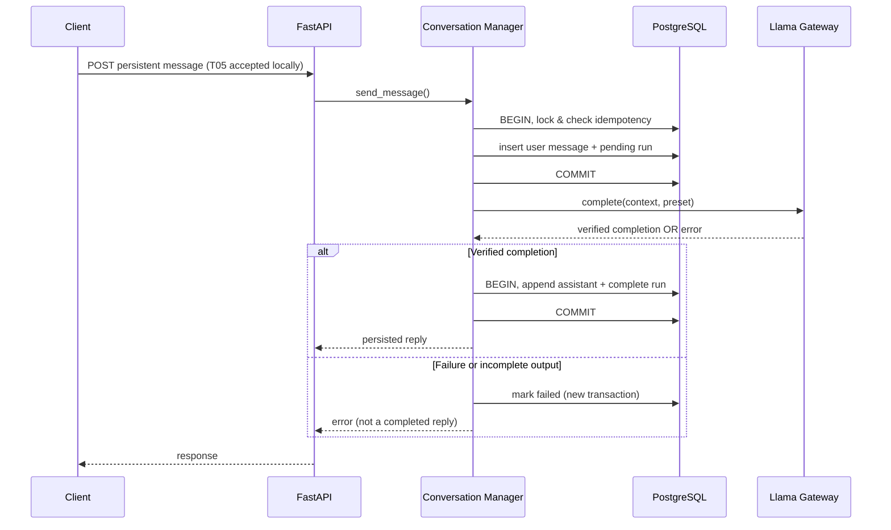

# LOCAL ASSISTANT — MASTER ROADMAP & EXECUTION TRACKER

> **Version:** 3.62 (D44 bounded workflow controls PASS) · **Updated:** 2026-10-20 (Asia/Ho_Chi_Minh)
> **Workspace:** `~/Workspace/Server/ai`  
> **Target:** Local-first personal AI platform; 90 **development-day milestones** (not calendar-day commitments).  
> **CURRENT POSITION:** **D16–D32 PASS within recorded local scopes. D32 frozen native RAG gate:90 focused +9 transport/privacy PASS,0 SKIP; actual TXT/PDF/DOCX/XLSX,5/5 answerable and5/5 exact relevant citations, absent/foreign refusal and clean V006 audit. Necessary ADR-050 structured-only prompt repair preserves original failed case and agreed models. Historical D31 full1608 remains separate; no fresh1621 full claim. D33 local workspace foundation PASS:288 related PASS/0 SKIP, actual kernel link/mount/root/owner gates and clean audit; no endpoint/registration yet. D34 PASS:1785 full PASS/0 SKIP/exit0, exact301-file freeze and clean final audit. D35 PASS:349 related PASS/0 SKIP,64 new finite scoped tool cases and clean audit. D36 PASS; D37 PASS; D38 EVALUATION PASS; D39 PASS; D40 PASS; D41 PASS; D42 PASS; D43 PASS; D44 PASS. Production flags off.**
> **Scope source:** original `PERSONAL-AI-LOCAL-ROADMAP-UPDATED-2026-10-11.md`, `dev_log/dev_log.md` (D1–D10), source tree and terminal results, including the 2026-10-18 authenticated local release and recovery checkpoint.
> **Model strategy source:** [MODEL_REGISTRY.md](MODEL_REGISTRY.md); [model evaluation backlog](MODEL_EVALUATION_BACKLOG.md). Registry nominations, measured choices and deployed capabilities are distinct. The owner approved Qwen after the offline comparison and transition review. [Selected configuration](../configs/embedding-selected.json) now pins Qwen CPU/1024, `selected_not_deployed`; exact E5 rollback is retained. D24 historical evidence remains unchanged.
> **Operator note:** Task checkboxes reflect *observed verification*, not whether someone suggested or pasted code. Where evidence is incomplete, status = PARTIAL / VERIFY / TODO.

---

## 0. How to use with VS Code + Codex

1. The tracked roadmap is `docs/LOCAL_ASSISTANT_MASTER_ROADMAP.md`; `docs/MASTER_ROADMAP.md` is not present in this checkout. Keep the existing `dev_log/dev_log.md` as the factual chronological record; do **not** overwrite it.
2. At the start of a Codex work session, read this roadmap, `docs/MODEL_REGISTRY.md`, `dev_log/dev_log.md`, the active day's tests/code, and applicable `docs/ADR/` before changing anything. For model work also read `docs/MODEL_EVALUATION_BACKLOG.md` and the current configuration/evidence.
3. Work on **one task ID at a time**. After implementing, run the listed acceptance tests, paste/summarize the actual result and update status. Do not mark PASS without evidence.
4. Keep an append-only entry in `dev_log/dev_log.md`: timestamp, task ID, code changes, commands/tests, actual output summary, decisions, known issues, next action.
5. Never run migrations, modify Vault policies, replace Docker infrastructure or delete data without a reviewed plan and backup/rollback option.
6. Mermaid diagrams render in Markdown preview on many GitHub/VS Code setups; if not, install a Mermaid Markdown preview extension.

**State legend:** `PASS` = demonstrated by reported execution; `PARTIAL` = something built/tested but gate not entirely demonstrated; `VERIFY` = historical claim or deliverable needs recheck; `TODO` = not implemented/tested; `BLOCKED` = cannot proceed without prerequisite.

**Codex briefing (paste into a Codex prompt):**

> Read `docs/LOCAL_ASSISTANT_MASTER_ROADMAP.md`, `docs/MODEL_REGISTRY.md`, `docs/MODEL_EVALUATION_BACKLOG.md`, `dev_log/dev_log.md`, `docs/conversation_schema_design.md`, existing `docs/ADR/`, and the affected source files. Identify the next unchecked task and prerequisites. Preserve currently working code, all containers and shared home-server infrastructure. Never create another PostgreSQL/Vault/Qdrant/MinIO/RabbitMQ/Keycloak/MongoDB service. Make the smallest reviewable change; provide full-file contents when explicitly requested; run specific tests and record evidence. Do not mark PASS for skipped tests. Do not invent endpoints, secret values or model metrics. Observe Vault least-privilege and approval gates. Never silently change an agreed model; replacements require measured benchmark/performance/resources, compatibility, migration, rollback and explicit owner approval.

---

## 1. Executive status (as of 2026-10-20)

| Stage | Development days | Status | Evidence / next work |
|---|---:|---|---|
| P1 — Machine, inference, two-profile baseline | D1–D14 | **PARTIAL / substantially implemented** | D1–D10 documented in dev log; later 32K, vision, MTP and runtime presets exercised. Full original D14 model quality/safety release gate not evidenced. |
| P2a — Conversation persistence foundation | **D15** | **PASS (6/6 local tasks)** | PostgreSQL + Vault, Alembic V001, repositories, Conversation Manager tested. Authenticated owner-scoped API, PostgreSQL/CORE/restart, leases/context and real pool export verified. Backup restore checked rows/owner/ACL before shared restart; Keycloak recovered. 151/151 regression PASS. |
| P2b — Files, ingestion, RAG, memory | D16–D32 (re-baselined) | **PASS (defined local scopes)** | D32 actual native RAG/citation gate99 focused PASS/0 SKIP and clean V006 audit;5/5 answers/citations plus refusals. Historical D31 full1608 separate, production flags off, limits explicit. |
| P3 — Coding agent | D33–D46 | **IN PROGRESS (D33–D44 defined local gates PASS)** | Explicit owner/workspace roots and kernel-scoped readonly discovery tested; D34 authenticated bounded inventory/search PASS,1785 full PASS/0 SKIP and clean final audit; D35 tool dispatch PASS:349 related/0 SKIP; D36 source-cited explanations PASS:423 related/0 SKIP, actual CORE2/2 answers/citations and1/1 refusal; D37 PASS; D38 EVALUATION PASS; D39 PASS; D40 PASS; D41 PASS; D42 PASS; D43 PASS; D44 PASS; security/MVP gates remain later. |
| P4 — Web research | D47–D60 | TODO | Citation provenance, research tool controls and artifacts. |
| P5 — Multimodal + voice | D61–D74 | PARTIAL foundations / TODO products | CORE vision smoke done earlier; full image, video and speech workflows unbuilt. |
| P6 — Harness, MCP, security, UI | D75–D86 | TODO | Permission-first tool runtime, skills, MCP, backup, observability. |
| P7 — Release gate | D87–D90 | TODO | End-to-end, restore, reproducibility, release. |

**Scheduling semantics:** these are **sequenced milestones**, not promises to finish each task in 24 hours. D15 has six subtasks. If D15 remains open tomorrow, do not relabel unfinished tasks as D16 merely because calendar time passed. The original document had D15 = file upload; **v3 explicitly changes that decision** and shifts file ingestion later. Later days are a planning baseline, subject to recorded re-estimation, not fake completion.

### Verified milestones and current task

| ID | Task | Status | Acceptance evidence |
|---|---|---|---|
| D15-T01 | Shared PostgreSQL instance, dedicated `local_assistant` DB + app credential in Vault | **PASS** | TCP login as `local_assistant_app` using Vault secret; current DB/user returned correctly. |
| D15-T02 | Alembic V001; `assistant` schema + tables; runtime grants | **PASS** | V001 verified at D15 (then head); four original relations/grants remain valid. D17 adds reviewed V002 without rewriting V001. |
| D15-T03 | Domain, repository ports, SQLAlchemy models, PostgreSQL repositories | **PASS** | Real PostgreSQL lifecycle integration test passed. |
| D15-T04 | Conversation Manager, inference port + adapter, replay/failure persistence | **PASS for defined tests** | 2 integration tests passed; 42 API/runtime regression tests passed. T06 subsequently verified defined race/crash/context cases; production multiworker remains unaccepted. |
| **D15-T05** | **Persistent Conversation REST API** | **PASS (localhost)** | Vault-backed app credential; 4/4 integration PASS including CORE; full suite 94 PASS, zero SKIP; history/list/replay verified across two Uvicorn processes. |
| D15-T06 | Concurrency, crash recovery, context, auth and recovery | **PASS (authenticated localhost)** | Full suite 151/151 PASS, zero SKIP; two-principal negative access, real pool export/reconnect, owner/ACL/data restore, shared PostgreSQL restart, Keycloak recovery and authenticated API process restart accepted. |
| **D16** | **Bounded file metadata/storage design and policy** | **PASS (design/policy)** | Spec + ADR-019 reviewed; 86 policy cases PASS; full suite 237/237 PASS; V001 unchanged. No migration, blob adapter or upload API introduced in D16. |
| **D17** | **Bounded authenticated file storage/HTTP/recovery** | **PASS (localhost, one worker; T01–T05)** | Full 443/443 PASS, zero SKIP; V002, owner/quota/replay, private FDs, isolated format verification, cancellation/deadlines, real crash/HTTP races, paired DB/blob/identity restore and two-process API restart; ADR-019–025. |

**Latest accepted gate:** D44 [acceptance](evidence/d44-controls-acceptance.json):**2622 full PASS/1559.31s,0SKIP,exit0**,1264 related subset/74 new cases,414 sources/488 unique source-protected hashes and [clean readonly audit](evidence/d44-final-post-audit.json). Finite trusted hooks, exact owner signal/join cancellation and one explicit immutable proposal retry; two interrupted fulls and four reproduced uncertainty faults retained. [Scope](D44_BOUNDED_WORKFLOW_CONTROLS.md), [ADR-063](ADR/063-bounded-workflow-hooks-cancel-and-retry.md). Original D43/D38 measurements and agreed models/config/data preserved. **D44 PASS; D45 NEXT.**

**Prior accepted workflow gate:** D43 [acceptance](evidence/d43-workflow-acceptance.json):**1190 related PASS/72.99s,0SKIP,exit0**, plus separate first actual CORE visible sample**1 PASS/4.61s**;87 new cases,405 source/434 protected hashes and [clean audit](evidence/d43-final-post-audit.json). Actual issue→plan/full-file diff→two typed approvals→checkpoint edit→immutable snapshot tests→trusted summary, native faults/cancel/expiry/TCP/ASGI/lifecycle gates. Not one1191 invocation;2548 collection is not a fresh full. D42 historical full2461 preserved. [Scope](D43_REVIEWED_CODING_WORKFLOW.md), original D38 first4/6/failures unchanged. **D43 PASS; D44 PASS.**

**Earlier milestone:** D39 **548 related PASS/7.70s,0 SKIP,exit0**,71 new scoped review/one-shot/expiry/auth/CLI/TCP/startup cases, clean [audit](evidence/d39-final-post-audit.json).2099 collected is not a fresh full. [Acceptance](evidence/d39-approval-acceptance.json), [scope/limits](D39_EXPLICIT_APPROVAL_REVIEW.md). Explicit disposable fixture approvals only; no production action approved/executed. D38 first4/6 repaired tasks and two failures hash-preserved, no retry/score selection. **D39 PASS, D40 PASS; D41 PASS; D42 PASS; D43 PASS; D44 PASS**; agreed models/configs/migrations and production flags preserved.

**Historical D24 demonstration:** 2026-10-18 **783 passed in 95.11s**, zero skipped/no exclusions with real PostgreSQL/CORE. D17-T01–T05 local gates accepted: 77 FS + 24 journal + 62 verifier + 31 HTTP/service + 12 recovery cases, alongside 237 prior tests. V002 is applied; previous conversation/message/run rows and owner/ACL fingerprints match. Retained paired backup `data/backups/d17-paired-20261018` verifies seven tables, one 53-byte fixture, namespace/principal bindings and blob/archive hashes/permissions. Actual authenticated upload/replay/download/delete survives API process restart; owned workers/canary/probes are cleaned and allocation is zero. File feature remains operator opt-in; no public/multiworker/off-host certification is implied. D18 is accepted with 33 additional tests (25 parser/protocol/resource + 8 real DB/HTTP/lifecycle): exact golden page/Unicode/blank mapping, owned/namespace/hash revalidation, two-slot isolated parsing and cancellation/delete/shutdown gates. Native text remains untrusted; no extraction cache, model context or schema change. D19 is accepted with 53 additional tests (37 processor/contract/independent opening + 16 real DB/HTTP/lifecycle): main-body paragraphs/runs/tables/styles, source-hash-bound Unicode edits, untouched member/format preservation, actual LibreOffice opening and response-lifetime admission/cancellation. Output is ephemeral; lxml runtime/python-docx dev are uv-locked; no schema/source mutation. D20 is accepted with 58 additional tests (42 processor/contract/sandbox + 16 DB/HTTP/lifecycle): native multi-sheet/cell/shared-string/style/merge views, typed literal edits, immutable source and exact formula/cache/untouched-part preservation. Output reopens with dev-only openpyxl; no formula evaluation, new runtime dependency or schema change. Cache uncertainty is explicit and admission remains held through delivery. D21 is accepted with 54 additional cases (28 page/parser/kernel + 10 vision protocol + 12 DB/HTTP lifecycle + 4 metric/live-quality): native/scan/image/page mapping, bounded sanitized raster/ICC removal, raw-score uncertainty, source fences and joined response/model ownership. Retained docs/evidence/d21-ocr-acceptance.json reports clean/scan CER0, actual CORE Vietnamese table6/6 exact cells/rows; degraded image CER1.0 remains explicit and requires review. OCR is English-only, VLM explicit/unverified/always-review; no confidence calibration/general-language claim. D22 is accepted with 59 additional cases (30 mapping/identity/budget +29 real DB/HTTP/lifecycle): exact Unicode spans, page/paragraph/declared heading/table/sheet boundaries, native cell/formula/cache/merge metadata and OCR review propagation. IDs bind source/hash/version/byte policy/content and private owner/namespace; labels are descriptive, never bearer capabilities. One response-lifetime slot, reference-counted nested tracking, joined transformation and final source fences preserve delete/cancel/shutdown/quota behavior. No dependency/schema/persistence/index changes. D23 is accepted with48 additional cases (30 scorer/failure/CLI +18 actual corpus/live report):18 mixed-document cases,56/56 exact source fields,32 chunks/7 empty records, independent golden content/structure/rewrites and explicit CORE table6/6. Retained docs/evidence/d23-document-pipeline.json separates expected empty/degraded/rejected cases and OCR CER/WER1.0 quality failure from evaluation gates. No production code/config/dependency/schema change or unproven repair. D24 is accepted with35 additional cases (33 scoring/token/pool/artifact/probe negatives +2 actual CPU/Qdrant): frozen20/40 bilingual retrieval selects pinned CPU-int8 multilingual-e5-base/768 over small, Recall@3=.925/MRR@10=.874405, measured802.863MiB RSS/p95 7.378ms. Small quality failure and3 base top3 misses retained. ADR-031 specifies model/runtime/tokenizer fingerprint, token-overflow rejection and private versioned collection/outbox lifecycle. Actual existing Qdrant1.18.2 accepts schema/10 indexes; owned empty probe removed with unchanged inventory. Dev-only ONNX/tokenizers uv-locked, no source/API/schema/permanent collection/worker changes. Full783 PASS/0 SKIP in95.11s; D25 durable ingestion is NEXT. Two authenticated principals are isolated across all conversation operations and manager locks; unowned legacy records remain hidden. Structured pool metrics export under actual Uvicorn; a stale owned backend reconnects. Protected backups of four databases and globals retained; Local Assistant restore matches rows plus owners/ACLs, and shared restart preserves data and Keycloak readiness. Actual authenticated API process restart/replay also passed. **Local acceptance scope:** direct localhost, one API worker, operator-delivered DB credential and private auth file. OIDC, production scoped Vault bootstrap, multiworker certification, off-host disaster recovery and load SLOs remain future deployment work. Pytest is not a model-quality scorecard.

---

## 2. Product objectives and non-goals

**Primary goal:** an extensible personal AI that runs primarily on the user's Ubuntu machine, supports Vietnamese/English chat, persistent conversations, reasoning, coding workflows, document/RAG/memory, grounded web research, vision/video/voice, tools/skills/MCP, strong privacy, reproducibility and opt-in remote capabilities.

**Principles:**

- Local-first, no mandatory cloud dependency or hidden fallback.
- CORE model default; UNRESTRICTED is opt-in, isolated, and must not acquire tools or extra permissions by selecting a model profile.
- llama.cpp handles model inference; FastAPI/Application Layer handles workflow and state; PostgreSQL/Vault/Qdrant/MinIO are shared infrastructure services.
- The product is a **separate application** hosted **on shared Home Server infrastructure**. Do not conflate applications, backend processes, containers, database instances, Vault paths, or Vault AppRoles.
- Deny-by-default for side-effecting tools; human approval, scope, budgets, logs and rollback.
- Tests must be reproducible; never report success from SKIPPED tests, hypothetical output or source code alone.
- No general-purpose autonomous host shell, internet, or privileged Docker socket for a model by default.

**Out of scope for v1.0:** pretraining a foundation model, public multi-tenant SaaS, autonomous privileged administration, automatically running risky scripts found online, mandatory fine-tuning, always-on cloud sync.

---

## 3. Existing architecture: actual vs target

### 3.1 Infrastructure, workloads and data



> Dashed arrows represent an intended dependency, **not** a tested production integration. The existing `/api/v1/chat/completions` remains stateless and has not been replaced.

### 3.2 Architecture boundaries



**Current compromise:** `ConversationManager` currently constructs concrete PostgreSQL repositories inside Application Service; the long-term goal is a Unit of Work/repository factory injected from the composition root. Do not label existing code perfectly dependency-inverted until fixed.

### 3.3 Home Server inventory — existing, do not duplicate

| Service | Existing instance | Use by Local Assistant |
|---|---|---|
| NVIDIA GPU | RTX 4070 Ti SUPER 16 GiB | CUDA inference; one heavyweight 9B at a time by default |
| llama.cpp | Pinned image `local-assistant/llama-cuda:5c8854fd8` | CORE / UNRESTRICTED profiles; host localhost:8080 |
| PostgreSQL | Container `postgres` (Postgres 17.x), host `127.0.0.1:5433` for app | DB `local_assistant`; schema `assistant` |
| Vault | Container `vault`, KV v2 under `secret/` | DB credentials; existing Shamir unlock behavior; no root token in app |
| Qdrant | Existing container `qdrant` | Future semantic memory/RAG collections |
| MinIO | Existing container `minio` | Future documents/artifacts buckets |
| RabbitMQ | Existing container `rabbitmq` | Optional later background jobs (only if warranted) |
| MongoDB | Existing container `mongo` | Not conversation source-of-truth |
| Keycloak | Existing container `keycloak` | Candidate for user auth; integration not yet confirmed |
| Docker network | `home-net` | Shared infrastructure networking; FastAPI currently native host process |

### 3.4 Data contract from Alembic V001

- `assistant.conversations`: UUID, title, profile, preset_default, status, created/updated/deleted timestamps, JSONB metadata.
- `assistant.messages`: UUID, conversation ID, sequence, role, content, request_key unique per conversation, created timestamp, JSONB metadata.
- `assistant.inference_runs`: user/assistant message links, requested/selected preset, model ID, pending/completed/failed/interrupted, usage, latency and timing, error code.
- Unique sequence per conversation and a partial unique index allowing only one `pending` inference per conversation.
- Roles: `local_assistant_migrator` owns DB/schema; `local_assistant_app` has required DML, not TRUNCATE. Migrations run separately.
- Credential paths: `secret/server/local-assistant/postgresql` and `.../postgresql-migrator`. They are in Vault, **not** config-file passwords.
- **Known gap:** no user/tenant ownership column or access policy in V001; auth/authorization must be designed before exposing conversation histories beyond controlled localhost.

### 3.5 Complete model strategy — registry reconciliation (2026-10-18)

**Purpose:** Restore the full lineup from [MODEL_REGISTRY.md](MODEL_REGISTRY.md) without changing D24, deployed profiles or configuration. Names below identify registry choices/candidates, not newly verified model availability, benchmark wins or deployment instructions.

**Registry lineup protection — owner clarification:** Preserve every model and its decision status in MODEL_REGISTRY.md as the agreed strategy. Do not substitute another name, remove an original candidate, or promote an experimental alternative into its strategic role without an explicit owner-approved decision. In particular, **Qwen3-Embedding-0.6B remains the original embedding candidate and Qwen3-Reranker-0.6B remains the original reranker candidate**. D24 records a separate measured E5 baseline; it does **not** replace either registry entry or establish an approved Qwen-to-E5 strategy change. Preserve the current E5 implementation/configuration/data as instructed while keeping that distinction explicit.

| Role | Established/current baseline and evidence | Original candidate / optional alternative | State and planned gate |
|---|---|---|---|
| CORE LLM | `Qwen/Qwen3.5-9B`, community `bartowski/Qwen_Qwen3.5-9B-GGUF`, Q6_K; llama.cpp/CUDA,32K, existing runtime presets; configs/models.yaml and D1–D14/D21 evidence | Larger/specialist models only after a measured gap | Established implementation; preserve default. Full original D14 quality release gate remains qualified |
| UNRESTRICTED LLM | `HauhauCS/Qwen3.5-9B-Uncensored-HauhauCS-Aggressive`, Q6_K, matching isolated profile/projector | No replacement proposed | Existing tested profile, config status `testing`; opt-in, no automatic tools/privileges; do not claim all quality gates closed |
| Embedding — current D24 choice | `intfloat/multilingual-e5-base`, official CPU ONNX int8,768; pinned config/ADR-031/evidence | Separate measured E5 baseline; it does not replace, rename or remove the Qwen3-Embedding-0.6B registry entry | D24 **PASS local selection/design**; historical E5 configuration preserved in `configs/embedding-e5-rollback.json` |
| Embedding — original nominated candidate | No Qwen embedding result/deployment established by D24 | **`Qwen3-Embedding-0.6B`**, original P1 evaluation candidate | **Owner-approved selection applied; not deployed**; [MODEL-EVAL-001](MODEL_EVALUATION_BACKLOG.md#model-eval-001--qwen3-embedding-06b-versus-current-e5), separate post-D24 evidence, no automatic cutover |
| Embedding — measured smaller alternative | `intfloat/multilingual-e5-small` CPU int8/384 was actually benchmarked in D24 | Lower-resource E5 alternative only | Ineligible under frozen D24 quality gates; not the selected model and not a Qwen comparison |
| Reranker | No production reranker evidenced in current RAG configuration | **`Qwen3-Reranker-0.6B`**, original P1 candidate | D27 / MODEL-EVAL-002: D27 local paired/resource/owner-delegated AI evaluation complete; retain dense/defer adoption. Batch1 failures retained; original nomination preserved, not selected/deployed |
| Vision | **CORE Qwen3.5-9B native vision plus compatible mmproj** is the default strategy; D21 explicit VLM/table evidence | `Qwen3-VL-4B/8B` only if measured evidence warrants | Keep CORE default; conditional MODEL-EVAL-006 at D62–D67, no automatic second VLM |
| ASR | No selected/deployed speech pipeline evidenced | **`Qwen3-ASR-0.6B` versus Whisper/faster-whisper** | D68 / MODEL-EVAL-003: planned Vietnamese/English accuracy, latency, memory comparison |
| VAD | No deployment evidenced by D24 | **Silero VAD v5** discussed candidate | D69 / MODEL-EVAL-004: speech/noise/segmentation/timestamp tests before selection |
| TTS | No selected/deployed speech synthesis evidenced | **`Qwen3-TTS-0.6B` versus Piper** | D70 / MODEL-EVAL-005: verify Vietnamese output, latency/naturalness/resources/license |
| OCR | **Native PDF parsing first, OCR/VLM fallback**; current D21 uses English Tesseract and explicit CORE VLM with review/uncertainty | No fixed separate OCR-model decision; dedicated OCR only after comparison | Preserve D18/D21 scope/blur failure; D62 quality evaluation, no invented OCR model winner |
| Coding | Approved strategy: **CORE plus deterministic Git/search/patch/test tools**; D38 evaluation-only baseline4/6 measured, application coding workflow still unimplemented | Specialist coder only after benchmark | D33–D46 baseline, D38 / conditional MODEL-EVAL-007; model choice never grants host tools |
| Larger LLM | CORE remains default | **Qwen3-14B / approximately20B /27B+ options** are optional future comparisons | MODEL-EVAL-008, conditional/unscheduled future phase or Day91+; not automatic CORE replacements |
| Web | Planned pipeline: **search/fetch/browser tools plus CORE** | No separate web-search model required | D47–D60 tool/provenance pipeline, not a new deployed model |
| Video | Planned integration: **FFmpeg frames/timestamps plus vision and ASR** | No standalone video-model decision | D64–D67/D74 integration; frame smoke is not a complete video product |

**Hardware/routing constraint:** RTX4070Ti SUPER16GiB and32GB nominal RAM are shared. CORE/UNRESTRICTED load separately by default; do not assume all nominated models stay resident simultaneously. A registry nomination restores evaluation scope, not permission to download, swap, deploy or widen tool privileges.

**D24 comparison audit:** ADR-031, configs/embedding-candidates.json, the runner/live test and docs/evidence/d24-embedding-selection.json all list only E5-small and E5-base. The result establishes E5-base over that smaller E5 candidate on the frozen local corpus. It establishes **no E5-versus-Qwen superiority**. The omitted comparison was subsequently executed as MODEL-EVAL-001, with separate evidence; it is not retroactively a D24 result. Preserve commit `a88584b` and all existing D24 results/configuration.

**Actual RAG configuration versus intended routing:** configs/models.yaml defines CORE/UNRESTRICTED LLM profiles; configs/embedding-selected.json separately pins owner-approved Qwen CPU/1024, `selected_not_deployed`. D25 now implements default-disabled authenticated indexing, source-held embedding, owned Qdrant writes and durable publication/cleanup. Actual acceptance used removable owned probes; no production collection or routing was enabled. D26 now implements default-disabled dense search with trusted tenant filters, SQL active-source checks and exact source rehydration. D27-T01 baseline and T02 offline original-reranker batch4 diagnostic comparison are now measured; no production reranker stage is integrated or deployed; an isolated test-only ASGI composition now measures complete source/query/ranking/delivery and bounded CORE traffic. Batch1 CPU failures remain retained. Registry routing describes the intended full pipeline. Historical D24 evidence is preserved; current post-test inventory is zero collections, with no existing user collection/data adopted or deleted.

**Binding model-change rule from the owner:** Protect the model lineup and original candidate roles in MODEL_REGISTRY.md as well as the current runtime configuration; preserving E5 operational state alone does not satisfy registry preservation. Do not unilaterally change any agreed CORE, UNRESTRICTED, embedding, reranker, ASR, VAD, TTS or VLM selection. Any replacement proposal must identify old/new model and reason, actual benchmark, performance/resources, compatibility, migration and rollback, then receive **explicit owner approval before configuration/deployment/cutover**. Better benchmark scores alone do not authorize replacement. The later explicit authorizations for Qwen download/comparison and selection are recorded in ADR-032 and the selection approval record; they do not certify an implemented ingestion/search service. Keep a separate evidence-backed ADR/decision record for any later approved change.

---

## 4. Historical progress — Days 1–14

Source of record for D1–D10 is `dev_log/dev_log.md` (compiled through 2026-10-12). D11–D14 below list observed deliverables from ongoing discussions but avoid invented per-day terminal results.

| Day | Focus and intended deliverable | Evidence-backed state |
|---|---|---|
| D01 | OS/hardware inventory; GPU/CUDA/VRAM/RAM; workspace | **PASS** — Ubuntu and RTX 4070 Ti SUPER validated |
| D02 | Build/version-pin llama.cpp CUDA | **PASS** — commit `5c8854fd8` confirmed |
| D03 | uv environment; CORE Qwen3.5-9B Q6_K GGUF; first inference | **PASS** — reported first inference |
| D04 | Micro-benchmark input 512/4K/8K/16K | **PASS** — benchmark outputs logged |
| D05 | Real API context and retrieval ~12K / 16K | **PASS** — logged in development record |
| D06 | Manifest/config, startup scripts and runtime hash | **PARTIAL** — `/health` and hash checked; script-specific run evidence qualified in log |
| D07 | CORE smoke acceptance | **VERIFY** — original standalone D7 acceptance output absent in old log |
| D08 | UNRESTRICTED model fetch, hash and inference | **PASS** — source log records SHA/inference |
| D09 | UNRESTRICTED throughput, OOM handling | **PASS** — 16K after releasing competing VRAM |
| D10 | CORE vs variant initial quality evaluation | **PARTIAL** — initial 8/10 vs 8/10; not enough to claim equivalent quality |
| D11 | Deeper original/variant comparison and architecture choices | **PARTIAL/VERIFY** — benchmark files exist; per-day sign-off not supplied |
| D12 | Long-context and multimodal checks | **PARTIAL/VERIFY** — 32K/vision tests discussed; full original gate unverified |
| D13 | Auto router, runtime presets and hard reasoning budgets | **PARTIAL/VERIFY** — implementations and regression evidence available; align day labels with actual dev log later |
| D14 | Phase-1 model decision, release evidence | **PARTIAL** — working CORE/UNRESTRICTED and runtime gate; full weighted 30–50-case comparison not signed off |

**Additional verified later than the old D1–D10 log:** CORE 32K retrieval passed reported acceptance; vision/mmproj and MTP probes were reported successful; runtime presets and Auto V1 tested; project has `benchmarks/results/`, `configs/models.yaml`, model and runtime manifests. This does **not** mean all planned D7–D14 acceptance items are closed.

**P1 cleanup backlog (carry-forward, do not block D15 local API work unnecessarily):**

- [ ] Reconcile actual dates/tests D11–D14 against results and `dev_log`.
- [ ] Decide formal weighted model scorecard and quality gap gate.
- [ ] Confirm streaming/cancel/graceful shutdown and load/reload behavior where required.
- [ ] Ensure UNRESTRICTED tool permissions stay disabled by policy, not only by convention.
- [ ] Snapshot exact model hash, mmproj and runtime SHA in release manifest.

---

## 5. Day 15 — detailed sprint (CURRENT)

### D15-T01 — PostgreSQL & Vault — **PASS**

- [x] Reuse existing `postgres` container; no second server.
- [x] Create `local_assistant` database and `local_assistant_app` role.
- [x] Store matching credentials in Vault KV v2.
- [x] Verify real TCP password auth using Vault secret.
- [x] Create separable `local_assistant_migrator` credential.

### D15-T02 — Schema V001 — **PASS**

- [x] Alembic revision `0001 (head)`.
- [x] Tables `assistant.alembic_version`, `assistant.conversations`, `assistant.messages`, `assistant.inference_runs`.
- [x] Owner `local_assistant_migrator`, app role DML allowed; TRUNCATE denied.
- [ ] Document production migration/backup/downgrade policy (carry forward to operations).

### D15-T03 — Repository Layer — **PASS (focused test)**

- [x] `src/domain/entities/` for Conversation, Message, InferenceRun.
- [x] `src/application/ports/repositories.py`.
- [x] `src/infrastructure/models/` mappings to existing V001.
- [x] `src/infrastructure/repositories/` and async connection/session factory.
- [x] Real DB lifecycle test: separate commits, history, inference, archive/soft delete.

### D15-T04 — Conversation Manager — **PASS (focused tests; hardening open)**

- [x] `src/application/ports/inference.py`.
- [x] `src/infrastructure/inference/llama_adapter.py` reusing `LlamaGateway`.
- [x] `src/application/services/conversation_manager.py` with two-transaction flow.
- [x] Fake-inference test for persistence, replay, differing-key conflict and failure.
- [x] Focused regression: 42 tests PASS plus 2 integration tests PASS.
- [x] Token-aware whole-turn trimming implemented in T06; keep system/current input, use actual gateway template/tokenizer, reject irreducible overflow.
- [ ] Full dependency inversion/Unit of Work and finish-state retry semantics.
- [x] Defined T06 timeout mapping/cancellation/cross-backend races/leased disposable-process crash tests passed; broader operations/identity gates remain open.

### **D15-T05 — Conversation REST API — PASS for localhost (2026-10-17)**

**Deliverables** (`apps/api/` remains HTTP adapter):

- [x] Local acceptance credential delivery: operator retrieved the existing app credential from Vault and injected DATABASE_URL into test/API child processes only. No Vault token was delivered to FastAPI/tests and no password was printed or committed. Production scoped AppRole/secret-agent delivery remains open.
- [x] Add FastAPI app lifespan for async DB engine and session factory; close pools on shutdown.
- [x] Add composition root/dependency wiring for `ConversationManager` and `LlamaInferenceAdapter`.
- [x] `POST /api/v1/conversations` — create profile/preset/title.
- [x] `GET /api/v1/conversations` — paginated listing with archive policy.
- [x] `GET /api/v1/conversations/{id}` — detail.
- [x] `PATCH /api/v1/conversations/{id}` — update title/preset.
- [x] `GET /api/v1/conversations/{id}/messages` — sequence pagination.
- [x] `POST /api/v1/conversations/{id}/messages` — persistent chat; optional idempotency key.
- [x] `POST /api/v1/conversations/{id}/archive` — archive.
- [x] `DELETE /api/v1/conversations/{id}` — soft-delete.
- [x] Preserve `POST /api/v1/chat/completions` exactly; do not replace its stateless behavior.
- [x] Consistent error mapping (404, 409, 422, 502/503/504), validation and response schemas.
- [x] Localhost-only development boundary: direct peer guard, Origin/proxy rejection and error redaction tested. External exposure remains prohibited until authN/authZ with owner boundary exists; this local PASS does not certify authentication.

**Exit criteria:** local HTTP request → DB conversation → gateway → assistant response; list/history survive FastAPI restart; no regression of existing stateless endpoint; no credentials in logs or repo; no anonymous external history access.

**Initial acceptance evidence (2026-10-17):** `pytest tests/integration/ -q -rs --tb=short`: **4 passed in 1.18s** with LIVE_E2E enabled. Full `pytest tests/ -q -rs --tb=short`: **94 passed in 6.48s**, no exclusions/SKIPs. Separate HTTP check created a CORE response in process A, terminated A, launched process B and verified exact stored history, list visibility and cached replay with unchanged assistant ID. Temporary processes and test rows were cleaned up. This original T05 checkpoint is retained; T06 and Day 15 local acceptance were completed on 2026-10-18 below. See the append-only dev-log follow-up, ADR-016 and the local runbook.

### D15-T06 — Hardening, E2E & resilience — PASS for authenticated localhost (2026-10-18)

- [x] Concurrent same-key requests: exactly one inference and deterministic replay/conflict (test across connections).
- [x] Concurrent different-key requests same conversation: no duplicate sequence and at most one pending.
- [x] Failure injection between reservation / inference / finalization; ensure consistent rollback/error codes.
- [x] No incomplete `finish_reason=length` answer committed; verify model mismatch and context overflow.
- [x] Pending-orphan policy: owner/120s lease/30s heartbeat using DB time; lazy expiry recovery and explicit interrupted state. SIGKILLed test worker recovered; legacy unowned pending records require manual ownership review.
- [x] No transaction/session held while waiting on LLM; 12 blocked inferences show checked_out=0. Runtime checkout/checkin/invalidation/timeout/peak gauges export through periodic structured logs; real saturation, stale-backend reconnect and Uvicorn export tested. Load SLOs are future work.
- [x] Whole-turn history trimming and 32K actual tokenizer budgeting, including system context.
- [x] Prevent archive/delete during pending inference from causing a logically inconsistent committed answer.
- [x] Real CORE model E2E; model-not-loaded and gateway timeout paths.
- [x] Authenticated API process restart/replay verified. ADR-018 plan executed: protected backups, isolated restore with matching data/owner/ACL, quiet gate, shared PostgreSQL restart, unchanged source data, Keycloak discovery recovery and cleanup passed.
- [x] Full `uv run python -m pytest` regression; record exact counts and skipped cases.
- [x] Bearer UUID principals, private reloadable digest file and server-assigned JSONB owner scope. Two-principal real DB tests deny cross-owner detail/history/update/send/replay/archive/delete and independently fence manager reservation; legacy unowned history stays quarantined. Direct-localhost guard remains enforced.
- [x] ADR-018, dev log and runbook record implementation, rollback/recovery, actual acceptance and local deployment limits. Definition-of-done review below accepted; no skipped test is counted as PASS.

**Day 15 definition-of-done review (2026-10-18):** V001 and app identity remain valid; persistence/multi-turn/idempotency and failure integrity pass; exact tokenizer budgeting retains current/system input; API and DB restarts preserve history; owner isolation and safe metrics export pass; full regression is 151/151. **D15-T06 and Day 15 PASS for authenticated localhost.** No D16 code has been started in this checkpoint.

**Retained limits/debt:** pending Auto has a provisional balanced schema field; recovery is lazy and unowned legacy pending runs need operator review; historical conversations without owner are not silently adopted. JSONB owner filtering is application-enforced (no PostgreSQL RLS). Runtime API tokens are static high-entropy credentials managed in the app Vault namespace; scoped production Vault identity/OIDC remain deployment work. Full Unit of Work inversion, production multiworker/load certification and off-host/full-cluster recovery remain tracked debt. Existing shared services were reused; only uniquely named restore databases and test canaries were removed. See ADR-018 and protected recovery manifests; backup payloads and auth files are ignored by Git.

---

## 6. Re-baselined future 90-day plan

> The **original** 2026-10-11 plan allocated D15–D28 entirely to files/RAG/memory. Because D15 actually delivered persistent conversation foundations, the remaining work below is re-sequenced. Day numbering describes *milestones*, not guaranteed time-to-complete. At a weekly review, change estimates in this file rather than silently dropping features or declaring them finished.

### D16 — File storage design/policy — PASS (2026-10-18)

- [x] Ownership/provenance and additive V002 metadata/usage proposal reviewed against Day 15 principals; no migration executed.
- [x] Private local root and UUID-only object keys; labels never used as paths; descriptor/no-follow/no-replace and file-lock cleanup contract specified.
- [x] Versioned 25 MiB/file, 1 GiB/owner, 10 GiB global quotas, count/concurrency/free-space/deadline/archive bounds and deterministic same-key semantics specified and pure policy cases executed.
- [x] Global -> owner -> file transaction ordering, no SQL transaction over streaming/fsync, cross-resource journal/crash matrix and exactly-once allocation release reviewed.
- [x] Rollout/rollback and paired DB/blob backup/identity restoration plan reviewed; D17 failure/race/MIME/FS/HTTP acceptance matrix explicit.
- [x] `tests/test_file_storage_policy.py`: 86 PASS; full Vault-backed PostgreSQL/CORE regression 237 PASS, zero SKIP. Read-only DB check: V001/four tables unchanged.

Artifacts: `docs/FILE_STORAGE_DESIGN.md`, `docs/ADR/019-bounded-local-file-storage.md`, `src/application/services/file_storage_policy.py`, `tests/test_file_storage_policy.py`.

**Scope boundary:** snapshot helpers do not implement atomic quota reservation, MIME sniffing, FD-safe blob I/O, durable publication or recovery. Those remain D17 acceptance. Existing Day 15 source/dependencies/services were preserved. No MinIO credential/policy, new service, file route, migration or payload directory was introduced in D16.

### D17 — File persistence/upload/download — PASS (2026-10-18, local acceptance)

All T01–T05 local acceptance gates below have observed evidence. FS was implemented first to prove absent-inode locking before schema mutation; subsequent tasks were accepted only after real tests. D18 was subsequently accepted below; production scope remains separately tracked.

| ID | Scope | Status / dependency |
|---|---|---|
| D17-T01 | Private descriptor-based local adapter, bounded writes/hash, durable no-replace publication, reader/writer/resource locks and physical purge | **PASS**; 77 current FS cases, real process locks/8 SIGKILL FS boundaries, injected I/O failures, namespace/inventory/integrity; integrated by T04/T05. |
| D17-T02 | Reviewed V002, app grants and owner/global atomic quota/replay/journal repositories | **PASS (repository scope)**; verified fresh backup/restore, V002 applied by existing migrator, 24 real journal cases and full 327 PASS; retain guard through post-lock DB claim |
| D17-T03 | Bounded MIME/container verification for every allowed format | **PASS (verifier scope)**; 62 cases, actual Bubblewrap namespaces/resource bounds; 389 full-suite PASS/0 SKIP |
| D17-T04 | Authenticated owner-scoped reserve/raw PUT/list/detail/download/delete HTTP, deadlines and cancellation | **PASS (local HTTP scope)**; 31 HTTP/service cases, root identity binding; full 428 PASS/0 SKIP; default feature disabled |
| D17-T05 | DB/FS restart reconciliation, quota/HTTP races, paired metadata/blob restore and full regression | **PASS (local)**; 12 recovery/race/paired cases, protected retained paired restore, real uploader kills and two actual API processes; full443 PASS/0 SKIP |

T01 introduced no production runtime change. T02 applied reviewed V002 after verified backup/restore; T04/T05 integrated opt-in file resources and completed local acceptance. The actual process drill initialized private `data/files`, retained its namespace/control directories and removed its sample payload/journal; default flag remains off. No new infrastructure service or credential/policy was introduced. Auth/backups/models are outside blob cleanup. Retention/production deployment remain separately reviewed.

### Phase 2b — Documents, retrieval and memory (D16–D32)

| Day | Concrete task | Acceptance gate |
|---|---|---|
| D16 | **PASS — design/policy:** owner-typed metadata, private local blobs, quotas, provenance, journal and rollback | ADR-019/spec review complete; 86 policy tests, full 237/237 PASS; no runtime file feature claimed |
| D17 | **PASS (local):** V002/quota/private FS/isolated verification, authenticated raw HTTP, bounded recovery and paired restore | 443 full-suite PASS/0 SKIP; retained paired/process-restart evidence and ADR-019–025; owner/path/quota/FD/crash gates accepted |
| D18 | **PASS (local):** on-demand native PDF text with UUID/hash/version/page provenance | Golden multi-page/Unicode/blank mapping; owner/namespace/ready/hash, real sandbox/resource/lifecycle gates; 33 new tests, full 476 PASS/0 SKIP; ADR-026 |
| D19 | **PASS (local):** owned DOCX inspection/run rewrite, tables/styles/provenance | Independent python-docx round trip and actual LibreOffice open; 53 new cases, full 529 PASS/0 SKIP; source/quota/lifecycle gates and ADR-027 |
| D20 | **PASS (local):** bounded native XLSX inspection/literal rewrite with sheet/cell provenance | Independent openpyxl reopening; exact formula/cache/styles/untouched-part preservation; 58 new cases, full 587 PASS/0 SKIP; ADR-028; no formula/macro execution |
| D21 | **PASS (local):** per-page native/English OCR and explicit CORE vision/table fallback | Actual clean/scan CER0, table6/6 exact cells/rows, degraded CER1.0 flagged review; source/pixel/uncertainty/resource/lifecycle gates; 54 new cases, full 641 PASS/0 SKIP; ADR-029 and retained evidence |
| D22 | **PASS (local):** deterministic private chunks by page/paragraph/declared section/table/sheet | Exact Unicode source spans, stable access/source/hash/version/content-bound IDs, preserved row/formula/cache/OCR flags; 59 new cases, full700 PASS/0 SKIP; ADR-030 |
| D23 | **PASS (local):** independent mixed-document evaluation and honest error/quality report |18 corpus cases;56/56 source fields; native/structured/OCR/rewrites and expected rejection stages; retained evidence;48 new tests, full748 PASS/0 SKIP; no production repair needed |
| D24 | **PASS (local selection/design):** pinned CPU-int8 multilingual-e5-base/768 +ADR-031 private collection/lifecycle design | Frozen20/40 retrieval R@3=.925/MRR=.874405, RSS/p95 evidence and known misses; actual owned empty10-index Qdrant probe removed;35 new tests/full783 PASS/0 SKIP; no production index/worker |
| D25 | **PASS (local opt-in lifecycle):** T01/T02/T03; full979 PASS/0 SKIP | [ADR-033–036](ADR/036-ingestion-worker-and-terminal-sweeps.md), [acceptance](evidence/d25-ingestion-acceptance.json); actual source/Qwen/Qdrant replay, replacement, delete, crash/reclaim and late-write repair; default disabled, no production index |
| D26 | **PASS (local opt-in):** ACL-filtered dense search and verified source/provenance rehydration |51 new cases/full1030 PASS/0 SKIP; actual Qwen/SQL/Qdrant/HTTP, owner/root isolation, stale/deleted/superseded omission, final delivery fence and drain; [evidence](evidence/d26-retrieval-acceptance.json) |
| D27 | **PASS (local evaluation/decision):** T01/T02/T03; retain approved dense, defer production reranker |1234 full +16 new AI-focused +1 TCP PASS,0 SKIP;1251 unique tests across checkpoints, not one full invocation. Original gains/failures preserved; new AI v2 three stable paired rounds equal1.0 answerable metrics, no new gain. Real ASGI/CORE/TCP/source/lifecycle/rollback gates and clean [acceptance](evidence/d27-local-evaluation-acceptance.json); no adoption |
| D28 | **PASS (local opt-in):** source-held existing CORE grounded answers; ADR-043 | Full1334+2 new native-field PASS/0 SKIP; actual CORE/TCP, exact native source spans and clean [acceptance](evidence/d28-grounded-acceptance.json). Initial failure retained; no model/schema/deployment change |
| D29 | **PASS (design/contract):** session/episodic/preference/project with explicit consent/provenance/retention |47 policy/schema+16 actual temporary PostgreSQL cases PASS/0 SKIP; [design](MEMORY_DESIGN.md), [validation](evidence/d29-contract-validation.json), no applied memory migration/runtime |
| D30 | **PASS (local opt-in):** T01 journal/V005, T02 owner controls, T03 explicit message extraction/retention/export | Full1570 PASS/1357.69s,0 SKIP; source/consent/version/Unicode/retention and actual CORE/HTTP/TCP gates, [acceptance](evidence/d30-memory-acceptance.json) and clean audit. Production off; no prompt/vector memory use |
| D31 | **PASS (local privacy scope):** transactional source invalidation, injection/export/deletion boundaries | Full1608 PASS/1361.93s,0 SKIP; actual CORE and Qwen/SQL/Qdrant/blob composition preserve foreign data, current [audit](evidence/d31-final-post-audit.json) clean; [acceptance](evidence/d31-privacy-acceptance.json). Soft-delete/recovery/cache limits explicit |
| D32 | **PASS (local knowledge gate):** frozen native RAG/citations/limits |90 focused +9 transport/privacy PASS,0 SKIP; actual four formats,5/5 answers/citations, absent/foreign refusal and clean audit; [acceptance](evidence/d32-knowledge-acceptance.json). ADR-050 necessary structured-prompt repair, original failure/oracles preserved; no fresh1621 full claim |

### Phase 3 — Coding agent (D33–D46)

| Day | Concrete task | Acceptance gate |
|---|---|---|
| D33 | **PASS (local foundation):** explicit owner/workspace roots, readonly discovery/capabilities |63 new cases within288 related PASS/0 SKIP; actual openat2 link/mount/root/owner gates, [acceptance](evidence/d33-workspace-acceptance.json), clean audit. No endpoint/runtime registration; D34 adds authenticated reads |
| D34 | **PASS:** bounded authenticated inventory/source lines/literal search/Python lexical hints |1785 full PASS/0 SKIP/exit0,101 new cases,301-file source freeze and clean final audit; [acceptance](evidence/d34-workspace-acceptance.json), [ADR-052](ADR/052-bounded-authenticated-workspace-reads.md), [guide](D34_WORKSPACE_READS.md). Default off, no host registration |
| D35 | **PASS:** internal finite shared-schema tool dispatch, scoped identities and budgets |349 related PASS/0 SKIP/exit0,64 new native/invalid/schema/byte/time/cancel cases; [acceptance](evidence/d35-tool-acceptance.json), [guide](D35_READ_TOOL_DISPATCH.md). No model/public run API |
| D36 | **PASS:** existing CORE explanations from explicit selected source lines |423 related PASS/0 SKIP/exit0,74 new cases; CORE2/2 answers/relevant exact citations and1/1 absent refusal, clean audit; [acceptance](evidence/d36-explanation-acceptance.json), [limits](D36_SOURCE_CITED_EXPLANATIONS.md) |
| D37 | **PASS:** source-backed diagnosis/manual plan without modifications |477 related PASS/0 SKIP/exit0,54 new cases; original CORE1/1 diagnosed/native-cited manual reproducer,1/1 refusal, clean audit; [acceptance](evidence/d37-diagnosis-acceptance.json), [limits](D37_DIAGNOSIS_AND_MANUAL_PLANS.md). Reproduction not executed |
| D38 | **PASS (evaluation):** unchanged CORE + deterministic tool baseline on isolated fixtures |589 related +1 separate actual measurement PASS/0 SKIP/exit0;6 tasks measured, **4 repairs PASS/2 FAIL** retained, clean audit. [Acceptance](evidence/d38-baseline-acceptance.json), [limits/failures](D38_CORE_CODING_BASELINE.md). No specialist/application edit/command authority |
| D39 | **PASS:** explicit scope/content/owner-bound expiring approval events and CLI review |548 related PASS/0 SKIP/exit0,71 new exact-clock/thread/nonce/scope/replay/auth/CLI/TCP/startup cases, clean audit; [acceptance](evidence/d39-approval-acceptance.json), [limits](D39_EXPLICIT_APPROVAL_REVIEW.md). Ephemeral one-process foundation, no action execution |
| D40 | **PASS:** exact reviewed single-file proposal / diff / atomic edit (ADR-058) |2172 full PASS/1543.21s,0 SKIP,exit0;621 related subset,73 new cases, clean355-file/data/config audit. [Acceptance](evidence/d40-patch-acceptance.json), [limits](D40_APPROVED_ATOMIC_PATCHES.md). No production edits; durable rollback remains D41 |
| D41 | **PASS:** private Git checkpoint/journal and newly approved byte rollback (ADR-059/061) |2269 full PASS/1554.97s,0SKIP,exit0;912 related subset,97 new cases and clean371-source/377-hash audit. Two intentional exit2 partials and mount-fixture failure retained; [acceptance](evidence/d41-checkpoint-acceptance.json), [limits](D41_PRIVATE_GIT_CHECKPOINTS_AND_ROLLBACK.md). Local synthetic scope only |
| D42 | **PASS (local finite snapshot scope):** approved stdlib unittest/Ruff checks (ADR-060) |2461 full PASS/1536.84s,0SKIP,exit0;1104 related subset/192 new cases,396 source/409 protected hashes and clean audit. Actual CLI/TCP/native/ASGI-loss/SIGKILL/cancel gates; [acceptance](evidence/d42-checks-acceptance.json), [scope](D42_APPROVED_SNAPSHOT_CHECKS.md). Trusted readonly OS boundary/quality limits explicit |
| D43 | **PASS:** finite existing CORE issue→plan→diff→separate patch/check approvals→tests→summary |1190 related +separate first actual CORE sample1 PASS,0SKIP/exit0;87 new cases,405 source/434 protected hashes and clean audit. Host structural/four native sample oracles, typed approvals/TCP/lost-send/cancel/expiry; [acceptance](evidence/d43-workflow-acceptance.json), [limits](D43_REVIEWED_CODING_WORKFLOW.md). No fresh full/general-quality claim |
| D44 | **PASS (local finite controls):** trusted hooks, owner signal/join cancellation, one explicit immutable proposal retry |2622 full PASS/1559.31s,0SKIP/exit0;1264 related subset/74 new cases,414 sources/488 unique source-protected hashes and clean audit. Actual capture/model/write/check/independent-writer/hook/cancel/shutdown/TCP/CLI/lost-send gates; four uncertainty faults reproduced/repaired, both interrupted fulls retained. [Acceptance](evidence/d44-controls-acceptance.json), [ADR-063](ADR/063-bounded-workflow-hooks-cancel-and-retry.md), [scope](D44_BOUNDED_WORKFLOW_CONTROLS.md). Default off; no automatic action/model retry or old-grant recovery |
| D45 | Prompt injection, malicious README and tool-output tests | No unauthorized changes |
| D46 | Agent MVP gate, failure review and scorecard | At least 10 realistic coding cases, evidence recorded |

**Evaluated coding follow-ups:** [CODING_AGENT_BACKLOG.md](CODING_AGENT_BACKLOG.md) records priority/dependencies/effort/risk for retained CORE failures, explicit checkpoint retention, conditional pytest runtime, larger/multifile edits, orphan recovery and durable cross-worker authority. Planning only; no implementation, new scheduling, model adoption or bypass of the active acceptance gate.

### Phase 4 — Web research (D47–D60)

| Day | Concrete task | Acceptance gate |
|---|---|---|
| D47 | Search provider/tool pipeline + CORE, terms/quota/privacy | Provider ADR; no separate web-search model implied |
| D48 | Query normalizer, rate limits and search API | Resilient search fixture tests |
| D49 | HTTP fetch, text extraction, redirects, canonical URLs | Correct readable content and source URLs |
| D50 | Read-only browser for dynamic pages | Navigation/download permissions enforced |
| D51 | Provenance (title/date/fetch date), dedupe, cache | Every claim can map to evidence |
| D52 | Malicious webpage and injection red-team suite | Web content cannot override system/tool policy |
| D53 | Search freshness and coverage benchmark | Grounded results and dates logged |
| D54 | Multi-query research planning with time/token budgets | Bounded execution |
| D55 | Primary-source lookup and cross-source reconciliation | Conflicts explicitly surfaced |
| D56 | Claim-to-citation validation | No fabricated citations |
| D57 | Markdown research report generation | Reproducible evidence-backed report |
| D58 | PDF/DOCX export from generated report | Valid artifacts with source references |
| D59 | Long-run state, cancel/resume and error handling | No lost data or runaway tool loops |
| D60 | Web research phase gate | End-to-end researched artifact with tested sources |

### Phase 5 — Multimodal + voice (D61–D74)

> Prior CORE vision/mmproj smoke tests are foundations; they do not automatically close the product-level tasks below.

| Day | Concrete task | Acceptance gate |
|---|---|---|
| D61 | CORE native vision/mmproj adapter: request normalization, image sizing and privacy | Local image-chat sample passes; existing CORE remains default |
| D62 | Native-first OCR/CORE VLM quality; dedicated OCR or Qwen3-VL-4B/8B only if evidence warrants (MODEL-EVAL-006) | Measured tradeoffs/hallucination flags; no preselected replacement OCR/VLM |
| D63 | Image tables/figures/document screenshot tasks | Golden image results |
| D64 | FFmpeg video metadata/frame sampling for vision + ASR pipeline | Timestamped reproducible frames; no standalone video model implied |
| D65 | Frame-based video description | Correct timestamp provenance |
| D66 | Join audio transcript and video frames | Synchronized short-clip summary |
| D67 | Multimodal VRAM/context/performance benchmark | Text inference stable after media tasks |
| D68 | Compare Qwen3-ASR-0.6B vs Whisper/faster-whisper (MODEL-EVAL-003) | Vietnamese/English WER/latency/memory evidence before approved selection |
| D69 | Evaluate Silero VAD v5 candidate and segmentation (MODEL-EVAL-004) | Noise/timestamp/false speech-silence tests; not claimed deployed |
| D70 | Compare Qwen3-TTS-0.6B vs Piper (MODEL-EVAL-005) | Verify Vietnamese output, naturalness/latency/memory/license before approved selection |
| D71 | Push-to-talk / explicit recording control | User consent and stop works |
| D72 | ASR → LLM → TTS flow, buffering | Round-trip latency and error handling |
| D73 | Audio retention/delete/security tests | No unintended always-on recording |
| D74 | Multimodal/voice phase gate | End-to-end tested examples and resource matrix |

### Phase 6 — Harness, extensibility, security and UX (D75–D86)

| Day | Concrete task | Acceptance gate |
|---|---|---|
| D75 | Skill contract and versioned permissions | Validated schema, explicit install trust |
| D76 | MCP adapter, allowlisted servers/operations | Tool discovery cannot silently widen permissions |
| D77 | Pre-/post-tool hooks and error/stop handlers | Hooks cannot bypass approval layer |
| D78 | Run planner, budgets, retries, checkpoint/resume | Bounded orchestration and recovery |
| D79 | Deterministic tool routing + approval workflows | Audit for decisions and side effects |
| D80 | Profile isolation, prompt/template versions | CORE/UNRESTRICTED restrictions enforced |
| D81 | Cross-domain orchestration test (files + code + web) | Grounded result and no unsafe side effects |
| D82 | Threat model, RBAC/user ownership, CSRF/CORS and token handling | Negative tests for unauthorized access |
| D83 | Observability: TTFT/TPS, token usage, error traces, redaction | Metrics and logs do not expose secrets |
| D84 | Backup/restore of PostgreSQL, vector/object metadata and config | Actual restore drill |
| D85 | Load/concurrency/OOM/disk-full failure tests | Published bottleneck and recovery policy |
| D86 | UI polish + release candidate security/eval review | Zero unresolved critical release blockers |

### Phase 7 — Stabilization and release (D87–D90)

| Day | Concrete task | Acceptance gate |
|---|---|---|
| D87 | Feature freeze + full E2E benchmark suite | Reproducible result set with failures tracked |
| D88 | Critical fixes, clean-install rehearsal, model provenance/scorecard | Onboarding documented, reproducible |
| D89 | Backup restore drill, manual acceptance scenarios, security review | At least 10 representative workflows checked |
| D90 | Release tag v1.0-local, architecture/runbook, known limitations and vNext backlog | Internal production-ready release decision grounded in evidence |

**If a phase fails its gate, advance the calendar only after recording deferment and impact. Never interpret Day 90 as guaranteed release.**

---

## 7. Timeline diagrams

### 7.1 High-level milestone map



### 7.2 Dependency graph / release gates



### 7.3 Conversation transaction sequence



---

## 8. Detailed risks, open decisions and technical debt

**Model evaluation backlog:** [MODEL_EVALUATION_BACKLOG.md](MODEL_EVALUATION_BACKLOG.md) preserves original candidates, priority/dependency/effort/risk and approval requirements. **MODEL-EVAL-001 (P1, offline comparison complete, owner-approved selection applied; deployment gates open)** restores Qwen3-Embedding-0.6B versus retained E5. Qwen Recall@3/MRR@10=0.975/0.968750; E5=0.925/0.874405. [Measured tradeoffs and migration/rollback](QWEN_E5_COMPARISON_AND_TRANSITION.md) led to owner-approved Qwen selection; D25 local opt-in lifecycle now PASS with979 tests; source/Qwen/Qdrant integration was accepted separately from the model-selection decision. D26 retrieval now passes local opt-in scope separately; production deployment and D27 reranker evaluation remain open.

| Priority | Risk / debt | Mitigation / owner task |
|---|---|---|
| P1 | V1 ownership uses application-enforced JSONB scopes; legacy unowned records stay hidden | Tested bearer principals and repository/manager filters; review adoption mapping or typed owner migration/RLS before broader deployment |
| P1 | Legacy unowned pending runs; old/new writer overlap during rollback | T06 leased runs now recover after expiry; manually verify legacy ownership and drain active runs before rollback (ADR-017) |
| P1 | Persistent adapter depends on gateway private context/Auto helpers | Whole-turn/tokenizer budgeting now tested; extract a public planning port during planned dependency inversion |
| P0 | Production Vault auth for FastAPI not yet configured | Scoped AppRole or Vault Agent/injector; never root in runtime |
| P0 | File upload can cross DB/FS crash, quota, open-inode or MIME boundaries | D17 local gates accepted by real journal/FD-lock/quota/container/HTTP/restore tests; retain opt-in localhost scope and production/retention follow-up |
| P0 | User-provided files and web pages may contain hostile instructions | D17 onward verification/provenance; content remains untrusted, tool approval gate D33/D75 |
| P0 | UNRESTRICTED profile could get side-effecting tools if policy accidentally shared | Enforce policy server-side with negative tests |
| P1 | App Service imports concrete PostgreSQL repositories | Refactor to Unit of Work/factory injected at composition root |
| P1 | Existing API stateless and conversation API separate | Preserve old behavior and versioned contracts |
| P1 | Off-host/full-cluster disaster recovery not certified | Local Assistant data/owner/ACL restore and shared DB restart verified; preserve protected archives and validate off-host recovery before production |
| P1 | Old D1–D14 release/quality scorecard needs reconciliation | Historical cleanup and phase-gate evidence |
| P1 | `src/` is a generic top-level package name | Consider named package during planned packaging work, not urgent refactor |
| P2 | `apps/api/storage/__init__.py` empty; `.bak` files, `__pycache__` | Inventory and safe cleanup after green tests; ignore artifacts in Git |

### Secrets / authentication policy

- Vault is a shared server; `secret/angi`, `secret/game`, `secret/server` are **organizational paths**, not a measurement of how many backends exist.
- A Vault AppRole belongs to a **consumer identity / trust boundary**, not automatically one per database, one per container or one per folder.
- Angi and Game may each use one scoped AppRole if each has one consumer with the same minimum needed secret set.
- Local Assistant FastAPI should receive only its own PostgreSQL credential (regardless of whether that secret lives under `secret/server/local-assistant/`); do not give it a broad `server` AppRole.
- Separate static KV credential and dynamic PostgreSQL Vault database secrets are distinct options. Existing implementation uses **KV v2 static credentials**; dynamic credential engine is not currently mounted.
- Vault uses Shamir sealing and needed manual unseal during setup. Plan reboot/unseal operations and backups. Never commit/send root tokens, unseal shares, RoleIDs/SecretIDs or database passwords.

### Engineering conventions

- Python: `uv`, Python 3.12 in observed environment; `micro` editor; full-file edits over unreviewable ad-hoc patching when requested.
- FastAPI native `127.0.0.1:8000`; llama.cpp `127.0.0.1:8080`; PostgreSQL host port 5433; avoid open-public bind.
- Run Pytest with `uv run python -m pytest` (ensures root package import in current project).
- A test that SKIPs because `DATABASE_URL` is absent is **not** a PASS.
- Test DB state should be created with unique IDs and cleaned in correct FK order: inference_runs → messages → conversations.
- Never open a PostgreSQL transaction across an LLM/network call.
- Store final assistant text, metadata and usage, not hidden model reasoning by default.
- Code source/tree examples are **plans**, not proof of installed/run state.

---

## 9. Validation and release checklist

### Local D15 smoke commands (safe read-only unless test internally writes temporary rows)

```bash
cd ~/Workspace/Server/ai
uv run python -m pytest \
  tests/test_api_health.py \
  tests/test_llama_gateway.py \
  tests/test_runtime_presets.py \
  tests/test_runtime_auto.py -q
```

**Last observed:** 42 passed. The PostgreSQL integration tests require valid `DATABASE_URL` supplied securely at execution time; the last observed focused result was 2 passed. **Do not** place the DB URL/password in a tracked Markdown file.

### Cross-phase definition of done (DoD)

- [ ] Implementation reviewed; no accidental changes to shared Home Server containers.
- [ ] Task-specific tests, negative cases and regression tests executed with recorded actual output.
- [ ] Data migrations have verified rollback or restore procedure.
- [ ] Credentials/PII absent from Git, logs and test fixtures.
- [ ] Auth/permission boundary verified for side-effecting or user-specific functionality.
- [ ] Performance/resource measurements included when inference or media affected.
- [ ] Relevant ADR and `dev_log/dev_log.md` updated.
- [ ] Rollback or mitigation for errors known.

### End-of-project acceptance tests (D87–D90)

- **Chat:** multi-turn persistence and context management; restart recovery; cancel; profile separation; correct budgets.
- **Model:** original vs UNRESTRICTED provenance and reproducible quality/latency/VRAM benchmarks.
- **Documents:** PDF, DOCX, XLSX, OCR fallback, valid artifacts and provenance.
- **RAG/Memory:** retrieval citation, ACL, opt-out, retention and delete/export.
- **Coding:** read → explain → propose diff → approve → sandbox tests → rollback, without unapproved write.
- **Web:** fresh multi-source research with verified citations and guarded browser actions.
- **Multimodal:** image/frame/timecode and voice in/out with consent.
- **Security:** prompt-injection tests, Vault least privilege, unauthorized access denied, no secrets in output.
- **Operations:** backup/restore drill, disk/VRAM pressure, deployment from clean workspace and runbook.

---

## 10. Next-session execution order (Codex handoff)

D27 current policy/decision: owner delegated relevance review and similar tasks to the assistant under ADR-042; no mandatory manual labeling or fabricated human attestation. [Local evaluation decision](D27_RERANKER_EVALUATION_DECISION.md): retain approved dense, defer production reranker. All registry nominations/configurations preserved.

1. **D44 PASS; D45 NEXT.** [Acceptance](evidence/d44-controls-acceptance.json):2622 full/1264 related subset PASS/0SKIP/exit0,74 new cases,414 sources/488 unique source-protected hashes and clean readonly audit. Next freeze authored prompt-injection/malicious README/tool-output cases and exact no-unauthorized-change oracles. Keep untrusted source/model/output separate from exact owner approvals and trusted receipts; no automatic model/command permission or general robustness claim.
2. Preserve all prior accepted source/model/config/migration bytes except necessary reviewed related wiring/schema sharing. D34 actual malformed JSON failures, intentional interrupted exit2 and159-PASS process-loss partial remain separate evidence, never counted as completed full runs. Historical D34 full used301-file freeze; historical D42 full uses396 source/409 unique protected hashes; D43 related uses405 source/434 protected hashes. Latest D44 full2622 uses414 sources/488 unique source-protected hashes with boot/PID supervision and observed exit0; its earlier exit2/330.58s and exit2/62.84s full interruptions remain distinct non-PASS evidence. No model replacement, host workspace registration or production flags enabled. D41 intentionally interrupted419-marker and zero-marker exit2 partials remain separate from the completed2269 full.
3. Preserve original24/36 diagnostic gain, batch1 CPU failures and v1 absent-coverage failure. New v2 source/AI judgments/thresholds frozen before inference; three actual rounds have seven answerable cases all1 for both paths, one absent case with null retrieval metrics, gain0. Same-agent/limited-pool data is not human-independent/production quality; no abstention calibration or statistical superiority claim.
4. ASGI plus bounded101-overlap CORE drill and real ephemeral Uvicorn/TCP dense→ranking→dense rollback pass. TCP shares fixture event loop/resources; production separate-process/multiworker/load and persistent-model co-residency/optimization remain unvalidated. Do not convert tiny-sample descriptive timings into SLO or speedup claims.
5. Any future agreed-model/routing replacement/adoption still requires owner-specific approval and benchmark/performance/resources/migration/rollback plus implementation ADR. Keeping existing dense state changes no model choice and requires no candidate adoption. Production DR/load/general quality and conditional lexical/hybrid work remain evaluated backlog, not current manual tasks for the unavailable owner.

**Current formal checkpoint:** `D15-T01..T06 = PASS (defined local scope)`, **`D16–D32 = PASS (defined local scope)`**, **`D33 = PASS (local workspace foundation)`**, **`D34 = PASS (local authenticated bounded reads)`**, **`D35 = PASS (internal scoped read-tool dispatch)`**, **`D36 = PASS (local source-selected CORE explanations)`**, **`D37 = PASS (source-selected manual diagnosis)`**, **`D38 = PASS (baseline measurement,4/6 repaired tasks)`**, **`D39 = PASS (process-local explicit approval/CLI)`**, **`D40 = PASS (local approved single-file atomic edit)`**, **`D41 = PASS (local private Git checkpoints and newly approved byte rollback)`**, **`D42 = PASS (local finite approved snapshot checks)`**, **`D43 = PASS (local finite reviewed coding workflow)`**, **`D44 = PASS (local finite trusted workflow controls)`**, **`D45 = NEXT`**. No production reranker/flag enabled; original model nominations and failed evaluations, source/token/OCR/formula/underfill/privacy limits preserved.

---


## 11. Change log

| Version | Date | What changed |
|---|---|---|
| v2.0 | 2026-10-11 | Original two-model, 90-development-day plan (initial state was planning-only). |
| **v3.0** | **2026-10-16** | Reconciled original roadmap with terminal/dev-log evidence, recorded real D15 PostgreSQL/Vault/Alembic/Repository/Conversation Manager progress, moved file ingestion, and re-baselined remaining 90-day execution plan with codex-readable gates. |
| **v3.1** | **2026-10-17** | Implemented T05 HTTP contracts, pool lifespan, safe local access and tests; 90 passed / 4 skipped with legacy live script excluded. T05 remains PARTIAL; no advance to T06/D16. Added ADR-016 and local runbook. |
| **v3.2** | **2026-10-17** | Read existing app credential from Vault after operator unseal; corrected live test max_tokens to the existing 512-token minimum; 4/4 integration and 94/94 full suite PASS; verified actual API process restart and replay. T05 PASS for localhost; T06 NEXT. |
| **v3.3** | **2026-10-17** | Committed T05 as 18f3175. Implemented T06 leases/heartbeat/fencing, cancellation, recent whole-turn context and tokenizer budgeting; 127/127 PASS, zero SKIP. ADR-017 records limits; owner isolation and shared DB restore/restart keep T06 PARTIAL. |
| **v3.4** | **2026-10-18** | Closed T06 local gates: bearer principal/owner isolation, periodic pool export, protected data/owner/ACL restore and shared DB restart with Keycloak recovery. Authenticated CORE process restart/replay accepted; 151/151 PASS, zero SKIP. Day 15 local gate PASS; D16 design NEXT. |
| **v3.5** | **2026-10-18** | D16 schema/storage/rollback design and isolated policy accepted: ADR-019/spec, 86 policy cases and full 237/237 PASS; V001 unchanged. D17 actual file journal/FS/upload/download NEXT; no runtime file feature declared PASS. |
| **v3.6** | **2026-10-18** | D17-T01 private FS adapter and stable resource locks accepted; 66 real FS tests, full 303/303 PASS, zero SKIP. ADR-020 covers creation/purge race and unknown-stage quarantine. D17-T02 DB journal/quota NEXT; D17 remains IN PROGRESS, D18 not started. |
| **v3.7** | **2026-10-18** | D17-T02 additive V002/journal/quota accepted after verified backup/restore and unchanged prior rows/ACLs; 24 real journal cases, full 327 PASS/0 SKIP. MIME T03 NEXT; HTTP and paired blob restore remain unaccepted. |
| **v3.8** | **2026-10-18** | D17-T03 isolated bounded MIME/container verifier accepted; 62 cases, full 389 PASS/0 SKIP; ADR-022 and uv-locked parser dependencies. T04 HTTP NEXT; D17 remains open pending service/recovery/paired restore. |
| **v3.9** | **2026-10-18** | D17-T04 HTTP/cancellation/root namespace binding accepted; 31 HTTP/service + 8 additional FS cases, full 428 PASS/0 SKIP. ADR-023/024; T05 recovery/paired restore NEXT, feature default disabled. |
| **v3.10** | **2026-10-18** | D17 T01–T05 accepted for localhost/one worker: namespace-scoped fair recovery, actual uploader/FS crash cases, HTTP quota/delete races, paired DB/blob/identity restore and actual API process restart. Full443 PASS/0 SKIP; ADR-025/runbook, protected artifacts/canary cleanup. D18 native PDF extraction NEXT. |
| **v3.11** | **2026-10-18** | D18 native PDF extraction accepted with ADR-026, on-demand owner/namespace/ready/hash checks, bounded isolated worker, page provenance and 33 new tests; full 476 PASS/0 SKIP in 34.23s. D19 DOCX read/write NEXT; no schema/dependency/model-context changes. |
| **v3.12** | **2026-10-18** | D19 DOCX read/run rewrite accepted with ADR-027, native table/style/provenance, immutable source, bounded response-lifetime admission and independent python-docx/LibreOffice opening. 53 new cases; final full 529 PASS/0 SKIP in 43.90s. D20 XLSX NEXT; no migration/new service. |
| **v3.13** | **2026-10-18** | D20 bounded XLSX read/literal rewrite accepted with ADR-028, native sheet/cell provenance, exact formula/cache/style/untouched-part preservation and dev-only openpyxl reopening. 58 new cases; full 587 PASS/0 SKIP in 52.87s. D21 OCR/VLM NEXT; no migration/new service/runtime dependency. |
| **v3.14** | **2026-10-18** | D21 bounded page OCR/explicit CORE vision accepted with ADR-029, isolated rendering/ICC stripping, source/hash fencing and joined model/response lifetime. 54 new cases; full 641 PASS/0 SKIP in 66.51s. Retained clean/scan CER0, table6/6, degraded CER1.0/review evidence; D22 chunking NEXT. |
| **v3.15** | **2026-10-18** | D22 ephemeral deterministic private chunks accepted with ADR-030, exact source spans/row structure/access metadata, nested task tracking and response/source fences. 59 new cases; full700 PASS/0 SKIP in76.12s. D23 mixed-document pipeline evaluation NEXT. |
| **v3.16** | **2026-10-18** | D23 mixed-document evaluation accepted:18 golden cases/56 exact fields/32 chunks/7 empty records, independent content/structure/rewrite/span/digest oracles, explicit CORE table6/6 and retained quality-failure report.48 new tests; full748 PASS/0 SKIP in92.02s. No production code/config/dependency change; D24 model/collection design NEXT. |
| **v3.17** | **2026-10-18** | D24 measured CPU-int8 multilingual-e5-base/768 selected from frozen bilingual retrieval; retained small failures/base misses/RSS/token/latency evidence. ADR-031 private Qdrant generation/ACL/lifecycle design and actual removed owned empty10-index probe.35 new tests; full783 PASS/0 SKIP in95.11s. D25 ingestion NEXT; no production collection/worker. |
| **v3.42** | **2026-10-20** | D34 IN PROGRESS:164 focused PASS/0 SKIP,101 new bounded authenticated source/API/TCP/lifecycle cases, strict JSON correction after actual NaN/surrogate errors. Obsolete full intentionally interrupted/cleanup clean, corrected full1785 rerun pending under301-file freeze. D35 design drafts only; no model/config/schema change. |
| **v3.41** | **2026-10-20** | D33 local workspace foundation PASS:63 new cases in288 related PASS/7.02s,0 SKIP, actual owner/path/readonly/symlink-swap/same-device bind-mount EXDEV gates and clean audit. New unused modules only, accepted runtime/models unchanged; no authenticated endpoint yet.1684 collected, no fresh full claim; D34 NEXT. |
| **v3.40** | **2026-10-20** | D32 local native knowledge PASS:99 focused PASS/0 SKIP,5/5 actual native/cross-file answers and exact relevant citations, absent/foreign refusal and clean audit. Original DOCX relationship failure retained/repaired under ADR-050 without model/query/oracle changes.13 new cases/1621 collected, historical full1608 separate; D33 NEXT. |
| **v3.39** | **2026-10-20** | D31 local privacy PASS: preserved full1608 PASS/1361.93s,0 SKIP from2026-10-19;252 frozen files unchanged and fresh V006 audit clean after external restart. Actual CORE/SQL/vector/blob/foreign-data gates accepted with explicit erasure limits; D32 NEXT. |
| **v3.38** | **2026-10-19** | D31-T02 focused9 PASS/20.90s,0 SKIP: actual CORE/source privacy and Qwen/SQL/vector/blob deletion preserve foreign data; controlled error/export/log/physical record checks. Initial tombstone-reader fixture failure retained/fixed; no production code/model change. Final full/audit pending. |
| **v3.37** | **2026-10-19** | D31-T01 source repair PASS: V006 verified pre/post12-table restore preserves old rows/ACLs;271 final related/140 source-system PASS,0 SKIP and clean audit. Initial3 failures retained;29 new cases/1599 unique across checkpoints, no new full invocation. T02 privacy tests NEXT; D31 open. |
| **v3.36** | **2026-10-19** | D31-T01 actual source privacy baseline3 FAIL/.84s: source deletion/edit leaves derived memory in export. ADR-049 proposed before transactional repair; migration not applied, D31 open. D30 historical acceptance preserved. |
| **v3.35** | **2026-10-19** | D30 PASS locally after full1570 PASS/1357.69s,0 SKIP and clean audit. Explicit existing CORE message selection, bounded retention and consistent owner export; original failures retained. Models/config/V005 unchanged; D31 NEXT. |
| **v3.34** | **2026-10-19** | D30-T03 acceptance in progress: explicit source selection/retention under ADR-047,128 related PASS/0 SKIP; JSONB UUID boundary failure retained/fixed. Actual CORE, full regression and audit pending; no day advancement. |
| **v3.33** | **2026-10-19** | D30-T02 manual memory APIs PASS: default-off authenticated owner controls, strict private errors, version/consent/disabled-management and actual SQL cancellation/TCP;109 related PASS/0 SKIP. Repeated-cancel failure retained/fixed; V005/models unchanged, production off. D30 open; T03 extraction/retention IN PROGRESS. |
| **v3.32** | **2026-10-19** | D30-T01 local repository/schema PASS: V005 pre/post isolated restore preserves old data/security;123 focused+113 existing related PASS/0 SKIP, clean audits. Record/receipt quotas and consent/CAS/control races measured. D30 open, T02 APIs NEXT/T03 later; final full regression pending, no memory runtime/model change. |
| **v3.31** | **2026-10-19** | D29 design/contract PASS: four classes and strict consent/provenance/retention,47 unit+16 actual temporary PostgreSQL cases PASS/0 SKIP; source/schema/model/grants unchanged. No memory runtime/migration. D30 NEXT;1399 unique tests across checkpoints, not a new full invocation. |
| **v3.30** | **2026-10-19** | D28 local opt-in grounded generation PASS: full1334/1387.90s plus2 new native-field tests/1.21s,0 SKIP;1336 unique across checkpoints. Actual existing CORE/TCP, exact native citations/source fences/lifecycle and clean audit; v1 failure retained. Original model/schema/configuration preserved; D29 NEXT. |
| **v3.29** | **2026-10-19** | D27 local evaluation/decision PASS: retain dense/defer production reranker; owner-delegated AI v2 three stable actual rounds equal baseline quality, no new gain.1234 full+16 AI-focused+1 TCP PASS/0 SKIP,1251 unique tests across checkpoints (not one full invocation). Actual ASGI/CORE/TCP/lifecycle/rollback and clean post-audit; no model/routing change. D28 NEXT. |
| **v3.28** | **2026-10-19** | Owner delegated relevance review to AI under ADR-042; no manual labels required or human attestation invented. ADR-041 isolated source-held ASGI/CORE trial46 focused PASS; scorer/gate31 PASS; combined checkpoint1234 PASS/787.47s,0 SKIP; v2 actual trial running. V1 pre-inference absent coverage FAIL retained, v2 AI inputs frozen and actual execution pending. No model/routing change; D27 open. |
| **v3.27** | **2026-10-19** | D27-T03 review preparation: separately frozen unlabeled8/8 challenge/64 pending pairs, structural human-review validator and isolated old-input request resource probe; 61 new cases; full1157 PASS/553.32s,0 SKIP; clean post-audit. Prior data and model routing preserved. Owner will review, labels0/64. Human review, paired plan, HTTP/concurrency and adoption gates remain open; see T03 evidence/dev log for actual test outcomes. |
| **v3.26** | **2026-10-19** | D27-T02 original-candidate CPU batch4 local measurement PASS under ADR-039/040; two batch1 CPU failures retained, unchanged frozen inputs/gates and exact final-head parity.44 new tests; full1096 PASS/540.75s,0 SKIP, clean post-audit. Diagnostic quality=1, resource definitions/uncertainty explicit. D27 open; T03 independent/adoption review NEXT, no routing/model selection change. |
| **v3.25** | **2026-10-19** | D27-T01 local frozen baseline PASS under ADR-038: new authored24/36 diagnostic corpus/labels/plan hashes; real CPU vectors replayed through actual source/SQL/Qdrant/D26 twice, foreign identical-source isolation and retained misses.22 new tests; full1052 PASS/306.02s,0 SKIP. D27 remains IN PROGRESS, T02 original reranker comparison NEXT; no model/runtime/app/config/schema change. |
| **v3.24** | **2026-10-19** | D26 local opt-in retrieval PASS under ADR-037: exact instructed query through shared CPU encoder, read-only owned Qdrant ACL query, SQL active-source fences, source/provenance reconstruction and response-lifetime/final single-snapshot checks.51 new cases; full1030 PASS/216.32s,0 SKIP; clean post-audit. D27 evaluation planning NEXT, no model/deployment change. |
| **v3.23** | **2026-10-19** | D25 local opt-in lifecycle PASS: isolated actual CPU encoder, owned Qdrant adapter, source-held lease worker, authenticated admission/status, repeat terminal cleanup and pidfd hard-death supervision under ADR-035/036.65 new cases; full979 PASS/162.02s,0 SKIP. Clean post-audit; no production index or model change. D26 retrieval NEXT. |
| **v3.22** | **2026-10-19** | D25-T02 local journal/schema PASS: V003/V004 applied after protected restore verification, source/lease/latest-generation fences and restricted column grants; minimal file startup compatibility correction.44 new cases; full914 PASS/120.13s,0 SKIP. D25 open; T03 worker/upsert/delete/recovery NEXT. |
| **v3.21** | **2026-10-18** | D25 IN PROGRESS: T01 source/model-bound ingestion plans/fences and isolated actual Qwen tokenizer admission PASS under ADR-033;61 new cases, full870 PASS/114.48s,0 SKIP. T02 durable journal NEXT; T03 worker/upsert/delete and full Day acceptance open. No schema/vector/source/model configuration mutation. |
| **v3.20** | **2026-10-18** | Owner approved Qwen after measured comparison and migration/rollback review. Applied pinned CPU/1024 selection with status selected_not_deployed; retained exact E5 rollback and audit hashes. No application service, collection or source-data mutation. D24 historical PASS; D25 NEXT. |
| **v3.19 (review draft)** | **2026-10-18** | Authorized offline Qwen/E5 comparison executed with pinned artifacts and isolated CPU runtime; independent retained evidence and concrete migration/rollback proposal added. Recommend Qwen subject to owner approval. D24/a88584b and selected E5 unchanged; D25 NEXT. |
| **v3.18 (review draft)** | **2026-10-18** | Documentation-only registry reconciliation: restore complete original model lineup, separate established profiles/current E5 choice from untested candidates/optional replacements. D24 remains PASS at a88584b; Qwen3-Embedding-0.6B vs E5 NOT EVALUATED, MODEL-EVAL-001 added with fair benchmark/migration/rollback/owner approval gates. D25 remains NEXT on E5. No source/config/model/service/data changes; patch awaits owner review. |

| **v3.43** | **2026-10-20** | D34 PASS:1785 full PASS/1509.95s,0 SKIP,exit0; exact301-file freeze and clean final audit.101 new read/auth/native/HTTP/TCP/cancel cases, actual malformed JSON failures and interrupted runs retained. D35 NEXT; models/configs/migrations preserved. |

| **v3.44** | **2026-10-20** | D35 PASS:349 related PASS/1.60s,0 SKIP,64 new shared-schema/finite tool/native/output/time/cancel cases and clean audit.1849 collected, no new full claim. Only old workspace route schema imports changed; D36 PASS; D37 PASS; D38 EVALUATION PASS; D39 PASS; D40 NEXT, models/configs/migrations preserved. |

| **v3.46** | **2026-10-20** | D36 PASS:423 related PASS/3.95s,0 SKIP,74 new source/quote/pin/auth/TCP/cancel/startup cases and clean audit. Original CORE2/2 answerable citations,1/1 absent refusal on frozen synthetic cases.1923 collected, no new full claim. D37 PASS; D38 EVALUATION PASS; D39 PASS; D40 NEXT, agreed models/configs/migrations preserved. |

| **v3.48** | **2026-10-20** | D37 PASS:477 related PASS/7.22s,0 SKIP,54 new finite manual-plan/citation/native/auth/TCP/startup cases and clean audit. Original CORE1/1 supported diagnosis/reproducer proposal,1/1 refusal; steps not executed.1977 collected, no new full claim. D38 EVALUATION PASS; D39 PASS; D40 NEXT, models/configs/migrations preserved. |

| **v3.50** | **2026-10-20** | D38 evaluation PASS:589 related +1 separate actual measurement PASS/0 SKIP/exit0,51 new cases and clean audit. All6 CORE repairs measured;4 tasks PASS,2 FAIL retained.20/23 executed proposed oracles PASS,5 not executed after invalid JSON. First score preserved, no specialist adoption or application edit/command authority. D39 PASS; D40 NEXT. |

| **v3.52** | **2026-10-20** | D39 PASS:548 related PASS/7.70s,0 SKIP,71 new exact scoped/nonce/digest/TTL/replay/thread/CLI/TCP/startup cases and clean audit. Process-local approval foundation, no production action approved/executed.2099 collected, no fresh full claim. D38 first failures and model lineup preserved; D40 NEXT. |

| **v3.53** | **2026-10-20** | D40 IN PROGRESS under ADR-058: initial27 native PASS, full proposal/explicit approval/apply routing and joined ownership under test; no production edit, checkpoint/rollback remains D41. First D38 result preserved by separate private regression output. |

| **v3.54** | **2026-10-20** | D40 PASS:2172 full PASS/1543.21s,0 SKIP,exit0;621 related subset/73 new cases, clean355-file/data/config audit. Default-off exact approved single-file native writes/receipts on fixtures only. Public first D38 score/failures unchanged; separate private regression also4/6. D41 NEXT, durable rollback required before general release. |

| **v3.55** | **2026-10-20** | D41 IN PROGRESS after committed D40 `fd00d0e` actual2172 full PASS/0SKIP/exit0 and clean audit. ADR-059 accepted bounded private Git/journal/fresh approved byte rollback design; no D41 PASS, production checkpoint or real rollback. |

| **v3.56** | **2026-10-20** | D41 PASS:2269 full PASS/1554.97s,0SKIP,exit0;912 related subset/97 new cases, clean371-source/377-hash audit. Private Git checkpoint/journal/newly approved byte restore and actual SIGKILL/fault/cancel drills. ADR-061 necessary FD/payload/root and related mount-order repairs retain two interrupted fulls/failed compatibility and fixture checkpoints; no production action or model/data/config change. D42 NEXT, draft design only. |

| **v3.57** | **2026-10-20** | D42 IN PROGRESS after committed D41 `bd8db41` full2269 PASS/0SKIP/exit0 and clean audit. ADR-060 finalizes finite snapshot/runtime/approval/thread-only execution and truthful output policy before code; no D42 PASS/production job or model change. |

| **v3.58** | **2026-10-20** | D42 PASS:2461 full PASS/1536.84s,0SKIP,exit0;1104 related subset/192 new cases,396 source/409 protected hashes and clean audit. Finite approved readonly source/runtime stdlib unittest/Ruff, inherited fixed CPU/sealed thread-only filter, bounded observations and actual CLI/TCP/ASGI-loss/SIGKILL/lifecycle gates. Earlier affinity/probe/fixture failures preserved; trusted readonly OS and no-quality-inference limits explicit. No production/model/config/data/dependency change; D43 NEXT. |

| **v3.59** | **2026-10-20** | D43 IN PROGRESS after committed D42 `d01a809` full2461 PASS/0SKIP/exit0 and clean audit. ADR-062 finalizes finite existing CORE plan/full-file proposal, separate exact patch/check approvals and truthful snapshot-bound summaries before code. Pre-inference visible sample/oracles frozen; no D43 PASS or model/production change. |

| **v3.60** | **2026-10-20** | D43 PASS:1190 related +separate first actual original CORE visible sample1 PASS/0SKIP/exit0;87 new cases,405 source/434 protected hashes and clean audit. Full diff/checkpoint/two typed fixture approvals/native tests/trusted summary and source/expiry/cancel/TCP/ASGI/lifecycle gates. First related1188 PASS/2 FAIL due absent CORE retained; same configured CORE/vision resumed, no source/model/config change. D38 first4/6 preserved;2548 collection not a fresh full. D44 NEXT. |

| **v3.61** | **2026-10-20** | D44 IN PROGRESS after committed D43 `f5ff7da` related1190 +separate first CORE1 PASS/0SKIP and clean audit. ADR-063 defines finite trusted hooks, owner signal/join/pending capability cancellation and one explicit pre-action proposal retry, with no old grant/command/model widening. Fresh full/audit required before D44 PASS. |
| **v3.62** | **2026-10-20** | D44 PASS:2622 full/1264 related subset PASS/0SKIP/exit0,74 new cases,414 source/488 unique source-protected hashes and clean readonly audit. Finite hooks, exact owner cancellation/join, one explicit immutable proposal retry, actual native/TCP/two CLI approvals; four uncertainty faults reproduced/repaired in D44 only, both interrupted fulls retained. Agreed models/config/data and original D43/D38 artifacts preserved. D45 NEXT. |
