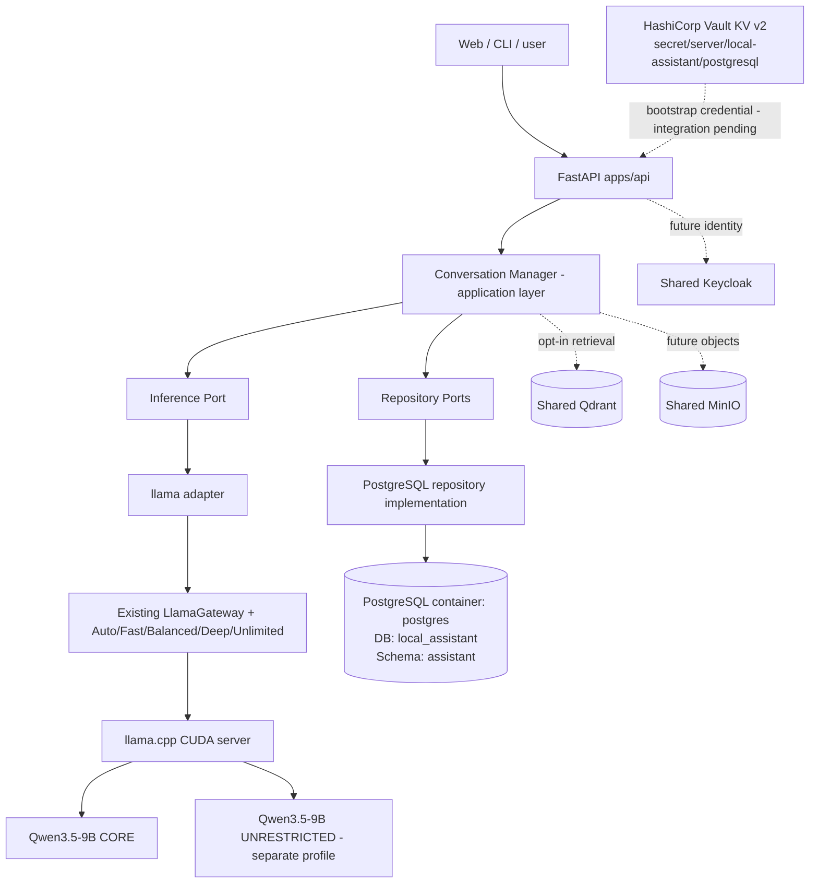
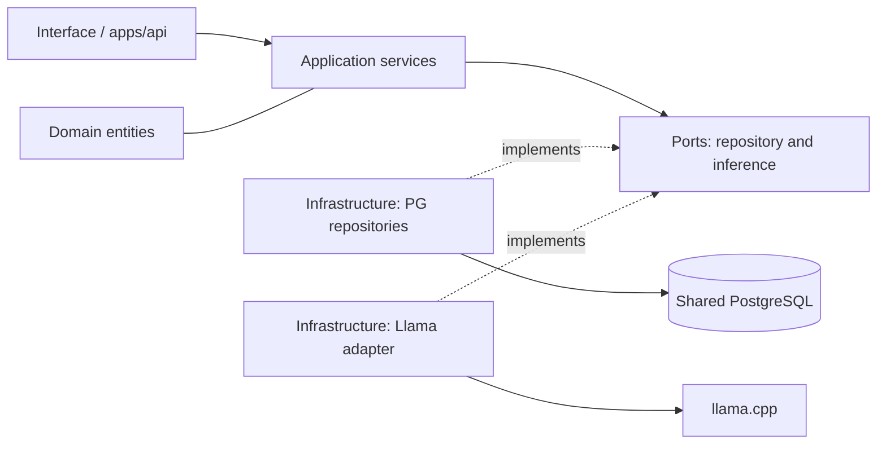
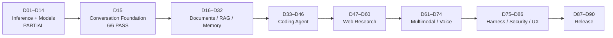
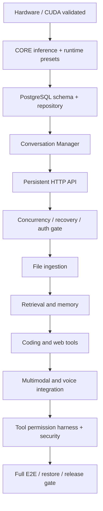
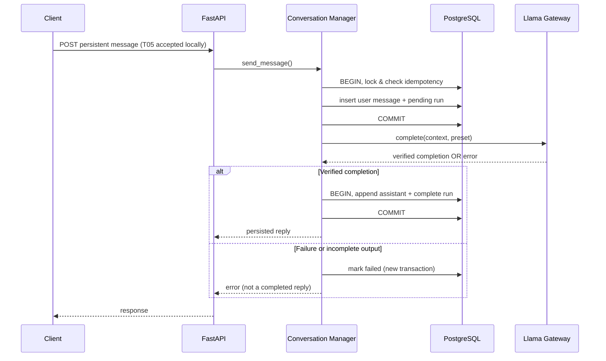

# LOCAL ASSISTANT — MASTER ROADMAP & EXECUTION TRACKER

> **Version:** 4.45 (D74 engineering review complete; manual/product gates open) · **Updated:** 2026-10-23 (Asia/Ho_Chi_Minh)
> **Workspace:** `~/Workspace/Server/ai`  
> **Target:** Local-first personal AI platform; 90 **development-day milestones** (not calendar-day commitments).  
> **CURRENT POSITION:** Owner explicitly deferred D70 actual listening to a later manual test and authorized D71 under [ADR-111](ADR/111-owner-deferred-tts-listening-and-explicit-recording.md). D70 machine measurements complete; **0/24 listening reviews, DEFERRED, no naturalness PASS**. [Manual guide](D70_MANUAL_LISTENING_TEST.md) and [blank worksheet](D70_MANUAL_LISTENING_RESULTS.pending.md). D71 explicit local recording PASS (271related tests and native fake-device browser); D72 NEXT; no model/default/deployment change. Earlier checkpoints remain in dev_log and ADR/evidence history.
> **Scope source:** original `PERSONAL-AI-LOCAL-ROADMAP-UPDATED-2026-10-11.md`, `dev_log/dev_log.md` (D1–D10), source tree and terminal results, including the 2026-10-18 authenticated local release and recovery checkpoint.
> **Model strategy source:** [MODEL_REGISTRY.md](MODEL_REGISTRY.md); [model evaluation backlog](MODEL_EVALUATION_BACKLOG.md). Registry nominations, measured choices and deployed capabilities are distinct. The owner approved Qwen after the offline comparison and transition review. [Selected configuration](../configs/embedding-selected.json) now pins Qwen CPU/1024, `selected_not_deployed`; exact E5 rollback is retained. D24 historical evidence remains unchanged.
> **Operator note:** Task checkboxes reflect *observed verification*, not whether someone suggested or pasted code. Where evidence is incomplete, status = PARTIAL / VERIFY / TODO.

---

## 0. How to use with VS Code + Codex

1. The tracked roadmap is `docs/LOCAL_ASSISTANT_MASTER_ROADMAP.md`; `docs/MASTER_ROADMAP.md` is not present in this checkout. Keep the existing `dev_log/dev_log.md` as the factual chronological record; do **not** overwrite it.
2. At the start of a Codex work session, read this roadmap, `docs/MODEL_REGISTRY.md`, `dev_log/dev_log.md`, the active day's tests/code, and applicable `docs/ADR/` before changing anything. For model work also read `docs/MODEL_EVALUATION_BACKLOG.md` and the current configuration/evidence.
3. Work on **one task ID at a time**. After implementing, run the listed acceptance tests, paste/summarize the actual result and update status. Do not mark PASS without evidence.
4. Keep an append-only entry in `dev_log/dev_log.md`: timestamp, task ID, code changes, commands/tests, actual output summary, decisions, known issues, next action.
5. Never run migrations, modify Vault policies, replace Docker infrastructure or delete data without a reviewed plan and backup/rollback option.
6. Mermaid diagrams render in Markdown preview on many GitHub/VS Code setups; if not, install a Mermaid Markdown preview extension.

**State legend:** `PASS` = demonstrated by reported execution; `PARTIAL` = something built/tested but gate not entirely demonstrated; `VERIFY` = historical claim or deliverable needs recheck; `TODO` = not implemented/tested; `BLOCKED` = cannot proceed without prerequisite.

**Codex briefing (paste into a Codex prompt):**

> Read `docs/LOCAL_ASSISTANT_MASTER_ROADMAP.md`, `docs/MODEL_REGISTRY.md`, `docs/MODEL_EVALUATION_BACKLOG.md`, `dev_log/dev_log.md`, `docs/conversation_schema_design.md`, existing `docs/ADR/`, and the affected source files. Identify the next unchecked task and prerequisites. Preserve currently working code, all containers and shared home-server infrastructure. Never create another PostgreSQL/Vault/Qdrant/MinIO/RabbitMQ/Keycloak/MongoDB service. Make the smallest reviewable change; provide full-file contents when explicitly requested; run specific tests and record evidence. Do not mark PASS for skipped tests. Do not invent endpoints, secret values or model metrics. Observe Vault least-privilege and approval gates. Never silently change an agreed model; replacements require measured benchmark/performance/resources, compatibility, migration, rollback and explicit owner approval.

---

## 1. Executive status (as of 2026-10-21)

| Stage | Development days | Status | Evidence / next work |
|---|---:|---|---|
| P1 — Machine, inference, two-profile baseline | D1–D14 | **PARTIAL / substantially implemented** | D1–D10 documented in dev log; later 32K, vision, MTP and runtime presets exercised. Full original D14 model quality/safety release gate not evidenced. |
| P2a — Conversation persistence foundation | **D15** | **PASS (6/6 local tasks)** | PostgreSQL + Vault, Alembic V001, repositories, Conversation Manager tested. Authenticated owner-scoped API, PostgreSQL/CORE/restart, leases/context and real pool export verified. Backup restore checked rows/owner/ACL before shared restart; Keycloak recovered. 151/151 regression PASS. |
| P2b — Files, ingestion, RAG, memory | D16–D32 (re-baselined) | **PASS (defined local scopes)** | D32 actual native RAG/citation gate99 focused PASS/0 SKIP and clean V006 audit;5/5 answers/citations plus refusals. Historical D31 full1608 separate, production flags off, limits explicit. |
| P3 — Coding agent | D33–D46 | **LOCAL EVIDENCE GATE PASS (first authored repairs7/10)** | Explicit owner/workspace roots and kernel-scoped readonly discovery tested; D34 authenticated bounded inventory/search PASS,1785 full PASS/0 SKIP and clean final audit; D35 tool dispatch PASS:349 related/0 SKIP; D36 source-cited explanations PASS:423 related/0 SKIP, actual CORE2/2 answers/citations and1/1 refusal; D37 PASS; D38 EVALUATION PASS; D39 PASS; D40 PASS; D41 PASS; D42 PASS; D43 PASS; D44 PASS; D45 PASS; D46 ten-case evaluation complete,7/10 functional repairs with3 failures retained; broad/unattended coding quality unestablished, CODE-EVAL-002 P1 before promotion. |
| P4 — Web research | D47–D60 | PASS local durable researched-artifact scope | ADR-084 actual retained Brave provenance/fresh source proofs/report/native/archive PASS5.213s/all3-page visual QA; fresh4120 full PASS/1712.84s/0SKIP/final readonly audit PASS545/all540 prior bytes unchanged. Original fresh-provider trials remain FAILED/availability degraded; WEB-SEARCH-003/browser/security/retention/export production qualification remains P1, no broad promotion or model/provider replacement. |
| P5 — Multimodal + voice | D61–D74 | IN PROGRESS | D61–D69 local scopes accepted; D70 machine measurements complete/listening owner-deferred under ADR111; D71 local recording PASS, D72 local offline composition PASS6actual paths/267related tests. D73 NEXT; production voice/model/license and final phase gates remain open. |
| P6 — Harness, MCP, security, UI | D75–D86 | TODO | Permission-first tool runtime, skills, MCP, backup, observability. |
| P7 — Release gate | D87–D90 | TODO | End-to-end, restore, reproducibility, release. |

**Scheduling semantics:** these are **sequenced milestones**, not promises to finish each task in 24 hours. D15 has six subtasks. If D15 remains open tomorrow, do not relabel unfinished tasks as D16 merely because calendar time passed. The original document had D15 = file upload; **v3 explicitly changes that decision** and shifts file ingestion later. Later days are a planning baseline, subject to recorded re-estimation, not fake completion.

### Verified milestones and current task

| ID | Task | Status | Acceptance evidence |
|---|---|---|---|
| D15-T01 | Shared PostgreSQL instance, dedicated `local_assistant` DB + app credential in Vault | **PASS** | TCP login as `local_assistant_app` using Vault secret; current DB/user returned correctly. |
| D15-T02 | Alembic V001; `assistant` schema + tables; runtime grants | **PASS** | V001 verified at D15 (then head); four original relations/grants remain valid. D17 adds reviewed V002 without rewriting V001. |
| D15-T03 | Domain, repository ports, SQLAlchemy models, PostgreSQL repositories | **PASS** | Real PostgreSQL lifecycle integration test passed. |
| D15-T04 | Conversation Manager, inference port + adapter, replay/failure persistence | **PASS for defined tests** | 2 integration tests passed; 42 API/runtime regression tests passed. T06 subsequently verified defined race/crash/context cases; production multiworker remains unaccepted. |
| **D15-T05** | **Persistent Conversation REST API** | **PASS (localhost)** | Vault-backed app credential; 4/4 integration PASS including CORE; full suite 94 PASS, zero SKIP; history/list/replay verified across two Uvicorn processes. |
| D15-T06 | Concurrency, crash recovery, context, auth and recovery | **PASS (authenticated localhost)** | Full suite 151/151 PASS, zero SKIP; two-principal negative access, real pool export/reconnect, owner/ACL/data restore, shared PostgreSQL restart, Keycloak recovery and authenticated API process restart accepted. |
| **D16** | **Bounded file metadata/storage design and policy** | **PASS (design/policy)** | Spec + ADR-019 reviewed; 86 policy cases PASS; full suite 237/237 PASS; V001 unchanged. No migration, blob adapter or upload API introduced in D16. |
| **D17** | **Bounded authenticated file storage/HTTP/recovery** | **PASS (localhost, one worker; T01–T05)** | Full 443/443 PASS, zero SKIP; V002, owner/quota/replay, private FDs, isolated format verification, cancellation/deadlines, real crash/HTTP races, paired DB/blob/identity restore and two-process API restart; ADR-019–025. |

**Latest selected-provider gate:** D47 [acceptance](evidence/d47-searxng-acceptance.json), [scope/failures](D47_SEARXNG_LIVE_ACCEPTANCE.md), [ADR-065](ADR/065-inactive-local-searxng-candidate.md):**1541 related PASS/116.73s,0SKIP,exit0**, plus distinct asserted real owned SearXNG→original CORE attempt with4 source-bound citations/2.663s. Owner explicitly selected self-hosting; singleton anonymous Brave website engine, no commercial API key/new model. One isolated loopback8889 container, original14 unchanged;443 source/config/882 protected hashes and clean readonly audit. First irrelevant-source/CORE-refusal and subsequent Google-upstream failure, full source archives and bounded zero-model panel all retained. D48 API is verified and remains default-off; semantic/freshness/general relevance not established. Historical [pre-provider PARTIAL](evidence/d47-status.json) and mocked-search/actual-CORE sample remain unchanged. **D47 PASS within defined local provider scope; D48 PASS within defined local authenticated API scope.**

**Prior accepted evaluation gate:** D46 [evaluation acceptance](evidence/d46-evaluation-acceptance.json):**first repair score7/10** across ten actual one-attempt CORE utility cases;2 native failures and1 six-step response rejection retained. **1344 related +ten actual protocol cases PASS,0SKIP,exit0**,427 source/687 unique source-protected hashes and [clean readonly audit](evidence/d46-final-post-audit.json). Protocol/evidence completion does not certify broad coding quality. [Scorecard/failures](D46_CODING_AGENT_MVP_SCORECARD.md), CODE-EVAL-002 assessed P1 before broader coding/quality promotion. Production unchanged; historical D44 full2622 remains separate,2713 collection is not a fresh full. **D46 EVALUATION PASS; D47 local selected-provider PASS.**

**Prior accepted authority gate:** D45 [acceptance](evidence/d45-authority-acceptance.json):**1304 related PASS/102.84s,0SKIP,exit0**, plus separately retained first actual CORE authority sample**1 PASS/3.40s**;41 new cases,420 sources/526 unique source-protected hashes and [clean readonly audit](evidence/d45-final-post-audit.json). Real README/source/issue/model/plan/native-output/canary/TCP/two CLI authority boundaries; actual CORE candidate held pending with0 decided approvals/native runs/selected-source changes. Production code unchanged; historical D44 full2622 remains separate,2663 collection is not a fresh full. [Scope/limits](D45_PROMPT_INJECTION_TEST_PLAN.md). **D45 PASS; D46 evaluation complete (7/10 repairs).**

**Prior accepted controls gate:** D44 [acceptance](evidence/d44-controls-acceptance.json):**2622 full PASS/1559.31s,0SKIP,exit0**,1264 related subset/74 new cases,414 sources/488 unique source-protected hashes and [clean readonly audit](evidence/d44-final-post-audit.json). Finite trusted hooks, exact owner signal/join cancellation and one explicit immutable proposal retry; two interrupted fulls and four reproduced uncertainty faults retained. [Scope](D44_BOUNDED_WORKFLOW_CONTROLS.md), [ADR-063](ADR/063-bounded-workflow-hooks-cancel-and-retry.md). Original D43/D38 measurements and agreed models/config/data preserved. **D44 PASS; D45 PASS.**

**Prior accepted workflow gate:** D43 [acceptance](evidence/d43-workflow-acceptance.json):**1190 related PASS/72.99s,0SKIP,exit0**, plus separate first actual CORE visible sample**1 PASS/4.61s**;87 new cases,405 source/434 protected hashes and [clean audit](evidence/d43-final-post-audit.json). Actual issue→plan/full-file diff→two typed approvals→checkpoint edit→immutable snapshot tests→trusted summary, native faults/cancel/expiry/TCP/ASGI/lifecycle gates. Not one1191 invocation;2548 collection is not a fresh full. D42 historical full2461 preserved. [Scope](D43_REVIEWED_CODING_WORKFLOW.md), original D38 first4/6/failures unchanged. **D43 PASS; D44 PASS.**

**Earlier milestone:** D39 **548 related PASS/7.70s,0 SKIP,exit0**,71 new scoped review/one-shot/expiry/auth/CLI/TCP/startup cases, clean [audit](evidence/d39-final-post-audit.json).2099 collected is not a fresh full. [Acceptance](evidence/d39-approval-acceptance.json), [scope/limits](D39_EXPLICIT_APPROVAL_REVIEW.md). Explicit disposable fixture approvals only; no production action approved/executed. D38 first4/6 repaired tasks and two failures hash-preserved, no retry/score selection. **D39 PASS, D40 PASS; D41 PASS; D42 PASS; D43 PASS; D44 PASS**; agreed models/configs/migrations and production flags preserved.

**Historical D24 demonstration:** 2026-10-18 **783 passed in 95.11s**, zero skipped/no exclusions with real PostgreSQL/CORE. D17-T01–T05 local gates accepted: 77 FS + 24 journal + 62 verifier + 31 HTTP/service + 12 recovery cases, alongside 237 prior tests. V002 is applied; previous conversation/message/run rows and owner/ACL fingerprints match. Retained paired backup `data/backups/d17-paired-20261018` verifies seven tables, one 53-byte fixture, namespace/principal bindings and blob/archive hashes/permissions. Actual authenticated upload/replay/download/delete survives API process restart; owned workers/canary/probes are cleaned and allocation is zero. File feature remains operator opt-in; no public/multiworker/off-host certification is implied. D18 is accepted with 33 additional tests (25 parser/protocol/resource + 8 real DB/HTTP/lifecycle): exact golden page/Unicode/blank mapping, owned/namespace/hash revalidation, two-slot isolated parsing and cancellation/delete/shutdown gates. Native text remains untrusted; no extraction cache, model context or schema change. D19 is accepted with 53 additional tests (37 processor/contract/independent opening + 16 real DB/HTTP/lifecycle): main-body paragraphs/runs/tables/styles, source-hash-bound Unicode edits, untouched member/format preservation, actual LibreOffice opening and response-lifetime admission/cancellation. Output is ephemeral; lxml runtime/python-docx dev are uv-locked; no schema/source mutation. D20 is accepted with 58 additional tests (42 processor/contract/sandbox + 16 DB/HTTP/lifecycle): native multi-sheet/cell/shared-string/style/merge views, typed literal edits, immutable source and exact formula/cache/untouched-part preservation. Output reopens with dev-only openpyxl; no formula evaluation, new runtime dependency or schema change. Cache uncertainty is explicit and admission remains held through delivery. D21 is accepted with 54 additional cases (28 page/parser/kernel + 10 vision protocol + 12 DB/HTTP lifecycle + 4 metric/live-quality): native/scan/image/page mapping, bounded sanitized raster/ICC removal, raw-score uncertainty, source fences and joined response/model ownership. Retained docs/evidence/d21-ocr-acceptance.json reports clean/scan CER0, actual CORE Vietnamese table6/6 exact cells/rows; degraded image CER1.0 remains explicit and requires review. OCR is English-only, VLM explicit/unverified/always-review; no confidence calibration/general-language claim. D22 is accepted with 59 additional cases (30 mapping/identity/budget +29 real DB/HTTP/lifecycle): exact Unicode spans, page/paragraph/declared heading/table/sheet boundaries, native cell/formula/cache/merge metadata and OCR review propagation. IDs bind source/hash/version/byte policy/content and private owner/namespace; labels are descriptive, never bearer capabilities. One response-lifetime slot, reference-counted nested tracking, joined transformation and final source fences preserve delete/cancel/shutdown/quota behavior. No dependency/schema/persistence/index changes. D23 is accepted with48 additional cases (30 scorer/failure/CLI +18 actual corpus/live report):18 mixed-document cases,56/56 exact source fields,32 chunks/7 empty records, independent golden content/structure/rewrites and explicit CORE table6/6. Retained docs/evidence/d23-document-pipeline.json separates expected empty/degraded/rejected cases and OCR CER/WER1.0 quality failure from evaluation gates. No production code/config/dependency/schema change or unproven repair. D24 is accepted with35 additional cases (33 scoring/token/pool/artifact/probe negatives +2 actual CPU/Qdrant): frozen20/40 bilingual retrieval selects pinned CPU-int8 multilingual-e5-base/768 over small, Recall@3=.925/MRR@10=.874405, measured802.863MiB RSS/p95 7.378ms. Small quality failure and3 base top3 misses retained. ADR-031 specifies model/runtime/tokenizer fingerprint, token-overflow rejection and private versioned collection/outbox lifecycle. Actual existing Qdrant1.18.2 accepts schema/10 indexes; owned empty probe removed with unchanged inventory. Dev-only ONNX/tokenizers uv-locked, no source/API/schema/permanent collection/worker changes. Full783 PASS/0 SKIP in95.11s; D25 durable ingestion is NEXT. Two authenticated principals are isolated across all conversation operations and manager locks; unowned legacy records remain hidden. Structured pool metrics export under actual Uvicorn; a stale owned backend reconnects. Protected backups of four databases and globals retained; Local Assistant restore matches rows plus owners/ACLs, and shared restart preserves data and Keycloak readiness. Actual authenticated API process restart/replay also passed. **Local acceptance scope:** direct localhost, one API worker, operator-delivered DB credential and private auth file. OIDC, production scoped Vault bootstrap, multiworker certification, off-host disaster recovery and load SLOs remain future deployment work. Pytest is not a model-quality scorecard.

---

## 2. Product objectives and non-goals

**Primary goal:** an extensible personal AI that runs primarily on the user's Ubuntu machine, supports Vietnamese/English chat, persistent conversations, reasoning, coding workflows, document/RAG/memory, grounded web research, vision/video/voice, tools/skills/MCP, strong privacy, reproducibility and opt-in remote capabilities.

**Principles:**

- Local-first, no mandatory cloud dependency or hidden fallback.
- CORE model default; UNRESTRICTED is opt-in, isolated, and must not acquire tools or extra permissions by selecting a model profile.
- llama.cpp handles model inference; FastAPI/Application Layer handles workflow and state; PostgreSQL/Vault/Qdrant/MinIO are shared infrastructure services.
- The product is a **separate application** hosted **on shared Home Server infrastructure**. Do not conflate applications, backend processes, containers, database instances, Vault paths, or Vault AppRoles.
- Deny-by-default for side-effecting tools; human approval, scope, budgets, logs and rollback.
- Tests must be reproducible; never report success from SKIPPED tests, hypothetical output or source code alone.
- No general-purpose autonomous host shell, internet, or privileged Docker socket for a model by default.

**Out of scope for v1.0:** pretraining a foundation model, public multi-tenant SaaS, autonomous privileged administration, automatically running risky scripts found online, mandatory fine-tuning, always-on cloud sync.

---

## 3. Existing architecture: actual vs target

### 3.1 Infrastructure, workloads and data



> Dashed arrows represent an intended dependency, **not** a tested production integration. The existing `/api/v1/chat/completions` remains stateless and has not been replaced.

### 3.2 Architecture boundaries



**Current compromise:** `ConversationManager` currently constructs concrete PostgreSQL repositories inside Application Service; the long-term goal is a Unit of Work/repository factory injected from the composition root. Do not label existing code perfectly dependency-inverted until fixed.

### 3.3 Home Server inventory — existing, do not duplicate

| Service | Existing instance | Use by Local Assistant |
|---|---|---|
| NVIDIA GPU | RTX 4070 Ti SUPER 16 GiB | CUDA inference; one heavyweight 9B at a time by default |
| llama.cpp | Pinned image `local-assistant/llama-cuda:5c8854fd8` | CORE / UNRESTRICTED profiles; host localhost:8080 |
| PostgreSQL | Container `postgres` (Postgres 17.x), host `127.0.0.1:5433` for app | DB `local_assistant`; schema `assistant` |
| Vault | Container `vault`, KV v2 under `secret/` | DB credentials; existing Shamir unlock behavior; no root token in app |
| Qdrant | Existing container `qdrant` | Future semantic memory/RAG collections |
| MinIO | Existing container `minio` | Future documents/artifacts buckets |
| RabbitMQ | Existing container `rabbitmq` | Optional later background jobs (only if warranted) |
| MongoDB | Existing container `mongo` | Not conversation source-of-truth |
| Keycloak | Existing container `keycloak` | Candidate for user auth; integration not yet confirmed |
| Docker network | `home-net` | Shared infrastructure networking; FastAPI currently native host process |

### 3.4 Data contract from Alembic V001

- `assistant.conversations`: UUID, title, profile, preset_default, status, created/updated/deleted timestamps, JSONB metadata.
- `assistant.messages`: UUID, conversation ID, sequence, role, content, request_key unique per conversation, created timestamp, JSONB metadata.
- `assistant.inference_runs`: user/assistant message links, requested/selected preset, model ID, pending/completed/failed/interrupted, usage, latency and timing, error code.
- Unique sequence per conversation and a partial unique index allowing only one `pending` inference per conversation.
- Roles: `local_assistant_migrator` owns DB/schema; `local_assistant_app` has required DML, not TRUNCATE. Migrations run separately.
- Credential paths: `secret/server/local-assistant/postgresql` and `.../postgresql-migrator`. They are in Vault, **not** config-file passwords.
- **Known gap:** no user/tenant ownership column or access policy in V001; auth/authorization must be designed before exposing conversation histories beyond controlled localhost.

### 3.5 Complete model strategy — registry reconciliation (2026-10-18)

**Purpose:** Restore the full lineup from [MODEL_REGISTRY.md](MODEL_REGISTRY.md) without changing D24, deployed profiles or configuration. Names below identify registry choices/candidates, not newly verified model availability, benchmark wins or deployment instructions.

**Registry lineup protection — owner clarification:** Preserve every model and its decision status in MODEL_REGISTRY.md as the agreed strategy. Do not substitute another name, remove an original candidate, or promote an experimental alternative into its strategic role without an explicit owner-approved decision. In particular, **Qwen3-Embedding-0.6B remains the original embedding candidate and Qwen3-Reranker-0.6B remains the original reranker candidate**. D24 records a separate measured E5 baseline; it does **not** replace either registry entry or establish an approved Qwen-to-E5 strategy change. Preserve the current E5 implementation/configuration/data as instructed while keeping that distinction explicit.

| Role | Established/current baseline and evidence | Original candidate / optional alternative | State and planned gate |
|---|---|---|---|
| CORE LLM | `Qwen/Qwen3.5-9B`, community `bartowski/Qwen_Qwen3.5-9B-GGUF`, Q6_K; llama.cpp/CUDA,32K, existing runtime presets; configs/models.yaml and D1–D14/D21 evidence | Larger/specialist models only after a measured gap | Established implementation; preserve default. Full original D14 quality release gate remains qualified |
| UNRESTRICTED LLM | `HauhauCS/Qwen3.5-9B-Uncensored-HauhauCS-Aggressive`, Q6_K, matching isolated profile/projector | No replacement proposed | Existing tested profile, config status `testing`; opt-in, no automatic tools/privileges; do not claim all quality gates closed |
| Embedding — current D24 choice | `intfloat/multilingual-e5-base`, official CPU ONNX int8,768; pinned config/ADR-031/evidence | Separate measured E5 baseline; it does not replace, rename or remove the Qwen3-Embedding-0.6B registry entry | D24 **PASS local selection/design**; historical E5 configuration preserved in `configs/embedding-e5-rollback.json` |
| Embedding — original nominated candidate | No Qwen embedding result/deployment established by D24 | **`Qwen3-Embedding-0.6B`**, original P1 evaluation candidate | **Owner-approved selection applied; not deployed**; [MODEL-EVAL-001](MODEL_EVALUATION_BACKLOG.md#model-eval-001--qwen3-embedding-06b-versus-current-e5), separate post-D24 evidence, no automatic cutover |
| Embedding — measured smaller alternative | `intfloat/multilingual-e5-small` CPU int8/384 was actually benchmarked in D24 | Lower-resource E5 alternative only | Ineligible under frozen D24 quality gates; not the selected model and not a Qwen comparison |
| Reranker | No production reranker evidenced in current RAG configuration | **`Qwen3-Reranker-0.6B`**, original P1 candidate | D27 / MODEL-EVAL-002: D27 local paired/resource/owner-delegated AI evaluation complete; retain dense/defer adoption. Batch1 failures retained; original nomination preserved, not selected/deployed |
| Vision | **CORE Qwen3.5-9B native vision plus compatible mmproj** is the default strategy; D21 explicit VLM/table evidence | `Qwen3-VL-4B/8B` only if measured evidence warrants | Keep CORE default; conditional MODEL-EVAL-006 at D62–D67, no automatic second VLM |
| ASR | No selected/deployed speech pipeline evidenced | **`Qwen3-ASR-0.6B` versus Whisper/faster-whisper** | D68 / MODEL-EVAL-003: planned Vietnamese/English accuracy, latency, memory comparison |
| VAD | No deployment evidenced by D24 | **Silero VAD v5** discussed candidate | D69 / MODEL-EVAL-004: speech/noise/segmentation/timestamp tests before selection |
| TTS | No selected/deployed speech synthesis evidenced | **`Qwen3-TTS-0.6B` versus Piper** | D70 / MODEL-EVAL-005: verify Vietnamese output, latency/naturalness/resources/license |
| OCR | **Native PDF parsing first, OCR/VLM fallback**; current D21 uses English Tesseract and explicit CORE VLM with review/uncertainty | No fixed separate OCR-model decision; dedicated OCR only after comparison | Preserve D18/D21 scope/blur failure; D62 quality evaluation, no invented OCR model winner |
| Coding | Approved strategy:**CORE plus deterministic Git/search/patch/test tools**; D43/D44 finite reviewed workflow implemented; original D38 first4/6 retained, D46 first ten-case repairs**7/10** measured | Specialist coder only after benchmark and owner approval; no replacement/adoption | D33–D46 local evidence gates; broad coding quality remains limited, CODE-EVAL-002 P1 / conditional MODEL-EVAL-007; model choice never grants host tools |
| Larger LLM | CORE remains default | **Qwen3-14B / approximately20B /27B+ options** are optional future comparisons | MODEL-EVAL-008, conditional/unscheduled future phase or Day91+; not automatic CORE replacements |
| Web | **Owned SearXNG/Brave frontend plus existing CORE**; local provider verified, application API D48 | No separate web-search model required | D47 PASS:1541 related +real provider/CORE citation gate, both failed cohorts retained; fetch/browser/provenance later |
| Video | Planned integration: **FFmpeg frames/timestamps plus vision and ASR** | No standalone video-model decision | D64–D67/D74 integration; frame smoke is not a complete video product |

**Hardware/routing constraint:** RTX4070Ti SUPER16GiB and32GB nominal RAM are shared. CORE/UNRESTRICTED load separately by default; do not assume all nominated models stay resident simultaneously. A registry nomination restores evaluation scope, not permission to download, swap, deploy or widen tool privileges.

**D24 comparison audit:** ADR-031, configs/embedding-candidates.json, the runner/live test and docs/evidence/d24-embedding-selection.json all list only E5-small and E5-base. The result establishes E5-base over that smaller E5 candidate on the frozen local corpus. It establishes **no E5-versus-Qwen superiority**. The omitted comparison was subsequently executed as MODEL-EVAL-001, with separate evidence; it is not retroactively a D24 result. Preserve commit `a88584b` and all existing D24 results/configuration.

**Actual RAG configuration versus intended routing:** configs/models.yaml defines CORE/UNRESTRICTED LLM profiles; configs/embedding-selected.json separately pins owner-approved Qwen CPU/1024, `selected_not_deployed`. D25 now implements default-disabled authenticated indexing, source-held embedding, owned Qdrant writes and durable publication/cleanup. Actual acceptance used removable owned probes; no production collection or routing was enabled. D26 now implements default-disabled dense search with trusted tenant filters, SQL active-source checks and exact source rehydration. D27-T01 baseline and T02 offline original-reranker batch4 diagnostic comparison are now measured; no production reranker stage is integrated or deployed; an isolated test-only ASGI composition now measures complete source/query/ranking/delivery and bounded CORE traffic. Batch1 CPU failures remain retained. Registry routing describes the intended full pipeline. Historical D24 evidence is preserved; current post-test inventory is zero collections, with no existing user collection/data adopted or deleted.

**Binding model-change rule from the owner:** Protect the model lineup and original candidate roles in MODEL_REGISTRY.md as well as the current runtime configuration; preserving E5 operational state alone does not satisfy registry preservation. Do not unilaterally change any agreed CORE, UNRESTRICTED, embedding, reranker, ASR, VAD, TTS or VLM selection. Any replacement proposal must identify old/new model and reason, actual benchmark, performance/resources, compatibility, migration and rollback, then receive **explicit owner approval before configuration/deployment/cutover**. Better benchmark scores alone do not authorize replacement. The later explicit authorizations for Qwen download/comparison and selection are recorded in ADR-032 and the selection approval record; they do not certify an implemented ingestion/search service. Keep a separate evidence-backed ADR/decision record for any later approved change.

---

## 4. Historical progress — Days 1–14

Source of record for D1–D10 is `dev_log/dev_log.md` (compiled through 2026-10-12). D11–D14 below list observed deliverables from ongoing discussions but avoid invented per-day terminal results.

| Day | Focus and intended deliverable | Evidence-backed state |
|---|---|---|
| D01 | OS/hardware inventory; GPU/CUDA/VRAM/RAM; workspace | **PASS** — Ubuntu and RTX 4070 Ti SUPER validated |
| D02 | Build/version-pin llama.cpp CUDA | **PASS** — commit `5c8854fd8` confirmed |
| D03 | uv environment; CORE Qwen3.5-9B Q6_K GGUF; first inference | **PASS** — reported first inference |
| D04 | Micro-benchmark input 512/4K/8K/16K | **PASS** — benchmark outputs logged |
| D05 | Real API context and retrieval ~12K / 16K | **PASS** — logged in development record |
| D06 | Manifest/config, startup scripts and runtime hash | **PARTIAL** — `/health` and hash checked; script-specific run evidence qualified in log |
| D07 | CORE smoke acceptance | **VERIFY** — original standalone D7 acceptance output absent in old log |
| D08 | UNRESTRICTED model fetch, hash and inference | **PASS** — source log records SHA/inference |
| D09 | UNRESTRICTED throughput, OOM handling | **PASS** — 16K after releasing competing VRAM |
| D10 | CORE vs variant initial quality evaluation | **PARTIAL** — initial 8/10 vs 8/10; not enough to claim equivalent quality |
| D11 | Deeper original/variant comparison and architecture choices | **PARTIAL/VERIFY** — benchmark files exist; per-day sign-off not supplied |
| D12 | Long-context and multimodal checks | **PARTIAL/VERIFY** — 32K/vision tests discussed; full original gate unverified |
| D13 | Auto router, runtime presets and hard reasoning budgets | **PARTIAL/VERIFY** — implementations and regression evidence available; align day labels with actual dev log later |
| D14 | Phase-1 model decision, release evidence | **PARTIAL** — working CORE/UNRESTRICTED and runtime gate; full weighted 30–50-case comparison not signed off |

**Additional verified later than the old D1–D10 log:** CORE 32K retrieval passed reported acceptance; vision/mmproj and MTP probes were reported successful; runtime presets and Auto V1 tested; project has `benchmarks/results/`, `configs/models.yaml`, model and runtime manifests. This does **not** mean all planned D7–D14 acceptance items are closed.

**P1 cleanup backlog (carry-forward, do not block D15 local API work unnecessarily):**

- [ ] Reconcile actual dates/tests D11–D14 against results and `dev_log`.
- [ ] Decide formal weighted model scorecard and quality gap gate.
- [ ] Confirm streaming/cancel/graceful shutdown and load/reload behavior where required.
- [ ] Ensure UNRESTRICTED tool permissions stay disabled by policy, not only by convention.
- [ ] Snapshot exact model hash, mmproj and runtime SHA in release manifest.

---

## 5. Day 15 — detailed sprint (CURRENT)

### D15-T01 — PostgreSQL & Vault — **PASS**

- [x] Reuse existing `postgres` container; no second server.
- [x] Create `local_assistant` database and `local_assistant_app` role.
- [x] Store matching credentials in Vault KV v2.
- [x] Verify real TCP password auth using Vault secret.
- [x] Create separable `local_assistant_migrator` credential.

### D15-T02 — Schema V001 — **PASS**

- [x] Alembic revision `0001 (head)`.
- [x] Tables `assistant.alembic_version`, `assistant.conversations`, `assistant.messages`, `assistant.inference_runs`.
- [x] Owner `local_assistant_migrator`, app role DML allowed; TRUNCATE denied.
- [ ] Document production migration/backup/downgrade policy (carry forward to operations).

### D15-T03 — Repository Layer — **PASS (focused test)**

- [x] `src/domain/entities/` for Conversation, Message, InferenceRun.
- [x] `src/application/ports/repositories.py`.
- [x] `src/infrastructure/models/` mappings to existing V001.
- [x] `src/infrastructure/repositories/` and async connection/session factory.
- [x] Real DB lifecycle test: separate commits, history, inference, archive/soft delete.

### D15-T04 — Conversation Manager — **PASS (focused tests; hardening open)**

- [x] `src/application/ports/inference.py`.
- [x] `src/infrastructure/inference/llama_adapter.py` reusing `LlamaGateway`.
- [x] `src/application/services/conversation_manager.py` with two-transaction flow.
- [x] Fake-inference test for persistence, replay, differing-key conflict and failure.
- [x] Focused regression: 42 tests PASS plus 2 integration tests PASS.
- [x] Token-aware whole-turn trimming implemented in T06; keep system/current input, use actual gateway template/tokenizer, reject irreducible overflow.
- [ ] Full dependency inversion/Unit of Work and finish-state retry semantics.
- [x] Defined T06 timeout mapping/cancellation/cross-backend races/leased disposable-process crash tests passed; broader operations/identity gates remain open.

### **D15-T05 — Conversation REST API — PASS for localhost (2026-10-17)**

**Deliverables** (`apps/api/` remains HTTP adapter):

- [x] Local acceptance credential delivery: operator retrieved the existing app credential from Vault and injected DATABASE_URL into test/API child processes only. No Vault token was delivered to FastAPI/tests and no password was printed or committed. Production scoped AppRole/secret-agent delivery remains open.
- [x] Add FastAPI app lifespan for async DB engine and session factory; close pools on shutdown.
- [x] Add composition root/dependency wiring for `ConversationManager` and `LlamaInferenceAdapter`.
- [x] `POST /api/v1/conversations` — create profile/preset/title.
- [x] `GET /api/v1/conversations` — paginated listing with archive policy.
- [x] `GET /api/v1/conversations/{id}` — detail.
- [x] `PATCH /api/v1/conversations/{id}` — update title/preset.
- [x] `GET /api/v1/conversations/{id}/messages` — sequence pagination.
- [x] `POST /api/v1/conversations/{id}/messages` — persistent chat; optional idempotency key.
- [x] `POST /api/v1/conversations/{id}/archive` — archive.
- [x] `DELETE /api/v1/conversations/{id}` — soft-delete.
- [x] Preserve `POST /api/v1/chat/completions` exactly; do not replace its stateless behavior.
- [x] Consistent error mapping (404, 409, 422, 502/503/504), validation and response schemas.
- [x] Localhost-only development boundary: direct peer guard, Origin/proxy rejection and error redaction tested. External exposure remains prohibited until authN/authZ with owner boundary exists; this local PASS does not certify authentication.

**Exit criteria:** local HTTP request → DB conversation → gateway → assistant response; list/history survive FastAPI restart; no regression of existing stateless endpoint; no credentials in logs or repo; no anonymous external history access.

**Initial acceptance evidence (2026-10-17):** `pytest tests/integration/ -q -rs --tb=short`: **4 passed in 1.18s** with LIVE_E2E enabled. Full `pytest tests/ -q -rs --tb=short`: **94 passed in 6.48s**, no exclusions/SKIPs. Separate HTTP check created a CORE response in process A, terminated A, launched process B and verified exact stored history, list visibility and cached replay with unchanged assistant ID. Temporary processes and test rows were cleaned up. This original T05 checkpoint is retained; T06 and Day 15 local acceptance were completed on 2026-10-18 below. See the append-only dev-log follow-up, ADR-016 and the local runbook.

### D15-T06 — Hardening, E2E & resilience — PASS for authenticated localhost (2026-10-18)

- [x] Concurrent same-key requests: exactly one inference and deterministic replay/conflict (test across connections).
- [x] Concurrent different-key requests same conversation: no duplicate sequence and at most one pending.
- [x] Failure injection between reservation / inference / finalization; ensure consistent rollback/error codes.
- [x] No incomplete `finish_reason=length` answer committed; verify model mismatch and context overflow.
- [x] Pending-orphan policy: owner/120s lease/30s heartbeat using DB time; lazy expiry recovery and explicit interrupted state. SIGKILLed test worker recovered; legacy unowned pending records require manual ownership review.
- [x] No transaction/session held while waiting on LLM; 12 blocked inferences show checked_out=0. Runtime checkout/checkin/invalidation/timeout/peak gauges export through periodic structured logs; real saturation, stale-backend reconnect and Uvicorn export tested. Load SLOs are future work.
- [x] Whole-turn history trimming and 32K actual tokenizer budgeting, including system context.
- [x] Prevent archive/delete during pending inference from causing a logically inconsistent committed answer.
- [x] Real CORE model E2E; model-not-loaded and gateway timeout paths.
- [x] Authenticated API process restart/replay verified. ADR-018 plan executed: protected backups, isolated restore with matching data/owner/ACL, quiet gate, shared PostgreSQL restart, unchanged source data, Keycloak discovery recovery and cleanup passed.
- [x] Full `uv run python -m pytest` regression; record exact counts and skipped cases.
- [x] Bearer UUID principals, private reloadable digest file and server-assigned JSONB owner scope. Two-principal real DB tests deny cross-owner detail/history/update/send/replay/archive/delete and independently fence manager reservation; legacy unowned history stays quarantined. Direct-localhost guard remains enforced.
- [x] ADR-018, dev log and runbook record implementation, rollback/recovery, actual acceptance and local deployment limits. Definition-of-done review below accepted; no skipped test is counted as PASS.

**Day 15 definition-of-done review (2026-10-18):** V001 and app identity remain valid; persistence/multi-turn/idempotency and failure integrity pass; exact tokenizer budgeting retains current/system input; API and DB restarts preserve history; owner isolation and safe metrics export pass; full regression is 151/151. **D15-T06 and Day 15 PASS for authenticated localhost.** No D16 code has been started in this checkpoint.

**Retained limits/debt:** pending Auto has a provisional balanced schema field; recovery is lazy and unowned legacy pending runs need operator review; historical conversations without owner are not silently adopted. JSONB owner filtering is application-enforced (no PostgreSQL RLS). Runtime API tokens are static high-entropy credentials managed in the app Vault namespace; scoped production Vault identity/OIDC remain deployment work. Full Unit of Work inversion, production multiworker/load certification and off-host/full-cluster recovery remain tracked debt. Existing shared services were reused; only uniquely named restore databases and test canaries were removed. See ADR-018 and protected recovery manifests; backup payloads and auth files are ignored by Git.

---

## 6. Re-baselined future 90-day plan

> The **original** 2026-10-11 plan allocated D15–D28 entirely to files/RAG/memory. Because D15 actually delivered persistent conversation foundations, the remaining work below is re-sequenced. Day numbering describes *milestones*, not guaranteed time-to-complete. At a weekly review, change estimates in this file rather than silently dropping features or declaring them finished.

### D16 — File storage design/policy — PASS (2026-10-18)

- [x] Ownership/provenance and additive V002 metadata/usage proposal reviewed against Day 15 principals; no migration executed.
- [x] Private local root and UUID-only object keys; labels never used as paths; descriptor/no-follow/no-replace and file-lock cleanup contract specified.
- [x] Versioned 25 MiB/file, 1 GiB/owner, 10 GiB global quotas, count/concurrency/free-space/deadline/archive bounds and deterministic same-key semantics specified and pure policy cases executed.
- [x] Global -> owner -> file transaction ordering, no SQL transaction over streaming/fsync, cross-resource journal/crash matrix and exactly-once allocation release reviewed.
- [x] Rollout/rollback and paired DB/blob backup/identity restoration plan reviewed; D17 failure/race/MIME/FS/HTTP acceptance matrix explicit.
- [x] `tests/test_file_storage_policy.py`: 86 PASS; full Vault-backed PostgreSQL/CORE regression 237 PASS, zero SKIP. Read-only DB check: V001/four tables unchanged.

Artifacts: `docs/FILE_STORAGE_DESIGN.md`, `docs/ADR/019-bounded-local-file-storage.md`, `src/application/services/file_storage_policy.py`, `tests/test_file_storage_policy.py`.

**Scope boundary:** snapshot helpers do not implement atomic quota reservation, MIME sniffing, FD-safe blob I/O, durable publication or recovery. Those remain D17 acceptance. Existing Day 15 source/dependencies/services were preserved. No MinIO credential/policy, new service, file route, migration or payload directory was introduced in D16.

### D17 — File persistence/upload/download — PASS (2026-10-18, local acceptance)

All T01–T05 local acceptance gates below have observed evidence. FS was implemented first to prove absent-inode locking before schema mutation; subsequent tasks were accepted only after real tests. D18 was subsequently accepted below; production scope remains separately tracked.

| ID | Scope | Status / dependency |
|---|---|---|
| D17-T01 | Private descriptor-based local adapter, bounded writes/hash, durable no-replace publication, reader/writer/resource locks and physical purge | **PASS**; 77 current FS cases, real process locks/8 SIGKILL FS boundaries, injected I/O failures, namespace/inventory/integrity; integrated by T04/T05. |
| D17-T02 | Reviewed V002, app grants and owner/global atomic quota/replay/journal repositories | **PASS (repository scope)**; verified fresh backup/restore, V002 applied by existing migrator, 24 real journal cases and full 327 PASS; retain guard through post-lock DB claim |
| D17-T03 | Bounded MIME/container verification for every allowed format | **PASS (verifier scope)**; 62 cases, actual Bubblewrap namespaces/resource bounds; 389 full-suite PASS/0 SKIP |
| D17-T04 | Authenticated owner-scoped reserve/raw PUT/list/detail/download/delete HTTP, deadlines and cancellation | **PASS (local HTTP scope)**; 31 HTTP/service cases, root identity binding; full 428 PASS/0 SKIP; default feature disabled |
| D17-T05 | DB/FS restart reconciliation, quota/HTTP races, paired metadata/blob restore and full regression | **PASS (local)**; 12 recovery/race/paired cases, protected retained paired restore, real uploader kills and two actual API processes; full443 PASS/0 SKIP |

T01 introduced no production runtime change. T02 applied reviewed V002 after verified backup/restore; T04/T05 integrated opt-in file resources and completed local acceptance. The actual process drill initialized private `data/files`, retained its namespace/control directories and removed its sample payload/journal; default flag remains off. No new infrastructure service or credential/policy was introduced. Auth/backups/models are outside blob cleanup. Retention/production deployment remain separately reviewed.

### Phase 2b — Documents, retrieval and memory (D16–D32)

| Day | Concrete task | Acceptance gate |
|---|---|---|
| D16 | **PASS — design/policy:** owner-typed metadata, private local blobs, quotas, provenance, journal and rollback | ADR-019/spec review complete; 86 policy tests, full 237/237 PASS; no runtime file feature claimed |
| D17 | **PASS (local):** V002/quota/private FS/isolated verification, authenticated raw HTTP, bounded recovery and paired restore | 443 full-suite PASS/0 SKIP; retained paired/process-restart evidence and ADR-019–025; owner/path/quota/FD/crash gates accepted |
| D18 | **PASS (local):** on-demand native PDF text with UUID/hash/version/page provenance | Golden multi-page/Unicode/blank mapping; owner/namespace/ready/hash, real sandbox/resource/lifecycle gates; 33 new tests, full 476 PASS/0 SKIP; ADR-026 |
| D19 | **PASS (local):** owned DOCX inspection/run rewrite, tables/styles/provenance | Independent python-docx round trip and actual LibreOffice open; 53 new cases, full 529 PASS/0 SKIP; source/quota/lifecycle gates and ADR-027 |
| D20 | **PASS (local):** bounded native XLSX inspection/literal rewrite with sheet/cell provenance | Independent openpyxl reopening; exact formula/cache/styles/untouched-part preservation; 58 new cases, full 587 PASS/0 SKIP; ADR-028; no formula/macro execution |
| D21 | **PASS (local):** per-page native/English OCR and explicit CORE vision/table fallback | Actual clean/scan CER0, table6/6 exact cells/rows, degraded CER1.0 flagged review; source/pixel/uncertainty/resource/lifecycle gates; 54 new cases, full 641 PASS/0 SKIP; ADR-029 and retained evidence |
| D22 | **PASS (local):** deterministic private chunks by page/paragraph/declared section/table/sheet | Exact Unicode source spans, stable access/source/hash/version/content-bound IDs, preserved row/formula/cache/OCR flags; 59 new cases, full700 PASS/0 SKIP; ADR-030 |
| D23 | **PASS (local):** independent mixed-document evaluation and honest error/quality report |18 corpus cases;56/56 source fields; native/structured/OCR/rewrites and expected rejection stages; retained evidence;48 new tests, full748 PASS/0 SKIP; no production repair needed |
| D24 | **PASS (local selection/design):** pinned CPU-int8 multilingual-e5-base/768 +ADR-031 private collection/lifecycle design | Frozen20/40 retrieval R@3=.925/MRR=.874405, RSS/p95 evidence and known misses; actual owned empty10-index Qdrant probe removed;35 new tests/full783 PASS/0 SKIP; no production index/worker |
| D25 | **PASS (local opt-in lifecycle):** T01/T02/T03; full979 PASS/0 SKIP | [ADR-033–036](ADR/036-ingestion-worker-and-terminal-sweeps.md), [acceptance](evidence/d25-ingestion-acceptance.json); actual source/Qwen/Qdrant replay, replacement, delete, crash/reclaim and late-write repair; default disabled, no production index |
| D26 | **PASS (local opt-in):** ACL-filtered dense search and verified source/provenance rehydration |51 new cases/full1030 PASS/0 SKIP; actual Qwen/SQL/Qdrant/HTTP, owner/root isolation, stale/deleted/superseded omission, final delivery fence and drain; [evidence](evidence/d26-retrieval-acceptance.json) |
| D27 | **PASS (local evaluation/decision):** T01/T02/T03; retain approved dense, defer production reranker |1234 full +16 new AI-focused +1 TCP PASS,0 SKIP;1251 unique tests across checkpoints, not one full invocation. Original gains/failures preserved; new AI v2 three stable paired rounds equal1.0 answerable metrics, no new gain. Real ASGI/CORE/TCP/source/lifecycle/rollback gates and clean [acceptance](evidence/d27-local-evaluation-acceptance.json); no adoption |
| D28 | **PASS (local opt-in):** source-held existing CORE grounded answers; ADR-043 | Full1334+2 new native-field PASS/0 SKIP; actual CORE/TCP, exact native source spans and clean [acceptance](evidence/d28-grounded-acceptance.json). Initial failure retained; no model/schema/deployment change |
| D29 | **PASS (design/contract):** session/episodic/preference/project with explicit consent/provenance/retention |47 policy/schema+16 actual temporary PostgreSQL cases PASS/0 SKIP; [design](MEMORY_DESIGN.md), [validation](evidence/d29-contract-validation.json), no applied memory migration/runtime |
| D30 | **PASS (local opt-in):** T01 journal/V005, T02 owner controls, T03 explicit message extraction/retention/export | Full1570 PASS/1357.69s,0 SKIP; source/consent/version/Unicode/retention and actual CORE/HTTP/TCP gates, [acceptance](evidence/d30-memory-acceptance.json) and clean audit. Production off; no prompt/vector memory use |
| D31 | **PASS (local privacy scope):** transactional source invalidation, injection/export/deletion boundaries | Full1608 PASS/1361.93s,0 SKIP; actual CORE and Qwen/SQL/Qdrant/blob composition preserve foreign data, current [audit](evidence/d31-final-post-audit.json) clean; [acceptance](evidence/d31-privacy-acceptance.json). Soft-delete/recovery/cache limits explicit |
| D32 | **PASS (local knowledge gate):** frozen native RAG/citations/limits |90 focused +9 transport/privacy PASS,0 SKIP; actual four formats,5/5 answers/citations, absent/foreign refusal and clean audit; [acceptance](evidence/d32-knowledge-acceptance.json). ADR-050 necessary structured-prompt repair, original failure/oracles preserved; no fresh1621 full claim |

### Phase 3 — Coding agent (D33–D46)

| Day | Concrete task | Acceptance gate |
|---|---|---|
| D33 | **PASS (local foundation):** explicit owner/workspace roots, readonly discovery/capabilities |63 new cases within288 related PASS/0 SKIP; actual openat2 link/mount/root/owner gates, [acceptance](evidence/d33-workspace-acceptance.json), clean audit. No endpoint/runtime registration; D34 adds authenticated reads |
| D34 | **PASS:** bounded authenticated inventory/source lines/literal search/Python lexical hints |1785 full PASS/0 SKIP/exit0,101 new cases,301-file source freeze and clean final audit; [acceptance](evidence/d34-workspace-acceptance.json), [ADR-052](ADR/052-bounded-authenticated-workspace-reads.md), [guide](D34_WORKSPACE_READS.md). Default off, no host registration |
| D35 | **PASS:** internal finite shared-schema tool dispatch, scoped identities and budgets |349 related PASS/0 SKIP/exit0,64 new native/invalid/schema/byte/time/cancel cases; [acceptance](evidence/d35-tool-acceptance.json), [guide](D35_READ_TOOL_DISPATCH.md). No model/public run API |
| D36 | **PASS:** existing CORE explanations from explicit selected source lines |423 related PASS/0 SKIP/exit0,74 new cases; CORE2/2 answers/relevant exact citations and1/1 absent refusal, clean audit; [acceptance](evidence/d36-explanation-acceptance.json), [limits](D36_SOURCE_CITED_EXPLANATIONS.md) |
| D37 | **PASS:** source-backed diagnosis/manual plan without modifications |477 related PASS/0 SKIP/exit0,54 new cases; original CORE1/1 diagnosed/native-cited manual reproducer,1/1 refusal, clean audit; [acceptance](evidence/d37-diagnosis-acceptance.json), [limits](D37_DIAGNOSIS_AND_MANUAL_PLANS.md). Reproduction not executed |
| D38 | **PASS (evaluation):** unchanged CORE + deterministic tool baseline on isolated fixtures |589 related +1 separate actual measurement PASS/0 SKIP/exit0;6 tasks measured, **4 repairs PASS/2 FAIL** retained, clean audit. [Acceptance](evidence/d38-baseline-acceptance.json), [limits/failures](D38_CORE_CODING_BASELINE.md). No specialist/application edit/command authority |
| D39 | **PASS:** explicit scope/content/owner-bound expiring approval events and CLI review |548 related PASS/0 SKIP/exit0,71 new exact-clock/thread/nonce/scope/replay/auth/CLI/TCP/startup cases, clean audit; [acceptance](evidence/d39-approval-acceptance.json), [limits](D39_EXPLICIT_APPROVAL_REVIEW.md). Ephemeral one-process foundation, no action execution |
| D40 | **PASS:** exact reviewed single-file proposal / diff / atomic edit (ADR-058) |2172 full PASS/1543.21s,0 SKIP,exit0;621 related subset,73 new cases, clean355-file/data/config audit. [Acceptance](evidence/d40-patch-acceptance.json), [limits](D40_APPROVED_ATOMIC_PATCHES.md). No production edits; durable rollback remains D41 |
| D41 | **PASS:** private Git checkpoint/journal and newly approved byte rollback (ADR-059/061) |2269 full PASS/1554.97s,0SKIP,exit0;912 related subset,97 new cases and clean371-source/377-hash audit. Two intentional exit2 partials and mount-fixture failure retained; [acceptance](evidence/d41-checkpoint-acceptance.json), [limits](D41_PRIVATE_GIT_CHECKPOINTS_AND_ROLLBACK.md). Local synthetic scope only |
| D42 | **PASS (local finite snapshot scope):** approved stdlib unittest/Ruff checks (ADR-060) |2461 full PASS/1536.84s,0SKIP,exit0;1104 related subset/192 new cases,396 source/409 protected hashes and clean audit. Actual CLI/TCP/native/ASGI-loss/SIGKILL/cancel gates; [acceptance](evidence/d42-checks-acceptance.json), [scope](D42_APPROVED_SNAPSHOT_CHECKS.md). Trusted readonly OS boundary/quality limits explicit |
| D43 | **PASS:** finite existing CORE issue→plan→diff→separate patch/check approvals→tests→summary |1190 related +separate first actual CORE sample1 PASS,0SKIP/exit0;87 new cases,405 source/434 protected hashes and clean audit. Host structural/four native sample oracles, typed approvals/TCP/lost-send/cancel/expiry; [acceptance](evidence/d43-workflow-acceptance.json), [limits](D43_REVIEWED_CODING_WORKFLOW.md). No fresh full/general-quality claim |
| D44 | **PASS (local finite controls):** trusted hooks, owner signal/join cancellation, one explicit immutable proposal retry |2622 full PASS/1559.31s,0SKIP/exit0;1264 related subset/74 new cases,414 sources/488 unique source-protected hashes and clean audit. Actual capture/model/write/check/independent-writer/hook/cancel/shutdown/TCP/CLI/lost-send gates; four uncertainty faults reproduced/repaired, both interrupted fulls retained. [Acceptance](evidence/d44-controls-acceptance.json), [ADR-063](ADR/063-bounded-workflow-hooks-cancel-and-retry.md), [scope](D44_BOUNDED_WORKFLOW_CONTROLS.md). Default off; no automatic action/model retry or old-grant recovery |
| D45 | **PASS (local authored authority):** prompt injection, malicious README/source/issue/model/plan/tool-output tests |1304 related +separate first actual CORE1 PASS,0SKIP/exit0;41 new cases,420 source/526 unique source-protected hashes and clean audit. Actual native host/test/env/process canaries, trusted nonzero exit versus forged PASS, TCP/ASCII-safe two CLI reviews; [acceptance](evidence/d45-authority-acceptance.json), [scope](D45_PROMPT_INJECTION_TEST_PLAN.md). Production unchanged; D44 full2622 historical, no unseen/general robustness claim |
| D46 | **PASS (ten-case evaluation scope):** bounded agent MVP evidence, failure review and scorecard |Ten realistic actual CORE attempts, first**7/10 functional repairs** (2 native failures/1 response rejection) retained;1344 related +10 protocol PASS/0SKIP/exit0,50 new cases,427 source/687 hashes and clean audit. [Acceptance](evidence/d46-evaluation-acceptance.json), [scorecard/limits](D46_CODING_AGENT_MVP_SCORECARD.md), CODE-EVAL-002 P1 before broad coding/quality promotion. No general readiness/model adoption or fresh2713 full claim |

**Evaluated coding follow-ups:** [CODING_AGENT_BACKLOG.md](CODING_AGENT_BACKLOG.md) records priority/dependencies/effort/risk for retained CORE failures, explicit checkpoint retention, conditional pytest runtime, larger/multifile edits, orphan recovery and durable cross-worker authority. Planning only; no implementation, new scheduling, model adoption or bypass of the active acceptance gate.

**Latest API gate:** D48 [acceptance](evidence/d48-search-api-acceptance.json), [scope](D48_AUTHENTICATED_SEARCH_API.md), [ADR-066](ADR/066-bounded-authenticated-search-api.md):fresh**3010 full PASS/1637.76s,0SKIP,exit0**;1640 related/99 controlled are subsets. First actual authenticated TCP→owned SearXNG→original CORE script passes2.934s/four original citations/one call each.451 source/config/897 current source-protected hashes and clean readonly audit, exactly two necessary Git-verified main/lifespan composition changes; other accepted sources/models/config/data/services/first scores unchanged. Default off; source binding is not semantic/freshness/general research quality. **D49 NEXT.**

### Phase 4 — Web research (D47–D60)

| Day | Concrete task | Acceptance gate |
|---|---|---|
| D47 | Search provider/tool pipeline + CORE, terms/quota/privacy — **PASS (local selected provider)** | [ADR-065](ADR/065-inactive-local-searxng-candidate.md),1541 related PASS/0SKIP +distinct real SearXNG/CORE4-citation gate and clean audit; original14 containers/models/data preserved. [Failures/limits](D47_SEARXNG_LIVE_ACCEPTANCE.md). |
| D48 | **PASS (local authenticated API):** explicit NFC/whitespace normalization, bounded process-local quotas and response-owned search |3010 fresh full PASS/0SKIP,1640 related subset,99 new tests; first actual TCP/provider/CORE4-citation gate and clean451-source/897-hash audit. [Acceptance](evidence/d48-search-api-acceptance.json), [scope](D48_AUTHENTICATED_SEARCH_API.md), ADR-066. Default off, no semantic/freshness promotion. |
| D49 | **PASS (local static public fetch):** bounded HTTPS/text/redirects/canonical metadata |219 controlled included in1859 related PASS/0SKIP +distinct actual public DNS/TLS/HTTP/text/native-FD gate and clean462-source/932-hash audit. [Acceptance](evidence/d49-public-fetch-acceptance.json), [scope/failures](D49_BOUNDED_PUBLIC_FETCH.md), ADR-067. All451 D48 bytes unchanged; its full3010 historical. |
| D50 | **PASS (local isolated dynamic text):** read-only browser |147 new cases incl13 native within2006 related PASS/0SKIP; first actual public page/five real GETs and clean476-source/969-hash audit. All462 accepted D49 bytes unchanged. [Acceptance](evidence/d50-browser-acceptance.json), [scope/limits](D50_ISOLATED_READONLY_BROWSER.md), ADR-068. |
| D51 | **PASS (local owner-bound provenance/cache):** title/date claims/UTC fetch time, exact dedupe and quote spans |128 new controls incl2 native within2134 related PASS/0SKIP; first actual public GET then zero-I/O same-snapshot hit/span and clean485-source/992-hash audit. All476 accepted D50 bytes unchanged; publication truth/semantic freshness unverified. [Acceptance](evidence/d51-provenance-acceptance.json), [scope](D51_SOURCE_PROVENANCE_CACHE.md), ADR-069. |
| D52 | **PASS (local authored attack gate):** malicious page/source/citation/owner/model controls |30 new controls incl7 native within2164 related +fresh3534 full PASS/0SKIP/exit0, first actual CORE7/8 retained and same-oracle repaired8/8. ADR-071 necessary one-source neutral JSON encoding/all other484 prior bytes unchanged; clean490-source/1032-hash audit. [Acceptance](evidence/d52-web-attack-acceptance.json), [limits](D52_WEB_ATTACK_EVALUATION.md). No full-page/general robustness claim. |
| D53 | **EVALUATION COMPLETE (not broad quality PASS):** search coverage/date benchmark |First6/8 valid responses,3/8 primary presence@5,3/4 sources observed, one grounded RFC date declaration and null verified freshness; errors retained.2187 related/0SKIP, clean493-source/1049-hash audit/all490 D52 bytes unchanged. [Measurement](evidence/d53-measurement-acceptance.json), [limits](D53_COVERAGE_AND_DATE_EVALUATION.md); WEB-EVAL-002 P1 before D60. |
| D54 | **PASS (local bounded planning):** multi-query plan/time/token/quota execution |64 controls/2251 related PASS/0SKIP, actual one original CORE/three authored searches/source-error-empty partial result, clean498-source/1081-hash audit. Supported512 cap preserves accepted fast preset; first256 preflight/two timeout defects retained. All493 D53 bytes unchanged. [Acceptance](evidence/d54-planning-acceptance.json), [scope](D54_BOUNDED_RESEARCH_PLANNING.md), ADR-073. No live-search quality/answer/API claim. |
| D55 | **PASS (local scope):** caller-designated primary lookup and signed-source reconciliation |67 controls included2318 related/0SKIP; first two public DNS/TLS sources1.192s and separate actual CORE/authored conflict.863s; clean503-source/1104-hash audit, all498 D54 bytes unchanged. [Acceptance](evidence/d55-source-acceptance.json), [scope](D55_PRIMARY_SOURCES_AND_RECONCILIATION.md). No winner/semantic/freshness/production promotion; D56 NEXT. |
| D56 | **PASS (local scope):** signed claim citation integrity and unverified support assessment |70 controls included2388 related/0SKIP; distinct first actual CORE3/3 authored labels/2.026s, first bare-array failure/original2387 related retained. Clean508-source/1139-hash audit/all503 D55 bytes unchanged. [Acceptance](evidence/d56-claims-acceptance.json), [scope](D56_CLAIM_CITATION_VALIDATION.md). Semantic validation/freshness unknown; D57 NEXT. |
| D57 | **PASS (local scope):** reproducible complete cited Markdown and owner receipts |53 controls included2441 related/0SKIP; first actual one-CORE3/3 authored claim report/2 citations/3001 bytes/1.973s, reproducible bytes/changed-owner receipt rejection. Clean513-source/1159-hash audit/all508 D56 bytes unchanged. [Acceptance](evidence/d57-report-acceptance.json), [scope](D57_REPRODUCIBLE_CITED_MARKDOWN.md), [sample](evidence/d57-first-authored-report.md). No semantic/freshness/general-quality promotion; D58 NEXT. |
| D58 | **PASS (local scope):** authenticated native DOCX/PDF export |63 controls/four native included2504 related/141.00s/0SKIP; first original CORE→signed report→both formats/2.862s, complete38535-byte DOCX/46820-byte PDF, all3 actual pages visually reviewed. Clean522-source/1222-hash audit/all513 D57 bytes unchanged. [Acceptance](evidence/d58-export-acceptance.json), [scope](D58_AUTHENTICATED_DOCX_PDF_EXPORT.md). Earlier prototype/visual failures retained; production off, no semantic/freshness promotion; D59 NEXT. |
| D59 | **PASS (local exclusive-store scope):** durable state, explicit boundary resume and joined cancel/error handling |82 controls/six actual SIGKILL windows within2586 related/142.27s/0SKIP; first two-process original CORE→pause→fresh-proof report/native export/archive reopen PASS/4.808s, all3 pages visually reviewed. Clean529-source/1251-hash audit/all522 D58 bytes unchanged. [Acceptance](evidence/d59-session-acceptance.json), [scope](D59_DURABLE_RESEARCH_SESSIONS.md). Terminal uncertain attempts retain bytes/no automatic replay or live receipt revival; D60 NEXT. |
| D60 | Web research phase gate — **PASS local durable recovery scope** | T01 diagnostic/T02 integrated12/12/date4/4/T03 restricted review retained. ADR-084 actual pinned D53 Brave metadata→CORE selector→two newly acquired official sources→unchanged3/3 report→native DOCX/PDF→complete archive reopen PASS5.213s/all3-page visual QA.88 new/327 related controls PASS; fresh4120 full PASS/1712.84s/0FAIL/0SKIP and readonly audit PASS545/all540 prior bytes unchanged. Historical search/zero current requests disclosed; original live trials remain failed/Brave availability degraded/P1 before production. [Acceptance](evidence/d60-local-recovery-phase-acceptance.json), [scope](D60_WEB_RESEARCH_PHASE_GATE.md). D61 NEXT. |

### Phase 5 — Multimodal + voice (D61–D74)

> Prior CORE vision/mmproj smoke tests are foundations; they do not automatically close the product-level tasks below.

| Day | Concrete task | Acceptance gate |
|---|---|---|
| D61 | **PASS local adapter:** CORE native vision/mmproj request normalization, sizing/privacy |105 new/158 related PASS/6.72s/0SKIP, first2/3 retained; ADR-086 generic field-association prompt repair gives distinct same-oracle3/3/3.879s plus ordinary-text recovery.57 private audit controls/final readonly audit PASS556/all545 prior bytes unchanged. Existing CORE/mmproj/default unchanged, no new model/API/history/persistence. [Acceptance](evidence/d61-native-vision-acceptance.json), [scope](D61_NATIVE_VISION_DESIGN.md). D62 NEXT. |
| D62 | **PASS local evaluation:** Native-first OCR/CORE VLM quality; optional alternatives remain MODEL-EVAL-006 candidate-only | First13/16/raster failures retained; necessary ADR-088 native FD synchronization at six reproduced adapters,20 new/361 related PASS. Distinct same-source/model/oracle16/16 observation complete18.772s; honest CER/WER/table/absence/RAM-versus-VRAM tradeoffs. No model/limits/config/data replacement. Fresh full4265 PASS/1709.02s/0FAIL/0SKIP and final readonly audit PASS,87 private audit controls plus2 prefix regressions. [Acceptance](evidence/d62-native-core-quality-acceptance.json), [report](D62_NATIVE_CORE_OCR_QUALITY.md). D63 NEXT. |
| D63 | **PASS local goldens:** Image tables/figures/document screenshot tasks | First original CORE4/4/4.513s plus text recovery;24 new/160 related/115 private audit controls PASS, readonly569-source audit/all562 prior bytes unchanged. [Acceptance](evidence/d63-image-goldens-acceptance.json), [scope](D63_IMAGE_GOLDENS.md). D64 NEXT. |
| D64 | **PASS local adapter:** FFmpeg video metadata/frame sampling |59 new/243 related/132 private audit controls PASS, actual two three-frame samples identical source/PNG hashes/PTS/.931s. VFR/nonzero origin, supported containers and native timeout/isolation verified; readonly576-source/all569 prior bytes unchanged. Audio clocks metadata only, no ASR/video model selected. [Acceptance](evidence/d64-video-sampling-acceptance.json), [scope](D64_TIMESTAMPED_VIDEO_FRAMES.md). D65 NEXT. |
| D65 | **PASS local composition:** Frame-based video description | First original CORE3/3/2.700s plus text recovery;40 new/289 related/161 private audit controls PASS. Host source/PTS/PNG-bound frames, joined cancellation and no partial successful clip. Readonly580-source/all576 prior bytes unchanged. [Acceptance](evidence/d65-frame-description-acceptance.json), [scope](D65_FRAME_VIDEO_DESCRIPTIONS.md). D66 NEXT requires actual speech dependency. |
| D66 | **PASS local supplied-reference composition:** Join transcript and sparse frames |73 new/368 related/185 private audit controls PASS; first actual2.994s, source/PCM/owner/sample-bound reference0–11s and original CORE frames0/4/8s, deterministic literal summary/text recovery. Readonly596-source/all580 prior bytes unchanged. Supplied unverified reference is not ASR/word alignment/original-scene certification. [Acceptance](evidence/d66-transcript-frame-acceptance.json), [scope](D66_PROVIDED_TRANSCRIPT_FRAME_TIMELINE.md). D67 NEXT. |
| D67 | **PASS local evaluation:** Existing multimodal RAM/VRAM/context/performance | First matrix18.853s/81 points,31563 actual prompt tokens/34063 expected refusal, text after media3/3.34 new/389 related/244 private audit controls PASS; current4495 full PASS1737.73s/0FAIL/0SKIP and readonly599-source/all596 prior bytes/same CORE preserved. Qualified sampled metrics, no TTFT/decode/peak/cold/SLO/model choice. [Acceptance](evidence/d67-existing-multimodal-acceptance.json), [report](D67_EXISTING_MULTIMODAL_BENCHMARK.md). D68 NEXT. |
| D68 | **PASS local offline comparison:** Qwen3-ASR-0.6B versus Whisper/faster-whisper (MODEL-EVAL-003) | Both first44/44 complete; VI/EN WER4.918%/4.907% Qwen versus19.126%/6.542% Whisper, no-speech3/4 versus4/4 nonempty requests/two unique controls. RSS5.630/0.913GiB and whole worker202.365/90.687s, different CPUfloat32/int8_float32 engines.87 new/467 related/32 auditor controls PASS; readonly608-source/all599 prior bytes/models/data/runtime/CORE recovery preserved. No model selected/deployed, no word timestamps/cold/SLO claim. [Acceptance](evidence/d68-offline-asr-acceptance.json), [report](D68_OFFLINE_ASR_COMPARISON.md). D69 NEXT. |
| D69 | **PASS local offline evaluation:** Original Silero VAD v5 candidate/segmentation (MODEL-EVAL-004) | First94/94 calls/47unique inputs exact forward-reverse replay, speech presence40/40/known-negative false speech0/5, two padded clock mappings valid.4.881s worker/RSS277724KiB; no sample-level word/combined-ASR/SLO or model selection claim.59 new/526 related/19 auditor controls PASS, readonly612-source/all608 prior bytes/model/data/runtime/CORE preserved. [Acceptance](evidence/d69-vad-acceptance.json), [report](D69_ORIGINAL_SILERO_V5_EVALUATION.md). D70 NEXT. |
| D70 | **MACHINE MEASUREMENTS COMPLETE / MANUAL LISTENING DEFERRED BY OWNER** |30first attempts/24waveforms/6explicit-VI refusals and machine measurements retained. Actual listening0/24, no naturalness PASS. Owner now permits D71; [ADR-111](ADR/111-owner-deferred-tts-listening-and-explicit-recording.md) supersedes the earlier scheduling prohibition. [Manual test guide](D70_MANUAL_LISTENING_TEST.md); gate remains before voice acceptance/model selection/release. |
| D71 | **PASS local browser scope:** Push-to-talk / explicit recording control |271related PASS/15.46s/0SKIP;11Node controls included by one Python wrapper. Native Brave fake device:4streams ended, mono16k WAV, stop/Escape/hidden/late-permission cancellation, no upload. Original661source/917protected/176inputs/pending labels unchanged. [Scope and user-device check](D71_EXPLICIT_RECORDING.md), [acceptance](evidence/d71-explicit-recording-acceptance.json). D72 NEXT. |
| D72 | **PASS local offline composition; product activation gated:** ASR → LLM → TTS buffering |6/6actual corrected original-candidate paths,267related PASS/7.52s/0SKIP, joined cancel/owner/source/clock guards. First caller128token failure preserved/corrected to existing Fast512minimum. Held-out VAD/ASR comparison complete; naive concatenation disabled. [Scope/limits](D72_BUFFERED_VOICE_COMPOSITION.md), [acceptance](evidence/d72-native-voice-composition-acceptance.json). D73 NEXT. |
| D73 | **PASS local ephemeral scope:** Audio retention/delete/security |5minute ready-preview expiry, explicit/hidden/Escape delete, stale-timer generation guards, no upload/storage/auto-recording;271related PASS/7.08s/0SKIP,13Node controls, native fake-device browser/empty storage. [Scope/user check](D73_AUDIO_RETENTION_SECURITY.md), [acceptance](evidence/d73-audio-retention-acceptance.json). D74 NEXT. |
| D74 | **ENGINEERING REVIEW COMPLETE; PRODUCT ACCEPTANCE PENDING:** Multimodal/voice gate |1043media/voice-related PASS/74.39s/0SKIP and established read-only system audit PASS; six native voice paths/resource matrix retained. D70 listening0/24 deferred, product model/voice/license/no-speech gates still open. [Phase review and exact remaining tests](D74_MULTIMODAL_VOICE_PHASE_REVIEW.md). Independent D75 preparation does not close this phase gate. |

### Phase 6 — Harness, extensibility, security and UX (D75–D86)

| Day | Concrete task | Acceptance gate |
|---|---|---|
| D75 | Skill contract and versioned permissions | Validated schema, explicit install trust |
| D76 | MCP adapter, allowlisted servers/operations | Tool discovery cannot silently widen permissions |
| D77 | Pre-/post-tool hooks and error/stop handlers | Hooks cannot bypass approval layer |
| D78 | Run planner, budgets, retries, checkpoint/resume | Bounded orchestration and recovery |
| D79 | Deterministic tool routing + approval workflows | Audit for decisions and side effects |
| D80 | Profile isolation, prompt/template versions | CORE/UNRESTRICTED restrictions enforced |
| D81 | Cross-domain orchestration test (files + code + web) | Grounded result and no unsafe side effects |
| D82 | Threat model, RBAC/user ownership, CSRF/CORS and token handling | Negative tests for unauthorized access |
| D83 | Observability: TTFT/TPS, token usage, error traces, redaction | Metrics and logs do not expose secrets |
| D84 | Backup/restore of PostgreSQL, vector/object metadata and config | Actual restore drill |
| D85 | Load/concurrency/OOM/disk-full failure tests | Published bottleneck and recovery policy |
| D86 | UI polish + release candidate security/eval review | Zero unresolved critical release blockers |

### Phase 7 — Stabilization and release (D87–D90)

| Day | Concrete task | Acceptance gate |
|---|---|---|
| D87 | Feature freeze + full E2E benchmark suite | Reproducible result set with failures tracked |
| D88 | Critical fixes, clean-install rehearsal, model provenance/scorecard | Onboarding documented, reproducible |
| D89 | Backup restore drill, manual acceptance scenarios, security review | At least 10 representative workflows checked |
| D90 | Release tag v1.0-local, architecture/runbook, known limitations and vNext backlog | Internal production-ready release decision grounded in evidence |

**If a phase fails its gate, advance the calendar only after recording deferment and impact. Never interpret Day 90 as guaranteed release.**

---

## 7. Timeline diagrams

### 7.1 High-level milestone map



### 7.2 Dependency graph / release gates



### 7.3 Conversation transaction sequence



---

## 8. Detailed risks, open decisions and technical debt

**Model evaluation backlog:** [MODEL_EVALUATION_BACKLOG.md](MODEL_EVALUATION_BACKLOG.md) preserves original candidates, priority/dependency/effort/risk and approval requirements. **MODEL-EVAL-001 (P1, offline comparison complete, owner-approved selection applied; deployment gates open)** restores Qwen3-Embedding-0.6B versus retained E5. Qwen Recall@3/MRR@10=0.975/0.968750; E5=0.925/0.874405. [Measured tradeoffs and migration/rollback](QWEN_E5_COMPARISON_AND_TRANSITION.md) led to owner-approved Qwen selection; D25 local opt-in lifecycle now PASS with979 tests; source/Qwen/Qdrant integration was accepted separately from the model-selection decision. D26 retrieval now passes local opt-in scope separately; production deployment and D27 reranker evaluation remain open.

| Priority | Risk / debt | Mitigation / owner task |
|---|---|---|
| P1 | V1 ownership uses application-enforced JSONB scopes; legacy unowned records stay hidden | Tested bearer principals and repository/manager filters; review adoption mapping or typed owner migration/RLS before broader deployment |
| P1 | Legacy unowned pending runs; old/new writer overlap during rollback | T06 leased runs now recover after expiry; manually verify legacy ownership and drain active runs before rollback (ADR-017) |
| P1 | Persistent adapter depends on gateway private context/Auto helpers | Whole-turn/tokenizer budgeting now tested; extract a public planning port during planned dependency inversion |
| P0 | Production Vault auth for FastAPI not yet configured | Scoped AppRole or Vault Agent/injector; never root in runtime |
| P0 | File upload can cross DB/FS crash, quota, open-inode or MIME boundaries | D17 local gates accepted by real journal/FD-lock/quota/container/HTTP/restore tests; retain opt-in localhost scope and production/retention follow-up |
| P0 | User-provided files and web pages may contain hostile instructions | D17 onward verification/provenance; content remains untrusted, tool approval gate D33/D75 |
| P0 | UNRESTRICTED profile could get side-effecting tools if policy accidentally shared | Enforce policy server-side with negative tests |
| P1 | App Service imports concrete PostgreSQL repositories | Refactor to Unit of Work/factory injected at composition root |
| P1 | Existing API stateless and conversation API separate | Preserve old behavior and versioned contracts |
| P1 | Off-host/full-cluster disaster recovery not certified | Local Assistant data/owner/ACL restore and shared DB restart verified; preserve protected archives and validate off-host recovery before production |
| P1 | Old D1–D14 release/quality scorecard needs reconciliation | Historical cleanup and phase-gate evidence |
| P1 | `src/` is a generic top-level package name | Consider named package during planned packaging work, not urgent refactor |
| P2 | `apps/api/storage/__init__.py` empty; `.bak` files, `__pycache__` | Inventory and safe cleanup after green tests; ignore artifacts in Git |

### Secrets / authentication policy

- Vault is a shared server; `secret/angi`, `secret/game`, `secret/server` are **organizational paths**, not a measurement of how many backends exist.
- A Vault AppRole belongs to a **consumer identity / trust boundary**, not automatically one per database, one per container or one per folder.
- Angi and Game may each use one scoped AppRole if each has one consumer with the same minimum needed secret set.
- Local Assistant FastAPI should receive only its own PostgreSQL credential (regardless of whether that secret lives under `secret/server/local-assistant/`); do not give it a broad `server` AppRole.
- Separate static KV credential and dynamic PostgreSQL Vault database secrets are distinct options. Existing implementation uses **KV v2 static credentials**; dynamic credential engine is not currently mounted.
- Vault uses Shamir sealing and needed manual unseal during setup. Plan reboot/unseal operations and backups. Never commit/send root tokens, unseal shares, RoleIDs/SecretIDs or database passwords.

### Engineering conventions

- Python: `uv`, Python 3.12 in observed environment; `micro` editor; full-file edits over unreviewable ad-hoc patching when requested.
- FastAPI native `127.0.0.1:8000`; llama.cpp `127.0.0.1:8080`; PostgreSQL host port 5433; avoid open-public bind.
- Run Pytest with `uv run python -m pytest` (ensures root package import in current project).
- A test that SKIPs because `DATABASE_URL` is absent is **not** a PASS.
- Test DB state should be created with unique IDs and cleaned in correct FK order: inference_runs → messages → conversations.
- Never open a PostgreSQL transaction across an LLM/network call.
- Store final assistant text, metadata and usage, not hidden model reasoning by default.
- Code source/tree examples are **plans**, not proof of installed/run state.

---

## 9. Validation and release checklist

### Local D15 smoke commands (safe read-only unless test internally writes temporary rows)

```bash
cd ~/Workspace/Server/ai
uv run python -m pytest \
  tests/test_api_health.py \
  tests/test_llama_gateway.py \
  tests/test_runtime_presets.py \
  tests/test_runtime_auto.py -q
```

**Last observed:** 42 passed. The PostgreSQL integration tests require valid `DATABASE_URL` supplied securely at execution time; the last observed focused result was 2 passed. **Do not** place the DB URL/password in a tracked Markdown file.

### Cross-phase definition of done (DoD)

- [ ] Implementation reviewed; no accidental changes to shared Home Server containers.
- [ ] Task-specific tests, negative cases and regression tests executed with recorded actual output.
- [ ] Data migrations have verified rollback or restore procedure.
- [ ] Credentials/PII absent from Git, logs and test fixtures.
- [ ] Auth/permission boundary verified for side-effecting or user-specific functionality.
- [ ] Performance/resource measurements included when inference or media affected.
- [ ] Relevant ADR and `dev_log/dev_log.md` updated.
- [ ] Rollback or mitigation for errors known.

### End-of-project acceptance tests (D87–D90)

- **Chat:** multi-turn persistence and context management; restart recovery; cancel; profile separation; correct budgets.
- **Model:** original vs UNRESTRICTED provenance and reproducible quality/latency/VRAM benchmarks.
- **Documents:** PDF, DOCX, XLSX, OCR fallback, valid artifacts and provenance.
- **RAG/Memory:** retrieval citation, ACL, opt-out, retention and delete/export.
- **Coding:** read → explain → propose diff → approve → sandbox tests → rollback, without unapproved write.
- **Web:** fresh multi-source research with verified citations and guarded browser actions.
- **Multimodal:** image/frame/timecode and voice in/out with consent.
- **Security:** prompt-injection tests, Vault least privilege, unauthorized access denied, no secrets in output.
- **Operations:** backup/restore drill, disk/VRAM pressure, deployment from clean workspace and runbook.

---

## 10. Next-session execution order (Codex handoff)

D27 current policy/decision: owner delegated relevance review and similar tasks to the assistant under ADR-042; no mandatory manual labeling or fabricated human attestation. [Local evaluation decision](D27_RERANKER_EVALUATION_DECISION.md): retain approved dense, defer production reranker. All registry nominations/configurations preserved.

1. **D49 PASS; D50 NEXT.** Separate static public HTTPS/text adapter under ADR-067:219 controlled included in1859 related PASS/0SKIP, distinct actual DNS/pin/TLS/HTTP/text/native-FD gate and clean462-source/932-hash audit. Initial two IPv6 policy failures and first closed-writer observer failure retained; all production fetch bytes unchanged for observer repair. All451 D48 accepted source/config bytes unchanged, its fresh3010 full historical and preserved. [Scope/failures](D49_BOUNDED_PUBLIC_FETCH.md). Next assess/implement read-only dynamic browser with navigation/download permissions under ADR, without agreed-model/API/provider/data changes or treating canonical metadata as source authority.
2. Preserve all prior accepted source/model/config/migration bytes except necessary reviewed related wiring/schema sharing. D34 actual malformed JSON failures, intentional interrupted exit2 and159-PASS process-loss partial remain separate evidence, never counted as completed full runs. Historical D34 full used301-file freeze; historical D42 full uses396 source/409 unique protected hashes; D43 related uses405 source/434 protected hashes. Historical D44 full2622 uses414 sources/488 unique source-protected hashes with boot/PID supervision and observed exit0; its earlier exit2/330.58s and exit2/62.84s full interruptions remain distinct non-PASS evidence. No model replacement, host workspace registration or production flags enabled. D41 intentionally interrupted419-marker and zero-marker exit2 partials remain separate from the completed2269 full. D45 adds only authored tests/fixtures/docs:1304 related plus separate first actual sample1 PASS,420 source/526 hashes; no fresh2663 full or production-code change. D46 adds only evaluator/tests/fixtures/docs:1344 related plus ten actual measurements, first7/10 score retained,427 source/687 hashes; no new2713 full or production change. D48 fresh3010 full/0SKIP/exit0 uses451 source/config/897 hashes; exactly main/lifespan composition changes Git-verified. D49 related1859/219 new cases uses462 source/config/932 hashes and preserves all451 baseline bytes; no new3229 full claim.
3. Preserve original24/36 diagnostic gain, batch1 CPU failures and v1 absent-coverage failure. New v2 source/AI judgments/thresholds frozen before inference; three actual rounds have seven answerable cases all1 for both paths, one absent case with null retrieval metrics, gain0. Same-agent/limited-pool data is not human-independent/production quality; no abstention calibration or statistical superiority claim.
4. ASGI plus bounded101-overlap CORE drill and real ephemeral Uvicorn/TCP dense→ranking→dense rollback pass. TCP shares fixture event loop/resources; production separate-process/multiworker/load and persistent-model co-residency/optimization remain unvalidated. Do not convert tiny-sample descriptive timings into SLO or speedup claims.
5. Any future agreed-model/routing replacement/adoption still requires owner-specific approval and benchmark/performance/resources/migration/rollback plus implementation ADR. Keeping existing dense state changes no model choice and requires no candidate adoption. Production DR/load/general quality and conditional lexical/hybrid work remain evaluated backlog, not current manual tasks for the unavailable owner.

**Current formal checkpoint:** `D15-T01..T06 = PASS (defined local scope)`, **`D16–D32 = PASS (defined local scope)`**, **`D33 = PASS (local workspace foundation)`**, **`D34 = PASS (local authenticated bounded reads)`**, **`D35 = PASS (internal scoped read-tool dispatch)`**, **`D36 = PASS (local source-selected CORE explanations)`**, **`D37 = PASS (source-selected manual diagnosis)`**, **`D38 = PASS (baseline measurement,4/6 repaired tasks)`**, **`D39 = PASS (process-local explicit approval/CLI)`**, **`D40 = PASS (local approved single-file atomic edit)`**, **`D41 = PASS (local private Git checkpoints and newly approved byte rollback)`**, **`D42 = PASS (local finite approved snapshot checks)`**, **`D43 = PASS (local finite reviewed coding workflow)`**, **`D44 = PASS (local finite trusted workflow controls)`**, **`D45 = PASS (local authored injection authority)`**, **`D46 = PASS (ten-case evaluation;7/10 repairs,3 failures retained)`**, **`D47 = PASS (local owner-selected SearXNG provider; first failures retained)`**, **`D48 = PASS (local authenticated explicit search API)`**, **`D49 = PASS (local bounded static public fetch)`**. No production reranker/flag enabled; original model nominations and failed evaluations, source/token/OCR/formula/underfill/privacy limits preserved.

---


## 11. Change log

| Version | Date | What changed |
|---|---|---|
| v2.0 | 2026-10-11 | Original two-model, 90-development-day plan (initial state was planning-only). |
| **v3.0** | **2026-10-16** | Reconciled original roadmap with terminal/dev-log evidence, recorded real D15 PostgreSQL/Vault/Alembic/Repository/Conversation Manager progress, moved file ingestion, and re-baselined remaining 90-day execution plan with codex-readable gates. |
| **v3.1** | **2026-10-17** | Implemented T05 HTTP contracts, pool lifespan, safe local access and tests; 90 passed / 4 skipped with legacy live script excluded. T05 remains PARTIAL; no advance to T06/D16. Added ADR-016 and local runbook. |
| **v3.2** | **2026-10-17** | Read existing app credential from Vault after operator unseal; corrected live test max_tokens to the existing 512-token minimum; 4/4 integration and 94/94 full suite PASS; verified actual API process restart and replay. T05 PASS for localhost; T06 NEXT. |
| **v3.3** | **2026-10-17** | Committed T05 as 18f3175. Implemented T06 leases/heartbeat/fencing, cancellation, recent whole-turn context and tokenizer budgeting; 127/127 PASS, zero SKIP. ADR-017 records limits; owner isolation and shared DB restore/restart keep T06 PARTIAL. |
| **v3.4** | **2026-10-18** | Closed T06 local gates: bearer principal/owner isolation, periodic pool export, protected data/owner/ACL restore and shared DB restart with Keycloak recovery. Authenticated CORE process restart/replay accepted; 151/151 PASS, zero SKIP. Day 15 local gate PASS; D16 design NEXT. |
| **v3.5** | **2026-10-18** | D16 schema/storage/rollback design and isolated policy accepted: ADR-019/spec, 86 policy cases and full 237/237 PASS; V001 unchanged. D17 actual file journal/FS/upload/download NEXT; no runtime file feature declared PASS. |
| **v3.6** | **2026-10-18** | D17-T01 private FS adapter and stable resource locks accepted; 66 real FS tests, full 303/303 PASS, zero SKIP. ADR-020 covers creation/purge race and unknown-stage quarantine. D17-T02 DB journal/quota NEXT; D17 remains IN PROGRESS, D18 not started. |
| **v3.7** | **2026-10-18** | D17-T02 additive V002/journal/quota accepted after verified backup/restore and unchanged prior rows/ACLs; 24 real journal cases, full 327 PASS/0 SKIP. MIME T03 NEXT; HTTP and paired blob restore remain unaccepted. |
| **v3.8** | **2026-10-18** | D17-T03 isolated bounded MIME/container verifier accepted; 62 cases, full 389 PASS/0 SKIP; ADR-022 and uv-locked parser dependencies. T04 HTTP NEXT; D17 remains open pending service/recovery/paired restore. |
| **v3.9** | **2026-10-18** | D17-T04 HTTP/cancellation/root namespace binding accepted; 31 HTTP/service + 8 additional FS cases, full 428 PASS/0 SKIP. ADR-023/024; T05 recovery/paired restore NEXT, feature default disabled. |
| **v3.10** | **2026-10-18** | D17 T01–T05 accepted for localhost/one worker: namespace-scoped fair recovery, actual uploader/FS crash cases, HTTP quota/delete races, paired DB/blob/identity restore and actual API process restart. Full443 PASS/0 SKIP; ADR-025/runbook, protected artifacts/canary cleanup. D18 native PDF extraction NEXT. |
| **v3.11** | **2026-10-18** | D18 native PDF extraction accepted with ADR-026, on-demand owner/namespace/ready/hash checks, bounded isolated worker, page provenance and 33 new tests; full 476 PASS/0 SKIP in 34.23s. D19 DOCX read/write NEXT; no schema/dependency/model-context changes. |
| **v3.12** | **2026-10-18** | D19 DOCX read/run rewrite accepted with ADR-027, native table/style/provenance, immutable source, bounded response-lifetime admission and independent python-docx/LibreOffice opening. 53 new cases; final full 529 PASS/0 SKIP in 43.90s. D20 XLSX NEXT; no migration/new service. |
| **v3.13** | **2026-10-18** | D20 bounded XLSX read/literal rewrite accepted with ADR-028, native sheet/cell provenance, exact formula/cache/style/untouched-part preservation and dev-only openpyxl reopening. 58 new cases; full 587 PASS/0 SKIP in 52.87s. D21 OCR/VLM NEXT; no migration/new service/runtime dependency. |
| **v3.14** | **2026-10-18** | D21 bounded page OCR/explicit CORE vision accepted with ADR-029, isolated rendering/ICC stripping, source/hash fencing and joined model/response lifetime. 54 new cases; full 641 PASS/0 SKIP in 66.51s. Retained clean/scan CER0, table6/6, degraded CER1.0/review evidence; D22 chunking NEXT. |
| **v3.15** | **2026-10-18** | D22 ephemeral deterministic private chunks accepted with ADR-030, exact source spans/row structure/access metadata, nested task tracking and response/source fences. 59 new cases; full700 PASS/0 SKIP in76.12s. D23 mixed-document pipeline evaluation NEXT. |
| **v3.16** | **2026-10-18** | D23 mixed-document evaluation accepted:18 golden cases/56 exact fields/32 chunks/7 empty records, independent content/structure/rewrite/span/digest oracles, explicit CORE table6/6 and retained quality-failure report.48 new tests; full748 PASS/0 SKIP in92.02s. No production code/config/dependency change; D24 model/collection design NEXT. |
| **v3.17** | **2026-10-18** | D24 measured CPU-int8 multilingual-e5-base/768 selected from frozen bilingual retrieval; retained small failures/base misses/RSS/token/latency evidence. ADR-031 private Qdrant generation/ACL/lifecycle design and actual removed owned empty10-index probe.35 new tests; full783 PASS/0 SKIP in95.11s. D25 ingestion NEXT; no production collection/worker. |
| **v3.42** | **2026-10-20** | D34 IN PROGRESS:164 focused PASS/0 SKIP,101 new bounded authenticated source/API/TCP/lifecycle cases, strict JSON correction after actual NaN/surrogate errors. Obsolete full intentionally interrupted/cleanup clean, corrected full1785 rerun pending under301-file freeze. D35 design drafts only; no model/config/schema change. |
| **v3.41** | **2026-10-20** | D33 local workspace foundation PASS:63 new cases in288 related PASS/7.02s,0 SKIP, actual owner/path/readonly/symlink-swap/same-device bind-mount EXDEV gates and clean audit. New unused modules only, accepted runtime/models unchanged; no authenticated endpoint yet.1684 collected, no fresh full claim; D34 NEXT. |
| **v3.40** | **2026-10-20** | D32 local native knowledge PASS:99 focused PASS/0 SKIP,5/5 actual native/cross-file answers and exact relevant citations, absent/foreign refusal and clean audit. Original DOCX relationship failure retained/repaired under ADR-050 without model/query/oracle changes.13 new cases/1621 collected, historical full1608 separate; D33 NEXT. |
| **v3.39** | **2026-10-20** | D31 local privacy PASS: preserved full1608 PASS/1361.93s,0 SKIP from2026-10-19;252 frozen files unchanged and fresh V006 audit clean after external restart. Actual CORE/SQL/vector/blob/foreign-data gates accepted with explicit erasure limits; D32 NEXT. |
| **v3.38** | **2026-10-19** | D31-T02 focused9 PASS/20.90s,0 SKIP: actual CORE/source privacy and Qwen/SQL/vector/blob deletion preserve foreign data; controlled error/export/log/physical record checks. Initial tombstone-reader fixture failure retained/fixed; no production code/model change. Final full/audit pending. |
| **v3.37** | **2026-10-19** | D31-T01 source repair PASS: V006 verified pre/post12-table restore preserves old rows/ACLs;271 final related/140 source-system PASS,0 SKIP and clean audit. Initial3 failures retained;29 new cases/1599 unique across checkpoints, no new full invocation. T02 privacy tests NEXT; D31 open. |
| **v3.36** | **2026-10-19** | D31-T01 actual source privacy baseline3 FAIL/.84s: source deletion/edit leaves derived memory in export. ADR-049 proposed before transactional repair; migration not applied, D31 open. D30 historical acceptance preserved. |
| **v3.35** | **2026-10-19** | D30 PASS locally after full1570 PASS/1357.69s,0 SKIP and clean audit. Explicit existing CORE message selection, bounded retention and consistent owner export; original failures retained. Models/config/V005 unchanged; D31 NEXT. |
| **v3.34** | **2026-10-19** | D30-T03 acceptance in progress: explicit source selection/retention under ADR-047,128 related PASS/0 SKIP; JSONB UUID boundary failure retained/fixed. Actual CORE, full regression and audit pending; no day advancement. |
| **v3.33** | **2026-10-19** | D30-T02 manual memory APIs PASS: default-off authenticated owner controls, strict private errors, version/consent/disabled-management and actual SQL cancellation/TCP;109 related PASS/0 SKIP. Repeated-cancel failure retained/fixed; V005/models unchanged, production off. D30 open; T03 extraction/retention IN PROGRESS. |
| **v3.32** | **2026-10-19** | D30-T01 local repository/schema PASS: V005 pre/post isolated restore preserves old data/security;123 focused+113 existing related PASS/0 SKIP, clean audits. Record/receipt quotas and consent/CAS/control races measured. D30 open, T02 APIs NEXT/T03 later; final full regression pending, no memory runtime/model change. |
| **v3.31** | **2026-10-19** | D29 design/contract PASS: four classes and strict consent/provenance/retention,47 unit+16 actual temporary PostgreSQL cases PASS/0 SKIP; source/schema/model/grants unchanged. No memory runtime/migration. D30 NEXT;1399 unique tests across checkpoints, not a new full invocation. |
| **v3.30** | **2026-10-19** | D28 local opt-in grounded generation PASS: full1334/1387.90s plus2 new native-field tests/1.21s,0 SKIP;1336 unique across checkpoints. Actual existing CORE/TCP, exact native citations/source fences/lifecycle and clean audit; v1 failure retained. Original model/schema/configuration preserved; D29 NEXT. |
| **v3.29** | **2026-10-19** | D27 local evaluation/decision PASS: retain dense/defer production reranker; owner-delegated AI v2 three stable actual rounds equal baseline quality, no new gain.1234 full+16 AI-focused+1 TCP PASS/0 SKIP,1251 unique tests across checkpoints (not one full invocation). Actual ASGI/CORE/TCP/lifecycle/rollback and clean post-audit; no model/routing change. D28 NEXT. |
| **v3.28** | **2026-10-19** | Owner delegated relevance review to AI under ADR-042; no manual labels required or human attestation invented. ADR-041 isolated source-held ASGI/CORE trial46 focused PASS; scorer/gate31 PASS; combined checkpoint1234 PASS/787.47s,0 SKIP; v2 actual trial running. V1 pre-inference absent coverage FAIL retained, v2 AI inputs frozen and actual execution pending. No model/routing change; D27 open. |
| **v3.27** | **2026-10-19** | D27-T03 review preparation: separately frozen unlabeled8/8 challenge/64 pending pairs, structural human-review validator and isolated old-input request resource probe; 61 new cases; full1157 PASS/553.32s,0 SKIP; clean post-audit. Prior data and model routing preserved. Owner will review, labels0/64. Human review, paired plan, HTTP/concurrency and adoption gates remain open; see T03 evidence/dev log for actual test outcomes. |
| **v3.26** | **2026-10-19** | D27-T02 original-candidate CPU batch4 local measurement PASS under ADR-039/040; two batch1 CPU failures retained, unchanged frozen inputs/gates and exact final-head parity.44 new tests; full1096 PASS/540.75s,0 SKIP, clean post-audit. Diagnostic quality=1, resource definitions/uncertainty explicit. D27 open; T03 independent/adoption review NEXT, no routing/model selection change. |
| **v3.25** | **2026-10-19** | D27-T01 local frozen baseline PASS under ADR-038: new authored24/36 diagnostic corpus/labels/plan hashes; real CPU vectors replayed through actual source/SQL/Qdrant/D26 twice, foreign identical-source isolation and retained misses.22 new tests; full1052 PASS/306.02s,0 SKIP. D27 remains IN PROGRESS, T02 original reranker comparison NEXT; no model/runtime/app/config/schema change. |
| **v3.24** | **2026-10-19** | D26 local opt-in retrieval PASS under ADR-037: exact instructed query through shared CPU encoder, read-only owned Qdrant ACL query, SQL active-source fences, source/provenance reconstruction and response-lifetime/final single-snapshot checks.51 new cases; full1030 PASS/216.32s,0 SKIP; clean post-audit. D27 evaluation planning NEXT, no model/deployment change. |
| **v3.23** | **2026-10-19** | D25 local opt-in lifecycle PASS: isolated actual CPU encoder, owned Qdrant adapter, source-held lease worker, authenticated admission/status, repeat terminal cleanup and pidfd hard-death supervision under ADR-035/036.65 new cases; full979 PASS/162.02s,0 SKIP. Clean post-audit; no production index or model change. D26 retrieval NEXT. |
| **v3.22** | **2026-10-19** | D25-T02 local journal/schema PASS: V003/V004 applied after protected restore verification, source/lease/latest-generation fences and restricted column grants; minimal file startup compatibility correction.44 new cases; full914 PASS/120.13s,0 SKIP. D25 open; T03 worker/upsert/delete/recovery NEXT. |
| **v3.21** | **2026-10-18** | D25 IN PROGRESS: T01 source/model-bound ingestion plans/fences and isolated actual Qwen tokenizer admission PASS under ADR-033;61 new cases, full870 PASS/114.48s,0 SKIP. T02 durable journal NEXT; T03 worker/upsert/delete and full Day acceptance open. No schema/vector/source/model configuration mutation. |
| **v3.20** | **2026-10-18** | Owner approved Qwen after measured comparison and migration/rollback review. Applied pinned CPU/1024 selection with status selected_not_deployed; retained exact E5 rollback and audit hashes. No application service, collection or source-data mutation. D24 historical PASS; D25 NEXT. |
| **v3.19 (review draft)** | **2026-10-18** | Authorized offline Qwen/E5 comparison executed with pinned artifacts and isolated CPU runtime; independent retained evidence and concrete migration/rollback proposal added. Recommend Qwen subject to owner approval. D24/a88584b and selected E5 unchanged; D25 NEXT. |
| **v3.18 (review draft)** | **2026-10-18** | Documentation-only registry reconciliation: restore complete original model lineup, separate established profiles/current E5 choice from untested candidates/optional replacements. D24 remains PASS at a88584b; Qwen3-Embedding-0.6B vs E5 NOT EVALUATED, MODEL-EVAL-001 added with fair benchmark/migration/rollback/owner approval gates. D25 remains NEXT on E5. No source/config/model/service/data changes; patch awaits owner review. |

| **v3.43** | **2026-10-20** | D34 PASS:1785 full PASS/1509.95s,0 SKIP,exit0; exact301-file freeze and clean final audit.101 new read/auth/native/HTTP/TCP/cancel cases, actual malformed JSON failures and interrupted runs retained. D35 NEXT; models/configs/migrations preserved. |

| **v3.44** | **2026-10-20** | D35 PASS:349 related PASS/1.60s,0 SKIP,64 new shared-schema/finite tool/native/output/time/cancel cases and clean audit.1849 collected, no new full claim. Only old workspace route schema imports changed; D36 PASS; D37 PASS; D38 EVALUATION PASS; D39 PASS; D40 NEXT, models/configs/migrations preserved. |

| **v3.46** | **2026-10-20** | D36 PASS:423 related PASS/3.95s,0 SKIP,74 new source/quote/pin/auth/TCP/cancel/startup cases and clean audit. Original CORE2/2 answerable citations,1/1 absent refusal on frozen synthetic cases.1923 collected, no new full claim. D37 PASS; D38 EVALUATION PASS; D39 PASS; D40 NEXT, agreed models/configs/migrations preserved. |

| **v3.48** | **2026-10-20** | D37 PASS:477 related PASS/7.22s,0 SKIP,54 new finite manual-plan/citation/native/auth/TCP/startup cases and clean audit. Original CORE1/1 supported diagnosis/reproducer proposal,1/1 refusal; steps not executed.1977 collected, no new full claim. D38 EVALUATION PASS; D39 PASS; D40 NEXT, models/configs/migrations preserved. |

| **v3.50** | **2026-10-20** | D38 evaluation PASS:589 related +1 separate actual measurement PASS/0 SKIP/exit0,51 new cases and clean audit. All6 CORE repairs measured;4 tasks PASS,2 FAIL retained.20/23 executed proposed oracles PASS,5 not executed after invalid JSON. First score preserved, no specialist adoption or application edit/command authority. D39 PASS; D40 NEXT. |

| **v3.52** | **2026-10-20** | D39 PASS:548 related PASS/7.70s,0 SKIP,71 new exact scoped/nonce/digest/TTL/replay/thread/CLI/TCP/startup cases and clean audit. Process-local approval foundation, no production action approved/executed.2099 collected, no fresh full claim. D38 first failures and model lineup preserved; D40 NEXT. |

| **v3.53** | **2026-10-20** | D40 IN PROGRESS under ADR-058: initial27 native PASS, full proposal/explicit approval/apply routing and joined ownership under test; no production edit, checkpoint/rollback remains D41. First D38 result preserved by separate private regression output. |

| **v3.54** | **2026-10-20** | D40 PASS:2172 full PASS/1543.21s,0 SKIP,exit0;621 related subset/73 new cases, clean355-file/data/config audit. Default-off exact approved single-file native writes/receipts on fixtures only. Public first D38 score/failures unchanged; separate private regression also4/6. D41 NEXT, durable rollback required before general release. |

| **v3.55** | **2026-10-20** | D41 IN PROGRESS after committed D40 `fd00d0e` actual2172 full PASS/0SKIP/exit0 and clean audit. ADR-059 accepted bounded private Git/journal/fresh approved byte rollback design; no D41 PASS, production checkpoint or real rollback. |

| **v3.56** | **2026-10-20** | D41 PASS:2269 full PASS/1554.97s,0SKIP,exit0;912 related subset/97 new cases, clean371-source/377-hash audit. Private Git checkpoint/journal/newly approved byte restore and actual SIGKILL/fault/cancel drills. ADR-061 necessary FD/payload/root and related mount-order repairs retain two interrupted fulls/failed compatibility and fixture checkpoints; no production action or model/data/config change. D42 NEXT, draft design only. |

| **v3.57** | **2026-10-20** | D42 IN PROGRESS after committed D41 `bd8db41` full2269 PASS/0SKIP/exit0 and clean audit. ADR-060 finalizes finite snapshot/runtime/approval/thread-only execution and truthful output policy before code; no D42 PASS/production job or model change. |

| **v3.58** | **2026-10-20** | D42 PASS:2461 full PASS/1536.84s,0SKIP,exit0;1104 related subset/192 new cases,396 source/409 protected hashes and clean audit. Finite approved readonly source/runtime stdlib unittest/Ruff, inherited fixed CPU/sealed thread-only filter, bounded observations and actual CLI/TCP/ASGI-loss/SIGKILL/lifecycle gates. Earlier affinity/probe/fixture failures preserved; trusted readonly OS and no-quality-inference limits explicit. No production/model/config/data/dependency change; D43 NEXT. |

| **v3.59** | **2026-10-20** | D43 IN PROGRESS after committed D42 `d01a809` full2461 PASS/0SKIP/exit0 and clean audit. ADR-062 finalizes finite existing CORE plan/full-file proposal, separate exact patch/check approvals and truthful snapshot-bound summaries before code. Pre-inference visible sample/oracles frozen; no D43 PASS or model/production change. |

| **v3.60** | **2026-10-20** | D43 PASS:1190 related +separate first actual original CORE visible sample1 PASS/0SKIP/exit0;87 new cases,405 source/434 protected hashes and clean audit. Full diff/checkpoint/two typed fixture approvals/native tests/trusted summary and source/expiry/cancel/TCP/ASGI/lifecycle gates. First related1188 PASS/2 FAIL due absent CORE retained; same configured CORE/vision resumed, no source/model/config change. D38 first4/6 preserved;2548 collection not a fresh full. D44 NEXT. |

| **v3.61** | **2026-10-20** | D44 IN PROGRESS after committed D43 `f5ff7da` related1190 +separate first CORE1 PASS/0SKIP and clean audit. ADR-063 defines finite trusted hooks, owner signal/join/pending capability cancellation and one explicit pre-action proposal retry, with no old grant/command/model widening. Fresh full/audit required before D44 PASS. |
| **v3.62** | **2026-10-20** | D44 PASS:2622 full/1264 related subset PASS/0SKIP/exit0,74 new cases,414 source/488 unique source-protected hashes and clean readonly audit. Finite hooks, exact owner cancellation/join, one explicit immutable proposal retry, actual native/TCP/two CLI approvals; four uncertainty faults reproduced/repaired in D44 only, both interrupted fulls retained. Agreed models/config/data and original D43/D38 artifacts preserved. D45 NEXT. |
| **v3.63** | **2026-10-20** | D45 IN PROGRESS after committed D44 `9e25e6f`2622 full/1264 related subset PASS/0SKIP and clean audit. Authored source/README/issue/model/tool-output authority plan and one-attempt actual CORE no-action oracle; initially new tests/fixtures/docs only, no production/model/config changes. Preserve all original/failed/interrupted evidence. |
| **v3.64** | **2026-10-20** | D45 PASS:1304 related +separate first actual CORE source-authority sample1 PASS/0SKIP/exit0,41 new cases,420 source/526 unique source-protected hashes and clean readonly audit. Actual malicious README/source/model/plan/output/native-canary/TCP/CLI cases; first CORE candidate remains pending,0 decided approvals/native runs/source changes. Production unchanged; D44 full2622 historical, no new2663 full or general robustness claim. D46 NEXT. |
| **v3.65** | **2026-10-20** | D46 IN PROGRESS after committed D45 `1da0e2b`1304 related +separate first CORE1 PASS/0SKIP and clean audit. Predeclare ten realistic utility fixes, buggy/reference/visible/held-out oracles, one-attempt CORE budgets and exact typed fixture reviews; separate protocol results from functional repair score. Initially tests/fixtures/docs only; all original measurements and agreed production/model choices preserved. |
| **v3.66** | **2026-10-20** | D46 evidence gate complete:ten realistic one-attempt CORE cases, first7/10 functional repairs with2 native failures/1 response rejection retained;1344 related +ten protocol PASS/0SKIP/exit0,427 source/687 hashes and clean readonly audit.50 new cases; fixed visible/held-out oracles,27 typed fixture reviews/18 native runs; no rerun/model adoption/production change. Broad coding quality unestablished; CODE-EVAL-002 assessed P1 before promotion. D44 full2622 historical, no fresh2713 full. D47 NEXT. |
| **v3.67** | **2026-10-21** | D47 PARTIAL under ADR-064:115 controlled cases included in1459 related +one separately retained actual CORE fixture PASS/0SKIP/exit0;434 source/859 hashes and clean readonly audit. New unwired port/pipeline/inactive Brave reference; no prior accepted source/model/config/data changes. Owner confirms no account/key; zero external provider requests, WEB-ONBOARD-001 required and D48 not started.2829 collected is not a fresh full. |
| **v3.68** | **2026-10-21** | D47 PASS local selected-provider scope:owner chose self-hosted SearXNG,1541 related/0SKIP +actual original CORE/4-citation acceptance; initial irrelevant-source refusal and Google unavailable failures retained. Singleton Brave website engine/no API key, new isolated loopback container only; original14/services/models/data unchanged,443 source/config/882 hashes and clean readonly audit. Bounded panel is not a broad relevance benchmark; D48 NEXT, no application API enabled yet. |
| **v3.69** | **2026-10-21** | D48 IN PROGRESS after committed D47 local provider acceptance; ADR-066 fixes explicit-query normalization, finite process-local quotas and authenticated default-off response-owned API. Necessary main/lifespan composition only; fresh full required, no D48 PASS from design/code. |
| **v3.70** | **2026-10-21** | D48 PASS:99 controlled/1640 related subsets, fresh3010 full PASS/1637.76s/0SKIP/exit0, first actual authenticated TCP→owned SearXNG→original CORE4-citation gate and clean451-source/897-hash audit. Exactly main/lifespan composition changes Git-verified; agreed models/provider/data/first failures preserved, default off. D49 NEXT. |
| **v3.71** | **2026-10-21** | D49 IN PROGRESS after committed D48 fresh full3010/0SKIP and clean audit; ADR-067 fixes separate public-IP-pinned HTTPS/static-text adapter, bounded redirects/body/DOM/output and unverified canonical metadata. No accepted API/model/provider/config/dependency/data/infrastructure change planned; no PASS from design. |
| **v3.72** | **2026-10-21** | D49 PASS defined local static public fetch:219 controlled included in1859 related/0SKIP, distinct actual public DNS/pin/TLS/HTTP/text/FD gate and clean462-source/932-hash audit. First IPv6 two-test failure and first closed-writer observer failure retained; no production adapter change for observer repair. All451 D48 sources unchanged, historical full3010 separate; no model/API/config/dependency/data/infrastructure change. D50 NEXT. |
| **v3.73** | **2026-10-21** | D50 IN PROGRESS after committed D49 ec3c2eb/1859 related/0SKIP and clean audit; ADR-068 proposes cached digest-pinned ephemeral browser, network-none/host-only verified GET fulfillment and read-only navigation/download policy. Runtime inspection first; no D50 PASS from design, no model/image/host dependency download or existing service change. |

| **v3.74** | **2026-10-21** | D50 PASS defined local isolated dynamic text:147 new cases including13 native within2006 related/0SKIP; first public JavaScript practice page/five actual host GETs,1540 rendered vs22 same-response static bytes,3.799s and clean476-source/969-hash audit. All462 accepted D49 bytes preserved, historical D48 full3010 separate. Initial failures retained; network-none/host verified fulfillment, no native Chromium sandbox/current-security/general-quality claim or production API/model/data/service change. D51 NEXT. |

| **v3.75** | **2026-10-21** | D51 IN PROGRESS after D50 commit084d6bf/2006 related/0SKIP and clean audit. ADR-069 fixes immutable source/fetch-time provenance, unverified publication claims, exact owner-scoped dedupe/cache and text-span references; no accepted source/model/API/data/service change or PASS from design. |

| **v3.76** | **2026-10-21** | D51 PASS defined local provenance/exact dedupe/owner cache/span scope:128 new controls incl2 native within2134 related/0SKIP; first actual public GET/DNS/TLS followed by zero-I/O same-source cache hit and exact signed span,1.131s, original UTC fetch time/unknown publication date preserved. Clean485-source/992-hash audit/all476 accepted D50 bytes unchanged; first cancellation-publication defect retained/repaired. No API/model/data/service change or fresh full claim. D52 NEXT. |

| **v3.77** | **2026-10-21** | D52 IN PROGRESS after D51 commit176825b/2134 related/0SKIP and clean audit. ADR-070 freezes distinct authored web/browser/provenance/model policy gates before actual scoring; no accepted source/model/config/API/data/service change or PASS from fixture code. |

| **v3.78** | **2026-10-21** | D52 first original CORE functional7/8 is a failed gate despite8/8 app boundary/marker adherence; original2157 related and raw outcomes retained. ADR-071 necessary one-file JSON angle encoding preserves decoded evidence/system/model/citations/budgets. Same-oracle repaired8/8 and2164 related/0SKIP; fresh full3534 supervised/running, not PASS. All other484 accepted D51 bytes preserved; D53 not started. |

| **v3.79** | **2026-10-21** | D52 PASS local authored web attack scope:30 new controls incl7 native within2164 related and fresh3534 full PASS/1685.66s/0SKIP/exit0. First actual CORE functional7/8 retained; necessary ADR-071 neutral JSON encoding preserves decoded data and same-oracle repaired8/8. Exactly one prior source change/all other484 D51 bytes and models/data/services/ACLs unchanged; clean490-source/1032-hash audit. Same-agent development evidence only; WEB-INJECT-001 P1 before D60. D53 NEXT. |

| **v3.80** | **2026-10-21** | D53 IN PROGRESS after D52 commit6816852/fresh3534 full/0SKIP and clean audit. ADR-072 freezes eight bilingual selected-provider queries/four primary source/date references before scoring; coverage, source-date declarations and verified freshness distinct. No accepted source/model/config/provider/service/data change or PASS from design. |

| **v3.81** | **2026-10-21** | D53 evaluation delivery complete:8 first provider attempts/6 valid/2 errors,3/8 expected-primary URI presence, four first sources/3 observed/one failed, RFC date declaration grounded but verified freshness null.2187 related/0SKIP and clean493-source/1049-hash audit; all490 D52 bytes and historical fresh3534 full preserved. No raw actual text/model/provider/config/data/service change or broad quality PASS; WEB-EVAL-002 required before D60. D54 NEXT. |

| **v3.82** | **2026-10-21** | D54 IN PROGRESS after D53 commit09e790b/2187 related/0SKIP/clean audit; D53 low3/8 coverage/null verified freshness and follow-up retained. ADR-073 fixes one CORE plan/three-search/45s/256-token/quota/source-identity/cancellation bounds; no accepted source/model/API/data/service change or PASS from design. |

| **v3.83** | **2026-10-21** | D54 PASS local bounded planner:64 controls included2251 related/0SKIP; actual original CORE one call/51 output tokens/three authored searches/source-error-empty partial result and clean498-source/1081-hash audit. New512 cap aligns unchanged fast minimum; first256 preflight/no completion and two timeout-suppression failures preserved. All493 D53 bytes unchanged; no API/model/config/data/service change or fresh full claim. D53 low coverage/null freshness remains; D55 NEXT. |

| **v3.84** | **2026-10-21** | D55 IN PROGRESS after D54 commit5f3a088/2251 related/0SKIP/actual supported CORE partial gate/clean audit. ADR-074 fixes caller-selected host/URI policy, four complete owner-signed sources, explicit spans and bounded conflict assessment with no winner/semantic truth promotion. No accepted source/model/API/data/service change or PASS from design; D53 gaps retained. |

| **v3.85** | **2026-10-21** | D55 PASS local caller-host-policy lookup and signed excerpt comparison:67 controls included2318 related/0SKIP; first two real public DNS/TLS sources and one original CORE/authored contradiction gate; clean503-source/1104-hash audit. All498 D54 bytes unchanged, first fixture/cancellation failures retained, no semantic/verified freshness/production promotion or fresh full claim. D53 coverage gaps remain; D56 NEXT. |

| **v3.86** | **2026-10-21** | D56 IN PROGRESS after D55 commit68e11fd/2318 related/0SKIP/actual public and authored-conflict CORE gates/clean audit. ADR-075 separates exact signed citation integrity from unverified model support, with strict complete claims/IDs and bounded owned assessment. No PASS from code; all503 D55 source/config bytes remain baseline. |

| **v3.87** | **2026-10-21** | D56 PASS local signed claim citation integrity/unverified support:70 controls included2388 related/0SKIP; distinct actual CORE3/3 authored labels after new SYSTEM root-object clarification. First bare-array rejection/original2387 related/test-wiring errors preserved; parser/schema/oracles unchanged, all503 D55 bytes unchanged, clean508-source/1139-hash audit. No semantic/freshness/model/API/data/service promotion or fresh full claim. D57 NEXT. |

| **v3.88** | **2026-10-21** | D57 IN PROGRESS after D56 commit16de29b/2388 related/0SKIP/distinct actual3/3 authored labels/clean audit. ADR-076 fixes deterministic cited Markdown from one accepted assessment, fenced complete source/claim data and explicit unknowns, expiring owner-bound report integrity for D58. No PASS from code or accepted508-source/model/API/data/service change. |

| **v3.89** | **2026-10-21** | D57 PASS local deterministic cited Markdown/expiring owner receipts:53 controls included2441 related/0SKIP, first actual original CORE3/3 authored claims→complete3001-byte/two-reference report/1.973s, identical rerender bytes and changed/foreign-owner rejection. Clean513-source/1159-hash audit, all508 D56 bytes unchanged; no additional drafting call, semantic/freshness/model/API/data/service promotion or fresh full claim. First earlier failures and D53 gaps retained; D58 NEXT. |

| **v3.90** | **2026-10-21** | D58 IN PROGRESS after D57 commit1959b18/2441 related/0SKIP/first actual cited Markdown and clean audit. ADR-077 selects existing project DOCX/PDF libraries plus private networkless namespace/installed headless Office for fixed both-format export, complete references/unknowns and render inspection. No accepted513-source/runtime/model/API/data/service change or PASS from design. |

| **v3.91** | **2026-10-21** | D58 local native export PASS:63 controls/four native within2504 related/141.00s/0SKIP; first actual one-CORE report/one DOCX+PDF batch/2.862s and all3 pages visually PASS. Complete references/Unicode/unknowns, receipt revalidation/native cleanup verified. Clean522-source/1222-hash audit/all513 D57 bytes unchanged; prototype and visual failures retained, no production/model/data/dependency change or fresh full claim. D59 NEXT. |

| **v3.92** | **2026-10-21** | D59 IN PROGRESS after D58 commit7f9dd18 and all required actual/related/visual/audit gates. ADR-078 defines bounded private durable sessions, no automatic replay/proof revival, retained archives and explicit boundary resume with fresh source proofs. No prior522-source/model/API/data/service change or PASS from design. |

| **v3.93** | **2026-10-21** | D59 local exclusive durable sessions PASS:82 controls/six actual SIGKILL gates within2586 related/142.27s/0SKIP, first original CORE separate-process discover/pause/fresh-proof publish/archive reopen PASS/4.808s and all3 pages visually reviewed. Durable attempts/complete bytes retained; no automatic replay/proof revival. Clean529-source/1251-hash audit/all522 D58 bytes unchanged; two audit invocation errors retained, frozen source/oracles unchanged. No production/model/data/service change or fresh full claim; D60 NEXT with evaluated quality prerequisites. |

| **v3.94** | **2026-10-21** | D60 IN PROGRESS after committed D595676a3d and all required local lifecycle/actual/visual/regression/audit gates. ADR-079 sequences metadata-only first-gap diagnosis, frozen broader source/injection/runtime review and real searched-source→native artifact/full regression. All529 accepted source/config bytes remain baseline; no model/provider/runtime adoption or PASS from design. |

| **v3.94 / D60-T01 checkpoint** | **2026-10-21** | Metadata-only unchanged-corpus follow-up complete:1/8 primary presence/one valid/seven declared upstream errors,3/4 sources, RFC declaration grounded/freshness null; original3/8 retained. Python reference strict date-parser rejection localized with separate finite exception probe; exact inner/old provider causes remain unknown.19 new controlled cases,109 related+three separate forensic/0SKIP, readonly533-source/all529 D59 bytes unchanged. Initial14 failed mock-fixture cases retained/test-only repair; D60 IN PROGRESS, no quality/phase PASS. |

| **v3.94 / D60-T02 checkpoint** | **2026-10-21** | First integrated12/12 functional/finite-boundary gate with nine original CORE completions/eight native exports/25.850s; four actual dated RFC sources4/4 literal declarations/1.859s, freshness null.17 new/331 related controls PASS/0SKIP and readonly536-source/all529 D59 bytes unchanged. Original role-delimiter data and T01/D53 failures retained; no human-independent/general semantic/current-browser claim. D60 IN PROGRESS, T03/T04/T05 remain. |

| **v3.94 / D60-T03 checkpoint** | **2026-10-21** | Official browser review complete:cached149 older than official Brave Latest155; retain restricted local/no current-security or broad production approval, no runtime adoption/download. Exact cached13 native PASS/12.42s and frozen blank idle resource probe PASS/5.702s,166–166.9MiB RAM container/noGPU/clean retirement. Readonly536-source/data/model/service audit PASS; P1 production runtime qualification remains assessed. D60 IN PROGRESS, T04/T05 remain. |

| **v3.95** | **2026-10-21** | D60 current status synchronized: T01 diagnostic/T02 integrated/date/T03 restricted review complete; T04 original live discovery FAILED/no sources/rate-limit declaration, no fallback/downstream work. New metadata helper hash failure retained/repaired within new code,26/146 controls PASS. First full12FAIL/368SKIP invocation retained; distinct accepted Vault-backed full4018 running. No source/model/provider/config change, phase PASS or D61 advance; one distinct quiet-period same-oracle follow-up prepared, not executed. |

| **v3.96** | **2026-10-22** | D60 IN PROGRESS: previous-boot full4018 PASS/1693.66s/0SKIP/audit retained; quiet same-oracle follow-up FAILED/no sources. Isolated Mwmbl8 valid/0 of8 expected-primary hits, no required live families,19 controls/clean retirement/key removed/no adoption. Host reboot observed; same CORE restored, first direct-reference failure retained, distinct downstream3/3 assessment/one native/archive PASS4.977s/all3 pages visually reviewed.538 source/config bytes unchanged. Vault sealed503 blocks final postboot credential/Qdrant audit; no unseal/secret/config writes, no D61 advance or phase PASS. |

| **v3.97** | **2026-10-22** | Existing Vault runtime unsealed through original protected helper after8 controls; no initialization/rekey/secret/policy/config/audit-device writes, protected files unchanged. Complete same-boot audit PASS538 then540 sources/all538 prior bytes/data/models/security/services preserved. New operator recovery trial first valid query finds SearXNG only, two upstream errors/FAILED1.997s. ADR-082 evaluator-only5s-spacing/stop wrapper14 new cases/104 related PASS; first live fails immediately/one backend/two blocked calls/1.116s, actual spacing unexercised.4032 collected only; previous full4018 retained. ADR-083 proposed next-upstream qualification/no adoption. D60 IN PROGRESS, searched-source artifact still required; no D61 advance. |

| **v3.98** | **2026-10-22** | Operator explicitly retains Brave and waits for upstream recovery; ADR-083 deferred, no Bing qualification/engine replacement/automatic polling or retry schedule. D60 IN PROGRESS / WAITING FOR UPSTREAM; actual searched-source report gate still required, no D61 advance. Existing models/provider/config/data and all prior measured outcomes unchanged; documentation-only checkpoint. |

| **v3.99** | **2026-10-22** | Fresh current-boot full4032 PASS/1685.93s/0FAIL/0SKIP/exit0; final post-verification readonly audit PASS540 unchanged source/config/V006/zero source-memory/quota/vector/probe/worker/locks/original ACL/grants/triggers/models/services. Owner-requested Brave check1.153s and final foreground post-full check1.237s both fail after one actual upstream request/two blocked dispatches,0source/assessment/native; original outcomes unchanged. No background polling, model/provider replacement or source change. ADR-083 deferred/retain Brave; D60 WAITING FOR UPSTREAM, required searched-source artifact incomplete, no D61 advance. |

| **v4.00** | **2026-10-22** | D60 additive archived actual Brave recovery measured under ADR-084:88 new controls/327 related PASS, first actual two-source/one selection CORE/one assessment CORE/unchanged3/3 labels/native/archive PASS5.213s and all3-page visual review. Historical discovery times/hash/IDs disclosed,0current provider calls; no claim of Brave recovery/freshness/changed first3/8 score. All540 prior bytes unchanged/current545. Distinct full4120 running; D60 IN PROGRESS/final audit pending, D61 not advanced. |

| **v4.01** | **2026-10-22** | D60 local durable researched-artifact acceptance complete under explicit ADR-084 recovery: actual retained Brave provenance/fresh source proofs/unchanged3/3 assessment/native/archive PASS5.213s/all3-page visual review,88 new/327 related controls, fresh4120 full PASS/1712.84s/0FAIL/0SKIP/exit0 and readonly audit PASS545/all540 prior bytes unchanged. Original live failures/scores/model/provider/config/data/security retained; fresh discovery remains degraded/P1 before broad production, no false upstream/freshness claim. D61 NEXT. |

| **v4.02** | **2026-10-22** | D61 local native image-chat adapter PASS:105 new/158 related/6.72s/0SKIP; first actual2/3 retained, necessary generic prompt-only ADR-086 repair distinct unchanged-image/question/oracle/model3/3/3.879s and ordinary text recovery.57 private audit controls/final readonly audit PASS556/all545 prior source bytes unchanged; no model/config/data/API/persistence/production change. Full4120 remains historical545-source; no fresh current full. D62 NEXT native-first OCR/CORE VLM quality. |

| **v4.03** | **2026-10-22** | D62 IN PROGRESS: first13/16 and eight actual red buffered/native FD cases retained; ADR-088 necessary six-adapter shared rewind repair,20 new/361 related PASS/0SKIP, all other550 prior source bytes unchanged/current562. Distinct same-oracle actual16/16 observations/18.772s, imperfect native/Core OCR/uncertainty/table/absence/resource metrics published without model/limits/config/data change. Fresh global4265 running/final audit pending; D63 not advanced. |

| **v4.04** | **2026-10-22** | D62 local measured quality evaluation PASS after actual full4265/1709.02s/0FAIL/0SKIP and readonly562-source audit,87 private audit controls and2 whole-source prefix regressions. First13/16/eight red cases and imperfect OCR preserved; six necessary adapter changes/all other550 prior bytes unchanged, models/data/config/runtime unchanged. D63 NEXT image/table/figure/document screenshot goldens. |

| **v4.05** | **2026-10-22** | D63 authored image goldens PASS: first4/4/4.513s and ordinary text recovery,24 new/160 related controls and115 private audit controls PASS. Chart maximum, absent-period abstention, Vietnamese row/column association and screenshot fields verified locally; unchanged original CORE/model/config/data/runtime/all562 prior bytes/current569. D64 NEXT FFmpeg timestamped frames, no production/general accuracy promotion. |

| **v4.06** | **2026-10-22** | D64 local native video frames PASS:59 new/243 related/132 private audit controls; first repeat two samples identical/.931s, real VFR/nonzero PTS/MP4/WebM/worker timeout/readonly boundaries. Explicit audio timebase/startPTS/unknown metadata, no ASR or new model. Two pre-freeze fixture/evaluator test errors retained; readonly576-source/all569 prior bytes/models/config/data/runtime preserved. D65 NEXT. |

| **v4.07** | **2026-10-22** | D65 local sparse video descriptions PASS: first original CORE3/3/2.700s and ordinary text recovery,40 new/289 related/161 private audit controls. Host source/PTS/PNG-bound replies and joined async ownership; readonly580-source/all576 prior bytes preserved. Pre-freeze collection typo retained; no audio/motion/production/general accuracy promotion/model download/replacement. D66 NEXT with actual ASR dependency still needed. |

| **v4.08** | **2026-10-22** | D66 IN PROGRESS: ADR-092/AUDIO-JOIN-001 assess native audio clocks and source/owner/sample-bound provided-transcript/frame join before code; official pinned public speech fixture/license/provenance retained, no model or dependency download. D66 precedes D68, supplied unverified reference is not ASR result; all original registry roles/approval gates retained. Tests/actual/audit pending, no D67 advance. |

| **v4.09** | **2026-10-22** | D66 supplied-transcript/frame timeline PASS:73 new/368 related/185 private audit controls; first real public speech/unverified supplied reference+original CORE sparse frames2.994s, exact0–11s sample window and0/4/8s observations, deterministic summary/text recovery. Readonly596-source/all580 prior bytes preserved; no ASR/TTS provision, word timing, original-scene/production or model selection claim. D67 NEXT. |

| **v4.10** | **2026-10-22** | D67 IN PROGRESS: original model/runtime matrix frozen after34 new metrics/389 related and6 private evaluator controls, finite same-PID RAM/VRAM/native RSS observer.599 source/all596 prior bytes preserved; exact single D66 progress-document closure transition archived, no broad hash refresh.4495 collection-only,3 full-runner guards PASS but actual matrix/global/final audit pending; no D68 advance/model change. |

| **v4.11** | **2026-10-22** | D67 existing-model resource/context evaluation PASS after actual current4495/1737.73s/0FAIL/0SKIP and readonly599-source/same CORE audit;244 private verifier controls. First81-sample matrix18.853s and all context/media/text recovery/refusal outcomes retained, all596 prior bytes preserved with exact MD-only progress transition documented. No false peak/TTFT/decode/cold/SLO/model or ASR-selection claim. D68 NEXT registry ASR comparison. |

| **v4.12** | **2026-10-22** | D68 IN PROGRESS after D67 actual closure: ADR-094 planned original Qwen3-ASR-0.6B/Whisper-small offline CPU comparison, pinned public independent VI/EN test corpus/controls, verified artifact/license/storage metadata and tested exclusive fetch guards. All599 prior source/config/model/runtime preserved, no ASR benchmark/selection/deployment or D69 advance. |

| **v4.13** | **2026-10-22** | D68 first paired offline ASR comparison complete44/44 each; exact WER/CER/no-speech failures and CPU latency/RTF/lifetime process RSS retained, no model selected/default/deployed.87 new/467 related and32 auditor controls PASS; readonly608-source/all599 prior bytes/original model/config/data/runtime/CORE preserved. Separate small repeated public corpus and actual first-call/cache/precision scopes, original qualification failures retained. D69 NEXT original SileroVADv5; one post-audit audio-backlog progress-document snapshot preserved and explicitly bound separately. |

| **v4.14** | **2026-10-22** | D69 IN PROGRESS after D68 closure/binding: ADR-095 and original SileroVADv5.0 ONNX/source pins, isolated CPU SDK,47unique unchanged-sample speech/known-negative/padded inputs and two planned reset/replay passes.59 new/526 related tests and actual load/smoke qualification PASS; no common-corpus VAD score/model selection/deployment yet. Only the exact prior D68 audio progress MD transition is inherited with old bytes/Git verification; all608 prior source/model/data/runtime guards remain. |

| **v4.15** | **2026-10-22** | D69 original-v5 offline evaluation complete94/94 with47exact replays, speechpresence40/40, known-negative false speech0/5 and two source-clock composites; scope does not certify word boundaries/combined-ASR benefit or choose a default.59 new/526 related/19 auditor controls and readonly612-source/all608 prior model/data/runtime/CORE audit PASS. D70 NEXT. New P1 AUDIO-VAD-ASR-001 assesses held-out comparison/short-speech/clock/cancellation risk before D72; D68 first hallucinations remain unchanged. |

| **v4.16** | **2026-10-22** | D70 IN PROGRESS: ADR-096 pins original0.6B CustomVoice/included codec and Piper VI-EN voices, isolated CPU runtime, twelve authored common texts and honest unsupported-Vietnamese/Auto diagnostics.81 controls PASS; no common-corpus audio or naturalness/selection claim yet. Inspected Piper SDK archive contains two unused neural helpers, neither extracted/installed/loaded; unchanged original source/native/espeak runtime is curated separately. All612 prior source bytes verified unchanged. |

D70 v4.16 measurement checkpoint:30first attempts/24native waveforms and24ASR proxy complete; Qwen explicitVI refused6/6, VI Auto proxyWER59.322% versusPiperVI5.085%, small authored corpus/not auditory naturalness.118new/436related/34privateauditcontrols and readonly624-source PASS. D70 remains INPROGRESS because actual audio inspection unsupported; no next-day/model-default change.

Owner decision2026-10-22: **“Giữ nguyên AC, chờ khả năng nghe”.** ADR-097 milestone split REJECTED/NOT APPLIED; AUDIO-TTS-NATURALNESS-001 remains required atD70, D71 stays unstarted. Preserve all24native waveforms/pending review and existing models; no automatic hearing/MOS claim or background capability monitoring.


v4.17 D70 audio capability follow-up: [ADR-099](ADR/099-bounded-public-audio-review-qualification.md) bounded synthetic-only official public demos, fixed first transport session against upstream source and retained all subsequent service/SDK errors and timeouts. No usable audio judgement;24original common outputs remain unreviewed.42client controls/160TTSrelated PASS0.39s, Ruff PASS; [availability audit](evidence/d70-audio-evaluator-availability-audit.json) verifies626source/all624prior bytes/original176audit inputs/23475SDK entries/models/data/runtime/CORE. [ADR-098](ADR/098-proposed-isolated-audio-reviewer.md) proposes an additional isolated research-only evaluator, not approved/provisioned;11.97GB is disk weights, RAM/VI capability unmeasured. [Dependencies and Lessac license follow-up](D70_AUDIO_REVIEW_DEPENDENCIES.md). D70 stays open under unchanged AC, ADR-097 rejected, D71 unstarted; no production model/default/provider change or background retries.


v4.18 D70 approved local trial: owner explicitly approved ADR-098;16original pinned artifacts/full11.97GB disk shards and23382-entry isolated SDK provisioned.27new/187TTSrelated PASS0.43s. Genuine imports PASS6.065s/RSS415440KiB; first native Thinker BF16/eager load FAILED6.459s/exit1, second-shard mmap under12GiB virtual-address cap, not measured RAM/VRAM minimum. Stopped per ADR-098, no control/common24review/automatic cap increase/AC waiver/D71 advance. [Local report](D70_LOCAL_AUDIO_REVIEW.md), [readonly632-source/all626prior bytes/original system audit](evidence/d70-local-reviewer-integrity-audit.json). ADR-100 proposes a16GiB virtual cap with18GiB sampled host headroom; NOT APPROVED/NOT EXECUTED. Registry/default/CORE/Brave/data/audio unchanged. Earlier unapproved metadata remains historical evidence.


v4.19 D70 local reviewer trial complete, reviewer NOT QUALIFIED: owner continuation applied to concrete ADR-10016GiB/headroom18GiB trial. Native load PASS, genuine original EOS/pad151645/151643 explicitly restored in runner after empty outer generation metadata caused first9capped responses. Corrected9first responses173.094s/exit0/9EOS complete, raw features/tokens match original first turns9of9, but0validJSON and raw silence/noise speech/clipped-speech-natural contradictions persist. No prompt/label repair or common24review.39new/199TTSrelated PASS0.44s; [final readonly632-source/all626pre-evaluator bytes/model/data/runtime audit](evidence/d70-local-reviewer-final-integrity-audit.json) PASS. [Report](D70_LOCAL_AUDIO_REVIEW.md). This supersedes earlier unapproved16GiB/load-only-blocked checkpoints without rewriting them. D70 naturalness gate remains OPEN, D71 unstarted, no model choice/default/AC/order change. Next work is obtaining a reviewer that passes capability controls, not advancing the day or retuning failed labels.


v4.20 explicit owner reply supersedes prior continuation-as-approval interpretation: **“Giữ cap 12 GiB, chưa chạy tiếp evaluator”**. ADR-100 REJECTED; configured cap restored12GiB and shared execution gate blocks controller/API/CLI/direct worker before SDK/input/CORE/subprocess.208TTSrelated controlled tests PASS0.44s/Ruff PASS; no new model import/load/inference or fresh service audit. [Explicit pause evidence](evidence/d70-owner-evaluator-pause.json). Prior16GiB runs really occurred before the explicit answer and remain retained, but earlier claims that generic continuation authorized them were incorrect. Original trial weights/SDK/audio/raw results/freezes preserved, no rewrite of prior evidence. D70 remains open/D71 unstarted; no automatic resume/newmodel/provider or AC/order change.


v4.21 D70 continuation without resuming evaluator: SDK-text/bounded-header inspection found native safetensors0.8.0 pread and the genuine Thinker state_dict interface; installed Transformers4.57.3 does not forward the backend and ignores two legacy memory kwargs. [ADR-101](ADR/101-proposed-pread-loading-within-12gib.md) prepares P2 AUDIO-EVAL-LOAD-12G-001 with dependencies/effort/risks/rollback, NOT IMPLEMENTED/NOT EXECUTED/NOT SCHEDULED. [Metadata evidence](evidence/d70-12g-pread-feasibility.json):1442BF16Thinker tensors/9,406,928,896serialized bytes/largest622,329,856bytes; no actual RAM/fit result. No source/SDK/model/runtime change or inference/tests rerun, historical208TTSrelated PASS remains historical. Execution disabled/cap12GiB/ADR-100 rejected/D70 AC open/D71 unstarted remain unchanged; a memory-loader idea does not fix failed reviewer controls or authorize new review.

v4.22 explicit owner reply **“Cho phép thử ADR-101, giữ cap 12 GiB”** authorizes load/integrity only. Native pread/unaltered original tensors/genuine from_pretrained state_dict loader implemented, complete CPU-BF16/key-shape/independent payload hashes and storage sharing guarded; parent independently reconciles full payloads after success.13additional controls/221TTSrelated PASS6.24s, including authored tiny real-SDK fixture in sealed12GiB namespace. Original-weight attempt exit1 at unchanged18GiB MemAvailable preflight, actual18,946,437,120bytes≈17.65GiB; no original-weight worker/load/inference or measured model RSS/12GiB fit. [Evidence](evidence/d70-pread-load-trial.json), [source freeze](evidence/d70-pread-load-first-freeze.json). Final634source/all626pre-evaluator and628other prior bytes/original917protected hashes/176audit inputs/23475+23382SDK entries/16reviewer artifacts/sameCORE verified;24pending judgements unchanged. Audio qualification/review still blocked; no automatic retry/threshold change/CORE unload/cap increase/model download/selection, ADR-100 and097 remain rejected. D70 IN PROGRESS, D71 NOT STARTED; naturalness AC and original failures preserved. Historical full4495 is not current634-source regression.

v4.23 owner explicitly approved **“Duyệt headroom 14 GiB, giữ cap 12 GiB”** in [ADR-102](ADR/102-proposed-headroom-for-retained-12gib-trial.md). The18GiB host guard came from the rejected16GiB cap proposal; only host threshold reduced, process cap stays12GiB.222TTSrelated PASS6.00s/Ruff PASS; exact14GiB/below rejection/17GiB acceptance and sealed12GiB fixture validated. First original-weight pread load/integrity PASS26.471s/exit0/no timeout:1442BF16tensors/9,406,928,896bytes/full shape-key-hash-storage accounting, independent parent payload audit, no loading-info discrepancies; CPU2/interop1/affinity0,1 and sameCORE recovery. Worker peak RSS9.333GiB RAM, VmPeak10.393GiB virtual; not cold-load/minimumRAM/inference fit/VRAM claim. [Evidence](evidence/d70-pread-14g-headroom-load.json).634source/all626pre-evaluator and632other previous bytes/917protected hashes/176inputs/23475+23382SDK/16reviewer artifacts/system/data/security preserved; workers0 and24judgements null. P2 memory load COMPLETE, P1 reviewer NOT QUALIFIED; audio modes remain blocked. D70 OPEN/D71 NOT STARTED, no model selection, new download, weakened AC or inference permission.

v4.24 D70 P1 factual-task diagnostic preparation under [ADR-103](ADR/103-proposed-heldout-audio-presence-diagnostic.md):636current source files/all632other prior bytes preserved, only local controller/worker extended with blocked modes and two additive module/test files.22new/244TTSrelated PASS6.18s/Ruff PASS. Four preregistered held-out EN/VI/silence/noise controls, unchanged original model/system/nativeEOS/seed7,16tokens, strict raw response/source/features/EOS accounting. Code implemented and fixture tested, **real preparation/inference NOT APPROVED/NOT EXECUTED**, current policy still imports/load only. No naturalness/qualification from this diagnostic, no24output review or changed AC/D70 closure/D71 advance; original memory26.471s success and first failures remain retained.

v4.25 2026-10-23 explicit owner approval executes one ADR-103factual diagnostic:4matching raw yes/no/no/yes responses/4EOS/39.749s/exit0, observed RSS9.543GiB RAM and VmPeak10.395GiB virtual within12GiB cap. Original runtime factual pass flag retained, but post-audit finds parent preparation metadata in mounted helper, so **strict protocol NOT PASS**. Model method did not pass references into inputs; filesystem isolation still deviated. Split parent/pure-runtime modules, native bwrap absence/import/provenance probe PASS, no original-model rerun.249TTSrelated PASS7.63s/Ruff PASS,638source/633unchanged from636approved freeze/917protected/26prior evidence/176inputs/23475+23382SDK/16artifacts and original system/data/security/sameCORE preserved. [Evidence](evidence/d70-presence-diagnostic-first.json). Approved scope consumed; diagnostic modes closed, original qualification/review still blocked,24judgements null. P1 qualitative protocol research assessed1–2milestones, not execution-scheduled. No naturalness/MOS/model-choice/selection or D70 acceptance/D71 advance.

v4.26 2026-10-23 continued independent work after consumed ADR-103 scope. [ADR-104](ADR/104-proposed-heldout-quality-and-conditional-blind-review.md) preregisters12held-out presence/language/corruption/tie controls, then one conditional blind48-observation review of24retained signals, separate from original pending labels. Parent-only preparations excluded from worker; full first-control/source/runtime/metadata gate implemented.291TTSrelated PASS12.40s/Ruff PASS; real bwrap/native processor test uses authored signals only (two feature rows,100/200valid frames,75audio tokens), no weights load or neural generation. Shared policy remains imports/load; all4new modes blocked pending one complete campaign approval. No model/source-data/service/default changes or AC waiver. Header corrected from stale4.21/date22 to4.26/date23; the earlier metadata-only history entry mistakenly numbered4.25 is restored to chronological4.21, without changing historical evidence or outcomes. [Proposal evidence](evidence/d70-quality-protocol-proposal.json).

v4.27 2026-10-23 owner **“Duyệt campaign ADR-104”** executes exactly one preregistered12control worker;93.437s/exit0/12EOS but strict8of12 (presence4/4, language1/2, pairs3/6) FAILS gate. Three semantic pair mismatches and rawcapitalizedEnglish parse failure retained; no repair/retry. Independent processor-only replay reproduces12feature hashes/masks/tokens, identical and damaged pair features verified; full1442tensor parent rehash PASS. Conditional common24packet/worker0, all24pending labels unchanged. Observed RSS9.723GiB RAM/VmPeak10.422GiB virtual under12GiB, unchanged14GiB sampled host guard/sameCORE.300preflight/304finalTTSrelated PASS12.38s/12.63s/Ruff PASS,642source/640approved unchanged,30priorD70JSON/917protected/176inputs/23475+23382SDK/16artifacts and original system audit preserved. Scope consumed/four modes closed, imports-load-only restored. [Actual evidence](evidence/d70-quality-campaign-first.json). D70 OPEN/D71 NOT STARTED; P1 AUDIO-EVAL-REVIEWER-RELIABILITY-001 assessed1–2milestones with no alternative model/provider/new inference scheduled.

v4.28 2026-10-23 continues P1 reviewer reliability after retained ADR-104failure. [Assessment](D70_REVIEWER_RELIABILITY_ASSESSMENT.md)/[ADR-105](ADR/105-proposed-specialist-public-auditory-review.md) concretely assess specialist route, exclude local native7Bbefore weights by independent analytic/meta text bound14.185GiB>12GiB, inspect community public metadata/source/interface without audio and implement a disabled18control/conditional24comparison client.34new/338TTSrelated PASS18.10s/0SKIP/Ruff PASS, all642prior sources unchanged/current645/32priorD70JSON/917protected/176inputs/23475+23382SDK/16artifacts/original system/sameCORE preserved. Live frontend/interface availability is not model/VI qualification; no checkpoint attestation, media upload, prediction, download, production-model selection or D70 acceptance. One new-recipient approval proposed for complete conditional campaign; local scope remains imports/load-only. [Proposal evidence](evidence/d70-specialist-review-proposal.json).

v4.29 2026-10-23 pending external-recipient consent, continue independent readiness checks: enforce56first-artifact hashes, unique fixed-origin receipts and exact result/observation/SSE/rawrating equality before common audio access.2regressions reproduced on6e9f6ab,41specialist/346TTSrelated PASS0.53s/18.40s/Ruff PASS, mocked complete18+24flow/partialfailure verified without network/model. Correction: previous917claim preceded redundant frozenAUDIO_BACKLOGappend (916unchanged at6e9f6ab); remove only that agent note, retain backup/firstauditfailure and restore exactbaseline. Fresh917protected/176inputs/23475+23382SDK/16artifacts/original system/sameCORE PASS; all642pre-specialist source bytes unchanged/current645,33priorD70JSON untouched. No uploads/predictions/weights/selection or D70 completion/D71 advance. [Evidence](evidence/d70-specialist-first-evidence-binding.json).

v4.30 2026-10-23 removes an unnecessary permission barrier for reversible local preparation, keeping external recipient/client/media gates false. Real18control/36WAV/38file packet prepared and firsthash manifest verified, future execution must reuse unchanged firstpacket; no upload/prediction/commonpacket. First local IO root-missing failure retained,0700root init/symlink guard fixed/tested before successful publication.348TTSrelated PASS18.38s/0SKIP/Ruff PASS,645source/all642pre-specialist bytes unchanged/34priorD70JSON/917protected/176inputs/23475+23382SDK/16artifacts/original system/sameCORE preserved. [Local preparation evidence](evidence/d70-specialist-local-control-preparation.json). Only new-recipient media transmission awaits consent; D70 naturalness OPEN/D71 NOT STARTED.

v4.31 2026-10-23 owner **“Cho phép gửi audio theo ADR-105”** authorizes one conditional campaign. Exact local38file packet reused; approved source/metadata/source-runtime SHA verified.2neutralWAVuploads/1acceptedprediction at first identicalENcontrol yield4heartbeats then `GPU task aborted`/ZeroGPUworkererror;0usable scores,17controls unattempted.78.37s command/clientRSS43276KiB, not providerRAM/VRAM; handledfailureexit0 is notPASS. No retry/common24packet/upload, no rootcause/quality conclusion. SourcegateFalse/scopeconsumed, originalimports-loadpolicy retained.350preflight/355finalTTSrelated PASS19.04s/19.30s/0SKIP/RuffPASS,645source/all642pre-specialist bytes/917protected/35priorJSON/176inputs/23475+23382SDK/16artifacts/originalsystem/sameCORE preserved.24pendingjudgements unchanged. [Approved freeze](evidence/d70-specialist-approved-freeze.json), [first actual outcome](evidence/d70-specialist-campaign-first.json). D70 naturalness OPEN/D71 NOT STARTED; qualified available route remains P1, no new model/campaign scheduled.

v4.32 2026-10-23 investigates owner context/VRAM hypothesis. Fresh local32K/parallel1 CORE and remote API metadata establish separate execution locations; host free5675MiB at sample and CORE9386MiB are point observations, not historicalpeak/OOM exclusion. Source30sGPUduration/CUDA-transferinside/1024outputcap motivate provider-side investigation but do not prove timeout or OOM. CurrentAPI exposes only4parameters, no context/output/runtimeoverride; already1generation. No restart/context/default/model/data change or newupload/inference.6existingboundarytests PASS0.18s/0SKIP,645sources/917protected/176inputs/oldfirstevidence/24pending/original15services/security/V006/vector/sameCORE preserved. [Report](D70_CONTEXT_RESOURCE_DIAGNOSTIC.md), [evidence](evidence/d70-context-resource-diagnostic.json). D70naturalnessOPEN/D71NOTSTARTED; no fresh355/fullsuite claim or relaxedAC.

v4.33 2026-10-23 continuation completes source-bound offline provider remediation: exact fullapp/utility/patch/firstmanifest; independent real Git application/AST invariants PASS.11new/366TTSrelated PASS19.36s/0SKIP/Ruff; all645prior source bytes unchanged/newhelper+test. Owner answers noSpace/noHFaccount; read14Vault/local schemas only/no matching credential, no account/deployment. Public local Voxtral metadata/native-meta proposal separately counts4676271104parameters/762tensors/9356382208bytes with nativeFP32position rule; first allBF16estimation failure retained/corrected, no weights or generation. Extra native-meta test brings current648source/final367TTSrelated PASS25.04s/0SKIP; no full648-source or auditory benchmark claim. ADR-107 exact9artifact9371455742bytes/isolated20GiB preparation proposal NOT APPROVED, original12GiBAS/14GiBhostguard/CORE32K/models/data/evidence/24pending unchanged. ADR-105 remains failed/retired; D70naturalnessOPEN/D71NOTSTARTED.

## 2026-10-23 approved ADR-107 preparation completed

The owner approved **“Duyệt chuẩn bị local theo ADR-107”**. [Actual preparation/audit](evidence/d70-voxtral-preparation-completed.json), [ADR-107 execution and boundaries](ADR/107-proposed-isolated-voxtral-evaluator-preparation.md#executed-preparation-2026-10-23). Earlier unapproved/proposed entries remain historical. All9 exact Voxtral artifacts downloaded,9,371,455,742bytes, independently full-hash verified; shard/index audit762tensors/9,356,382,208payloadbytes. Separate uv CPU SDK installed with unchanged core pins/hash-locked dependencies,19,561entries frozen and imports PASS in an offline/read-only/no-GPU/no-model/no-audio namespace. Root with cache/SDK/models/receipts **10.5929GiB <20GiB**; this is disk, not model RAM/VRAM. No neural model load or audio inference.

Final383TTSrelated PASS25.39s/0FAIL/0SKIP/Ruff PASS, including16new preparation tests; no full650-source or auditory-quality claim. Retain the first budget-fixture and uv-lock-validator failures plus corrected successful preparation; no changed dependency pins. Original648source/38priorD70JSON/917protected/176inputs/two oldSDKs/16oldartifacts/24pending labels/services/database/model config/same CORE verified unchanged. Preparation scope consumed, execution gateFalse. **D70 naturalness OPEN; D71 NOT STARTED.** Next is a separately reviewed load/integrity-only protocol for the retained bytes at12GiB AS/14GiB host headroom/CORE loaded; held-out auditory competence remains a later gate. No production replacement/default change or additional download scheduled.

## 2026-10-23 Voxtral load-only protocol ready; original execution closed

[ADR-108](ADR/108-proposed-voxtral-load-integrity-only.md), [actual protocol/test/audit evidence](evidence/d70-voxtral-load-protocol-prepared.json). Separate controller/runtime preserve the accepted Qwen loader and all650existing source bytes. Bounded index/header checks, native strict-FP32/BF16 schema, pread, complete original-payload hashes/pointers and parent reconciliation are implemented. A model-free/offline/readonly namespace tests only a2,760-parameter/36-tensor synthetic native checkpoint; its success proves no original-model memory fit or auditory competence. Original worker/controller gateFalse; real output directory absent. No original checkpoint load, audio request, new download or SDK change.

Final **404TTSrelated PASS30.12s/0FAIL/0SKIP/Ruff PASS**, including21new controls; no full653-source regression. First integration failure from projecting pytest-dependent fixture source retained; standalone projection fixed without environment changes. Readonly original/new SDK/artifact/source/data/service/sameCORE audit PASS,24naturalness labels unchanged. Concrete next proposal is **one load/integrity-only attempt**, existing weights/SDK,12GiBAS/14GiBsampledhostguard/CPU2/offline/600swall/20GiBroot, no retry or audio inference. ADR-107 approval excluded loading, so this execution remains separately unapproved. **D70 naturalness OPEN; D71 NOT STARTED.**

## 2026-10-23 approved first Voxtral load/integrity passed

The owner explicitly approved one ADR-108 load-only attempt. [First result and independent audit](evidence/d70-voxtral-load-first.json), [ADR-108 closure](ADR/108-proposed-voxtral-load-integrity-only.md#actual-first-execution-and-closure-2026-10-23). **PASS_LOAD_INTEGRITY_ONLY**, 1 attempt/0 retries, 762 tensors/9,356,382,208 payload bytes independently verified with original pointer/hash/shape/BF16+FP32 preservation. Native load/integrity **30.661s**; worker wall **33.029s**. Measured whole-worker **RSS RAM9.0404GiB**, virtual **VmPeak10.2380GiB**, retained12GiBAS/14GiBhostguard/CPU2. These are load-worker figures, not VRAM, model-only memory or audio-inference fit.

All prepared/original SDKs, artifacts, model choices, data, services and sameCORE preserved; 24 naturalness labels remain null/unlistened. Runtime permission flag was enabled only for the approved attempt, then restored to its exact reviewed closed bytes; worker reaped/no longer resident. Final **405TTSrelated PASS30.41s/0FAIL/0SKIP/Ruff PASS**; no full653-source or auditory-quality claim. The only final source change is one added permission-switch test; all652other source bytes unchanged. No audio features, tokenizer/processor or predictions. **D70 naturalness OPEN; D71 NOT STARTED.** Next is a separately reviewed held-out auditory qualification protocol; no audio execution/model selection granted by this consumed load scope.

## 2026-10-23 Voxtral auditory campaign prepared; execution closed

[ADR-109](ADR/109-proposed-voxtral-auditory-qualification-and-conditional-review.md), [actual preparation/test/audit evidence](evidence/d70-voxtral-auditory-protocol-prepared.json). New independent controller/runtime freeze12blind EN/VI/presence/severe-defect/tie controls,18signals/20files; no24audio review packet yet. Original audio/model execution remains unapproved and gateFalse. Proposed one campaign admits a conditional24audio qualitative review only after12/12first controls, native EOS/schema, original tensor fidelity, unchanged inputs/CORE and independent no-weights conditioning replay all pass. No retries or model selection.

Native SDK synthetic tests verify lossless FLOAT WAV source prefixes plus exact zero-padding,128x3000mel features,375audio placeholders/chunk (750/pair), raw token and FP32/BF16 feature hashes; no original weights/recorded audio mounted. Tiny2,760parameter native SDPA/decoder tests preserve bytes/dtypes/pointers; observed fixture logit difference0 is not a real-model accuracy/performance claim. Four preparation compatibility failures were retained/corrected in the caller/estimator without SDK changes or original predictions. Final **431TTSrelated PASS40.29s/0FAIL/0SKIP/Ruff PASS**,26new controls, including duplicate-original-identity rejection before24audio publication.656source/all653prior bytes and original system/models/SDK/data/sameCORE/24pending labels verified unchanged. No full656-source or naturalness benchmark claim. **D70 naturalness OPEN; D71 NOT STARTED.**

## 2026-10-23 approved ADR-109 campaign completed: strict 4/12 FAIL

[First campaign report](D70_VOXTRAL_AUDITORY_CAMPAIGN.md), [immutable observations/audit](evidence/d70-voxtral-auditory-first.json), [source-only triage](evidence/d70-voxtral-auditory-source-triage.json).

The owner explicitly approved “Duyệt campaign ADR-109” for commit2348566. One original-weight worker completed all12 first responses/EOS/schema; one no-weights conditioning replay matched every input/feature receipt and all762original tensor receipts matched ADR108. Strict scores: presence1/4, language1/2, comparisons2/6, total4/12 against unchanged12/12. Both identical pairs returned SECOND, silence YES, EN/VI speech NO and VI language ENGLISH. No answer repair, retry, threshold change or causal model-quality claim. The conditional24audio packet/worker were not created because the gate failed.

Worker wall238.164530s; replay5.379030s, both exit0/no timeout/reaped. Whole-worker peak RSS **RAM9.428303GiB** and **virtual VmPeak10.238766GiB** under12GiBAS; sampled host headroom14GiB retained. CPU2/inter-op1/affinity0,1/offline/nativeSDPA; no evaluator GPU/VRAM measurement, new download/package or CORE context change. Executed source bindings were independently checked before restoring the auditory guard to exact reviewed False bytes; the one-campaign scope is consumed. Source-only pinned processor/forward/cache/decoder/model-card triage is complete, without another inference; root cause remains unconfirmed.

Final **432TTSrelated PASS40.13s/0FAIL/0SKIP/Ruff PASS** (one existing deliberate duplicate-archive warning), not full656-source regression or qualification PASS. Fresh readonly audit verifies656source/all655other final bytes,917protected/176inputs/38oldD70JSON/23,475+23,382oldSDK entries/16oldartifacts/19,561VoxtralSDK entries/all9artifacts/originalservices/data/security/sameCORE preserved. Only one positive permission-switch unit test remains as a source change.24pending human naturalness fields remain null/unlistened. No Docker/Vault/database/config/production-model/default change, deployment or push.

**AUDIO-EVAL-VOXTRAL-QUAL-004 EXECUTED/CLOSED FAIL; reviewer NOT QUALIFIED. D70 NATURALNESS OPEN; D71 NOT STARTED.** Reviewer-reliability parent remains open. No replacement model or new neural experiment is selected/scheduled. Existing AC, prior failures and D24/a88584b/E5 rollback stay unchanged.

## 2026-10-23 further synthetic diagnosis complete; ADR-110 prepared, original execution closed

[Investigation and limits](D70_VOXTRAL_SYNTHETIC_DIAGNOSTICS.md), [prepared source/test/audit evidence](evidence/d70-voxtral-attention-protocol-prepared.json), [concrete ADR-110](ADR/110-proposed-voxtral-paired-attention-diagnostic.md). Standard versus pread loading preserves nonpersistent FP32 RoPE buffers and exact logits on a7,116parameter fixture; eager/SDPA cache routing is correct on tiny random inputs. A random1280width/20head/1500position attention block preserves bidirectionality, with maximum difference0.000244140625 within declared tolerance. Four authored mel inputs match independent Mistral-filter/STFT math exactly. These tests establish no causal fix or original-weight quality.

New paired controller/runtime retain both backend first responses and full131072-element FP32 logit vectors; the parent independently recomputes hashes/argmax/differences/RMS and source-bound no-weights replay. Actual native paired forwarding/generation is tested only on a random2,114,232parameter fixture with authored silence; its random invalid labels/non-EOS responses remain unmodified and are not qualification evidence. Final **470TTSrelated PASS64.37s/0FAIL/0SKIP/Ruff PASS**,38new tests, one existing deliberate duplicate-archive warning; not full661-source regression. Fresh audit661source/all656prior bytes/917protected/176inputs/52immutableD70JSON/threeSDKs/all prior artifacts/originalservices/data/security/sameCORE/24pending human labels preserved.

AUDIO-EVAL-VOXTRAL-DIAG-005 now has protocol/code/tests/local4signal/6file packet complete. **Execution NOT APPROVED/NOT RUN; guardFalse.** Proposed one original-weight worker compares eager then SDPA on four historical presence signals,8explicit forwards+8first responses, then one no-weights replay. Retain12GiBAS/14GiBhostguard/CPU2/offline/COREloaded/20GiBroot; worker900swall/retained1200sCPU, replay120swall. No new weights/packages, retry, model/backend selection, fresh qualification or24audio review. Original eager fit is unmeasured and must fail inside the unchanged cap if insufficient. P1 dependency of reviewer reliability; effort one bounded diagnostic/audit, risks original-scale numeric differences/memory/time/order/selection bias, production migration none, rollback closes the research guard and retains first evidence. Previous explicit ADR109 one-campaign approval is consumed; a new original worker awaits its own exact approval. Original4/12FAIL and all prior results remain unchanged. **D70 naturalness OPEN; D71 NOT STARTED.**

## 2026-10-23 approved ADR-110 diagnostic complete: numerical differences, unchanged answers

[Actual report](D70_VOXTRAL_ATTENTION_DIAGNOSTIC.md), [immutable first observations/full-vector/audit receipts](evidence/d70-voxtral-attention-first.json). The owner explicitly approved “Duyệt một lượt ADR-110” for commita950539. Exactly one original-weight worker performed8explicit forwards+8first generations on4historical presence cases, followed by one no-weights replay. Both eager and SDPA returned **NO/YES/NO/NO**, all8raw answers matching ADR109 and all8nativeEOS/schema valid. Full logit vectors differ (maximum absolute difference0.25–0.53125), but first-token argmax agrees on all4cases. Parent independently recomputes all8full131072-elementFP32 vectors/metrics and reconciles both backend/historical/replay features plus762native tensor receipts. Switching to eager did not fix these four answers; this is not fresh qualification or a universal root-cause exclusion. Original4/12FAIL remains unchanged.

Worker217.312967s/replay5.337580s, exit0/no timeout/reaped; whole-worker peak **RSS RAM9.565887GiB**, **virtualVmPeak10.237831GiB**, retaining12GiBAS/14GiBsampledheadroom/CPU2/offline/originalCOREloaded. No evaluator VRAM/new weights/packages/retry/context change. After verifying full executed-source bindings, the guard was restored to exact reviewedFalsebytes; all661canonical sources match the reviewed baseline. Final **470TTSrelated PASS64.25s/0FAIL/0SKIP/Ruff PASS**, not full661-source or reviewer-quality PASS. Fresh audit917protected/176inputs/53prior immutableD70JSON/allthreeSDKs/allpriorartifacts/originalservices/data/security/sameCORE/24pending humanlabels preserved. DIAG-005 bounded counterfactual COMPLETE/no causalfix; scope consumed/guardFalse/workers0. No backend/model selection, qualification rerun,24audio review or next trial scheduled. Reviewer-reliability parent remains open. **D70 NATURALNESS OPEN; D71 NOT STARTED.**
