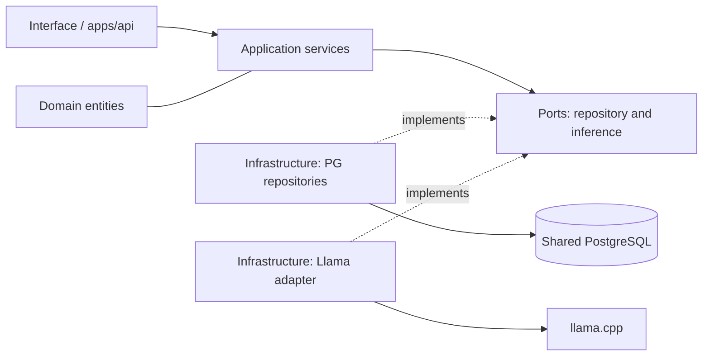
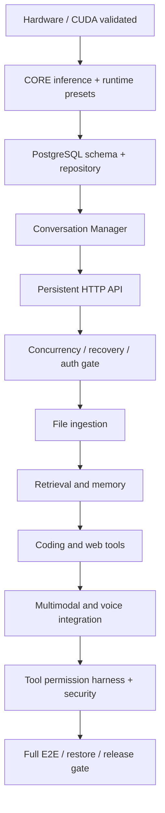
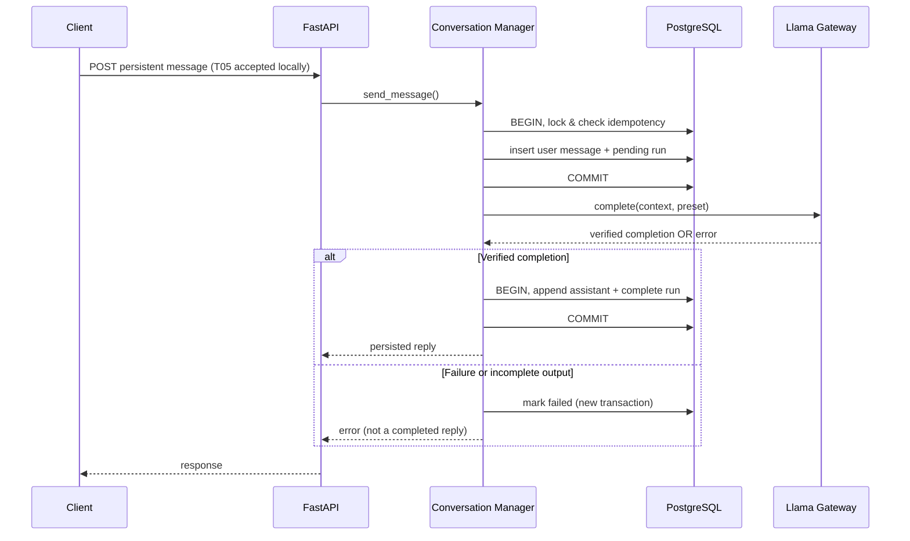

# LOCAL ASSISTANT — MASTER ROADMAP & EXECUTION TRACKER

> **Version:** 3.2 · **Updated:** 2026-10-17 (Asia/Ho_Chi_Minh)
> **Workspace:** `~/Workspace/Server/ai`  
> **Target:** Local-first personal AI platform; 90 **development-day milestones** (not calendar-day commitments).  
> **CURRENT POSITION:** **DAY 15 — D15-T05 PASS (localhost acceptance); NEXT = D15-T06 (Hardening/E2E).**
> **Scope source:** original `PERSONAL-AI-LOCAL-ROADMAP-UPDATED-2026-10-11.md`, `dev_log/dev_log.md` (D1–D10), source tree and terminal results, including the 2026-10-17 local implementation checkpoint.
> **Operator note:** Task checkboxes reflect *observed verification*, not whether someone suggested or pasted code. Where evidence is incomplete, status = PARTIAL / VERIFY / TODO.

---

## 0. How to use with VS Code + Codex

1. The tracked roadmap is `docs/LOCAL_ASSISTANT_MASTER_ROADMAP.md`; `docs/MASTER_ROADMAP.md` is not present in this checkout. Keep the existing `dev_log/dev_log.md` as the factual chronological record; do **not** overwrite it.
2. At the start of a Codex work session, ask it to read this roadmap, the active day's tests/code, and applicable `docs/ADR/` before changing anything.
3. Work on **one task ID at a time**. After implementing, run the listed acceptance tests, paste/summarize the actual result and update status. Do not mark PASS without evidence.
4. Keep an append-only entry in `dev_log/dev_log.md`: timestamp, task ID, code changes, commands/tests, actual output summary, decisions, known issues, next action.
5. Never run migrations, modify Vault policies, replace Docker infrastructure or delete data without a reviewed plan and backup/rollback option.
6. Mermaid diagrams render in Markdown preview on many GitHub/VS Code setups; if not, install a Mermaid Markdown preview extension.

**State legend:** `PASS` = demonstrated by reported execution; `PARTIAL` = something built/tested but gate not entirely demonstrated; `VERIFY` = historical claim or deliverable needs recheck; `TODO` = not implemented/tested; `BLOCKED` = cannot proceed without prerequisite.

**Codex briefing (paste into a Codex prompt):**

> Read `docs/LOCAL_ASSISTANT_MASTER_ROADMAP.md`, `dev_log/dev_log.md`, `docs/conversation_schema_design.md`, existing `docs/ADR/`, and the affected source files. Identify the next unchecked task and prerequisites. Preserve currently working code, all containers and shared home-server infrastructure. Never create another PostgreSQL/Vault/Qdrant/MinIO/RabbitMQ/Keycloak/MongoDB service. Make the smallest reviewable change; provide full-file contents when explicitly requested; run specific tests and record evidence. Do not mark PASS for skipped tests. Do not invent endpoints, secret values or model metrics. Observe Vault least-privilege and approval gates.

---

## 1. Executive status (as of 2026-10-17)

| Stage | Development days | Status | Evidence / next work |
|---|---:|---|---|
| P1 — Machine, inference, two-profile baseline | D1–D14 | **PARTIAL / substantially implemented** | D1–D10 documented in dev log; later 32K, vision, MTP and runtime presets exercised. Full original D14 model quality/safety release gate not evidenced. |
| P2a — Conversation persistence foundation | **D15** | **IN PROGRESS (5/6 tasks PASS)** | PostgreSQL + Vault, Alembic V001, repositories, Conversation Manager tested. REST API passed real PostgreSQL, CORE E2E and actual API process restart; hardening remains. |
| P2b — Files, ingestion, RAG, memory | D16–D32 (re-baselined) | TODO | Originally scheduled D15–D28, shifted by persistence prerequisite. |
| P3 — Coding agent | D33–D46 | TODO | Scoped reads, patch approval, isolated tests. |
| P4 — Web research | D47–D60 | TODO | Citation provenance, research tool controls and artifacts. |
| P5 — Multimodal + voice | D61–D74 | PARTIAL foundations / TODO products | CORE vision smoke done earlier; full image, video and speech workflows unbuilt. |
| P6 — Harness, MCP, security, UI | D75–D86 | TODO | Permission-first tool runtime, skills, MCP, backup, observability. |
| P7 — Release gate | D87–D90 | TODO | End-to-end, restore, reproducibility, release. |

**Scheduling semantics:** these are **sequenced milestones**, not promises to finish each task in 24 hours. D15 has six subtasks. If D15 remains open tomorrow, do not relabel unfinished tasks as D16 merely because calendar time passed. The original document had D15 = file upload; **v3 explicitly changes that decision** and shifts file ingestion later. Later days are a planning baseline, subject to recorded re-estimation, not fake completion.

### Progress of current day

| ID | Task | Status | Acceptance evidence |
|---|---|---|---|
| D15-T01 | Shared PostgreSQL instance, dedicated `local_assistant` DB + app credential in Vault | **PASS** | TCP login as `local_assistant_app` using Vault secret; current DB/user returned correctly. |
| D15-T02 | Alembic V001; `assistant` schema + tables; runtime grants | **PASS** | `0001 (head)`, four relations, DML privileges true and TRUNCATE false. |
| D15-T03 | Domain, repository ports, SQLAlchemy models, PostgreSQL repositories | **PASS** | Real PostgreSQL lifecycle integration test passed. |
| D15-T04 | Conversation Manager, inference port + adapter, replay/failure persistence | **PASS for defined tests** | 2 integration tests passed; 42 API/runtime regression tests passed. Concurrency/crash/context boundary **not** proven. |
| **D15-T05** | **Persistent Conversation REST API** | **PASS (localhost)** | Vault-backed app credential; 4/4 integration PASS including CORE; full suite 94 PASS, zero SKIP; history/list/replay verified across two Uvicorn processes. |
| D15-T06 | Concurrency, crash recovery, context trimming, actual LLM E2E, regressions | TODO | Independent tests including failure injection and restart. |

**Currently demonstrated:** 2026-10-17 Vault-backed verification: **4/4 integration PASS; full `pytest tests/`: 94 passed, zero skipped**. Real CORE persistent chat and list/history/idempotent replay across two actual Uvicorn processes passed. The old core smoke script still prints results without asserting them; pytest success is not a model-quality certification. **Not demonstrated:** multiworker safety, user identity authorization, production Vault bootstrap, pending-run lease recovery, whole-turn context trimming and PostgreSQL container restart.

---

## 2. Product objectives and non-goals

**Primary goal:** an extensible personal AI that runs primarily on the user's Ubuntu machine, supports Vietnamese/English chat, persistent conversations, reasoning, coding workflows, document/RAG/memory, grounded web research, vision/video/voice, tools/skills/MCP, strong privacy, reproducibility and opt-in remote capabilities.

**Principles:**

- Local-first, no mandatory cloud dependency or hidden fallback.
- CORE model default; UNRESTRICTED is opt-in, isolated, and must not acquire tools or extra permissions by selecting a model profile.
- llama.cpp handles model inference; FastAPI/Application Layer handles workflow and state; PostgreSQL/Vault/Qdrant/MinIO are shared infrastructure services.
- The product is a **separate application** hosted **on shared Home Server infrastructure**. Do not conflate applications, backend processes, containers, database instances, Vault paths, or Vault AppRoles.
- Deny-by-default for side-effecting tools; human approval, scope, budgets, logs and rollback.
- Tests must be reproducible; never report success from SKIPPED tests, hypothetical output or source code alone.
- No general-purpose autonomous host shell, internet, or privileged Docker socket for a model by default.

**Out of scope for v1.0:** pretraining a foundation model, public multi-tenant SaaS, autonomous privileged administration, automatically running risky scripts found online, mandatory fine-tuning, always-on cloud sync.

---

## 3. Existing architecture: actual vs target

### 3.1 Infrastructure, workloads and data


> Dashed arrows represent an intended dependency, **not** a tested production integration. The existing `/api/v1/chat/completions` remains stateless and has not been replaced.

### 3.2 Architecture boundaries



**Current compromise:** `ConversationManager` currently constructs concrete PostgreSQL repositories inside Application Service; the long-term goal is a Unit of Work/repository factory injected from the composition root. Do not label existing code perfectly dependency-inverted until fixed.

### 3.3 Home Server inventory — existing, do not duplicate

| Service | Existing instance | Use by Local Assistant |
|---|---|---|
| NVIDIA GPU | RTX 4070 Ti SUPER 16 GiB | CUDA inference; one heavyweight 9B at a time by default |
| llama.cpp | Pinned image `local-assistant/llama-cuda:5c8854fd8` | CORE / UNRESTRICTED profiles; host localhost:8080 |
| PostgreSQL | Container `postgres` (Postgres 17.x), host `127.0.0.1:5433` for app | DB `local_assistant`; schema `assistant` |
| Vault | Container `vault`, KV v2 under `secret/` | DB credentials; existing Shamir unlock behavior; no root token in app |
| Qdrant | Existing container `qdrant` | Future semantic memory/RAG collections |
| MinIO | Existing container `minio` | Future documents/artifacts buckets |
| RabbitMQ | Existing container `rabbitmq` | Optional later background jobs (only if warranted) |
| MongoDB | Existing container `mongo` | Not conversation source-of-truth |
| Keycloak | Existing container `keycloak` | Candidate for user auth; integration not yet confirmed |
| Docker network | `home-net` | Shared infrastructure networking; FastAPI currently native host process |

### 3.4 Data contract from Alembic V001

- `assistant.conversations`: UUID, title, profile, preset_default, status, created/updated/deleted timestamps, JSONB metadata.
- `assistant.messages`: UUID, conversation ID, sequence, role, content, request_key unique per conversation, created timestamp, JSONB metadata.
- `assistant.inference_runs`: user/assistant message links, requested/selected preset, model ID, pending/completed/failed/interrupted, usage, latency and timing, error code.
- Unique sequence per conversation and a partial unique index allowing only one `pending` inference per conversation.
- Roles: `local_assistant_migrator` owns DB/schema; `local_assistant_app` has required DML, not TRUNCATE. Migrations run separately.
- Credential paths: `secret/server/local-assistant/postgresql` and `.../postgresql-migrator`. They are in Vault, **not** config-file passwords.
- **Known gap:** no user/tenant ownership column or access policy in V001; auth/authorization must be designed before exposing conversation histories beyond controlled localhost.

---

## 4. Historical progress — Days 1–14

Source of record for D1–D10 is `dev_log/dev_log.md` (compiled through 2026-10-12). D11–D14 below list observed deliverables from ongoing discussions but avoid invented per-day terminal results.

| Day | Focus and intended deliverable | Evidence-backed state |
|---|---|---|
| D01 | OS/hardware inventory; GPU/CUDA/VRAM/RAM; workspace | **PASS** — Ubuntu and RTX 4070 Ti SUPER validated |
| D02 | Build/version-pin llama.cpp CUDA | **PASS** — commit `5c8854fd8` confirmed |
| D03 | uv environment; CORE Qwen3.5-9B Q6_K GGUF; first inference | **PASS** — reported first inference |
| D04 | Micro-benchmark input 512/4K/8K/16K | **PASS** — benchmark outputs logged |
| D05 | Real API context and retrieval ~12K / 16K | **PASS** — logged in development record |
| D06 | Manifest/config, startup scripts and runtime hash | **PARTIAL** — `/health` and hash checked; script-specific run evidence qualified in log |
| D07 | CORE smoke acceptance | **VERIFY** — original standalone D7 acceptance output absent in old log |
| D08 | UNRESTRICTED model fetch, hash and inference | **PASS** — source log records SHA/inference |
| D09 | UNRESTRICTED throughput, OOM handling | **PASS** — 16K after releasing competing VRAM |
| D10 | CORE vs variant initial quality evaluation | **PARTIAL** — initial 8/10 vs 8/10; not enough to claim equivalent quality |
| D11 | Deeper original/variant comparison and architecture choices | **PARTIAL/VERIFY** — benchmark files exist; per-day sign-off not supplied |
| D12 | Long-context and multimodal checks | **PARTIAL/VERIFY** — 32K/vision tests discussed; full original gate unverified |
| D13 | Auto router, runtime presets and hard reasoning budgets | **PARTIAL/VERIFY** — implementations and regression evidence available; align day labels with actual dev log later |
| D14 | Phase-1 model decision, release evidence | **PARTIAL** — working CORE/UNRESTRICTED and runtime gate; full weighted 30–50-case comparison not signed off |

**Additional verified later than the old D1–D10 log:** CORE 32K retrieval passed reported acceptance; vision/mmproj and MTP probes were reported successful; runtime presets and Auto V1 tested; project has `benchmarks/results/`, `configs/models.yaml`, model and runtime manifests. This does **not** mean all planned D7–D14 acceptance items are closed.

**P1 cleanup backlog (carry-forward, do not block D15 local API work unnecessarily):**

- [ ] Reconcile actual dates/tests D11–D14 against results and `dev_log`.
- [ ] Decide formal weighted model scorecard and quality gap gate.
- [ ] Confirm streaming/cancel/graceful shutdown and load/reload behavior where required.
- [ ] Ensure UNRESTRICTED tool permissions stay disabled by policy, not only by convention.
- [ ] Snapshot exact model hash, mmproj and runtime SHA in release manifest.

---

## 5. Day 15 — detailed sprint (CURRENT)

### D15-T01 — PostgreSQL & Vault — **PASS**

- [x] Reuse existing `postgres` container; no second server.
- [x] Create `local_assistant` database and `local_assistant_app` role.
- [x] Store matching credentials in Vault KV v2.
- [x] Verify real TCP password auth using Vault secret.
- [x] Create separable `local_assistant_migrator` credential.

### D15-T02 — Schema V001 — **PASS**

- [x] Alembic revision `0001 (head)`.
- [x] Tables `assistant.alembic_version`, `assistant.conversations`, `assistant.messages`, `assistant.inference_runs`.
- [x] Owner `local_assistant_migrator`, app role DML allowed; TRUNCATE denied.
- [ ] Document production migration/backup/downgrade policy (carry forward to operations).

### D15-T03 — Repository Layer — **PASS (focused test)**

- [x] `src/domain/entities/` for Conversation, Message, InferenceRun.
- [x] `src/application/ports/repositories.py`.
- [x] `src/infrastructure/models/` mappings to existing V001.
- [x] `src/infrastructure/repositories/` and async connection/session factory.
- [x] Real DB lifecycle test: separate commits, history, inference, archive/soft delete.

### D15-T04 — Conversation Manager — **PASS (focused tests; hardening open)**

- [x] `src/application/ports/inference.py`.
- [x] `src/infrastructure/inference/llama_adapter.py` reusing `LlamaGateway`.
- [x] `src/application/services/conversation_manager.py` with two-transaction flow.
- [x] Fake-inference test for persistence, replay, differing-key conflict and failure.
- [x] Focused regression: 42 tests PASS plus 2 integration tests PASS.
- [ ] Token-aware, whole-turn history trimming (currently message-count limit).
- [ ] Full dependency inversion/Unit of Work and finish-state retry semantics.
- [ ] Timeout/cancellation/race/process-crash recovery.

### **D15-T05 — Conversation REST API — PASS for localhost (2026-10-17)**

**Deliverables** (`apps/api/` remains HTTP adapter):

- [x] Local acceptance credential delivery: operator retrieved the existing app credential from Vault and injected DATABASE_URL into test/API child processes only. No Vault token was delivered to FastAPI/tests and no password was printed or committed. Production scoped AppRole/secret-agent delivery remains open.
- [x] Add FastAPI app lifespan for async DB engine and session factory; close pools on shutdown.
- [x] Add composition root/dependency wiring for `ConversationManager` and `LlamaInferenceAdapter`.
- [x] `POST /api/v1/conversations` — create profile/preset/title.
- [x] `GET /api/v1/conversations` — paginated listing with archive policy.
- [x] `GET /api/v1/conversations/{id}` — detail.
- [x] `PATCH /api/v1/conversations/{id}` — update title/preset.
- [x] `GET /api/v1/conversations/{id}/messages` — sequence pagination.
- [x] `POST /api/v1/conversations/{id}/messages` — persistent chat; optional idempotency key.
- [x] `POST /api/v1/conversations/{id}/archive` — archive.
- [x] `DELETE /api/v1/conversations/{id}` — soft-delete.
- [x] Preserve `POST /api/v1/chat/completions` exactly; do not replace its stateless behavior.
- [x] Consistent error mapping (404, 409, 422, 502/503/504), validation and response schemas.
- [x] Localhost-only development boundary: direct peer guard, Origin/proxy rejection and error redaction tested. External exposure remains prohibited until authN/authZ with owner boundary exists; this local PASS does not certify authentication.

**Exit criteria:** local HTTP request → DB conversation → gateway → assistant response; list/history survive FastAPI restart; no regression of existing stateless endpoint; no credentials in logs or repo; no anonymous external history access.

**Acceptance evidence:** `pytest tests/integration/ -q -rs --tb=short`: **4 passed in 1.18s** with LIVE_E2E enabled. Full `pytest tests/ -q -rs --tb=short`: **94 passed in 6.48s**, no exclusions/SKIPs. Separate HTTP check created a CORE response in process A, terminated A, launched process B and verified exact stored history, list visibility and cached replay with unchanged assistant ID. Temporary processes and test rows were cleaned up. T05 is PASS for localhost; Day 15 remains ACTIVE pending T06. See the append-only dev-log follow-up, ADR-016 and the local runbook.

### D15-T06 — Hardening, E2E & resilience

- [ ] Concurrent same-key requests: exactly one inference and deterministic replay/conflict (test across connections).
- [ ] Concurrent different-key requests same conversation: no duplicate sequence and at most one pending.
- [ ] Failure injection between reservation / inference / finalization; ensure consistent rollback/error codes.
- [ ] No incomplete `finish_reason=length` answer committed; verify model mismatch and context overflow.
- [ ] Pending-orphan policy: lease/heartbeat/expiry, no unsafe restart replay; explicit interrupted state.
- [ ] Do not hold transaction while waiting on LLM; instrument pool saturation.
- [ ] Whole-turn history trimming and 32K actual tokenizer budgeting, including system context.
- [ ] Prevent archive/delete during pending inference from causing a logically inconsistent committed answer.
- [ ] Real CORE model E2E; model-not-loaded and gateway timeout paths.
- [ ] Persistence test across API restart and, with backup/recovery precautions, DB restart.
- [ ] Full `uv run python -m pytest` regression; record exact counts and skipped cases.
- [ ] Security test: no user-to-user history access; no default external/public API exposure.
- [ ] Dev log + ADR update + definition-of-done review.

**Important open risks in T04 implementation:** provisional `balanced` value stored while Auto still deciding; duplicate-key behavior for a previously failed run is conflict rather than auto-retry; last-N-messages can split user/assistant turns; crash may leave `pending`; current schema has no ownership identity. Do not declare production-ready before explicit mitigation/testing.

---

## 6. Re-baselined future 90-day plan

> The **original** 2026-10-11 plan allocated D15–D28 entirely to files/RAG/memory. Because D15 actually delivered persistent conversation foundations, the remaining work below is re-sequenced. Day numbering describes *milestones*, not guaranteed time-to-complete. At a weekly review, change estimates in this file rather than silently dropping features or declaring them finished.

### Phase 2b — Documents, retrieval and memory (D16–D32)

| Day | Concrete task | Acceptance gate |
|---|---|---|
| D16 | Complete D15-T05/T06 spillover if needed; implement bounded file metadata/storage design | All D15 gates resolved or tracked as blockers; safe upload design |
| D17 | File upload/download APIs, MIME sniff, size caps, checksum, ACL | Invalid/malicious inputs rejected; no arbitrary path writes |
| D18 | PDF native text extraction with page provenance | Page and source mapping works on golden PDFs |
| D19 | DOCX read/write, tables, styles and round-trip tests | Valid output opens; sample content preserved |
| D20 | XLSX read/write, sheets, formula preservation and security | No macro execution; sample workbook round trip |
| D21 | OCR/VLM fallback for scans, images and tables | Confidence/uncertainty reporting, measurable examples |
| D22 | Chunking by page/section/table + metadata | Stable chunk IDs, provenance, access labels |
| D23 | Document pipeline evaluation and repair | Golden mixed-doc set, error report |
| D24 | Select embedding model and Qdrant collection design/ADR | Measured local accuracy/memory tradeoffs; no new Qdrant container |
| D25 | Incremental ingest/upsert/delete; embedding worker | Idempotent indexing, consistency after update/delete |
| D26 | Retrieval `search` adapter with ACL query filtering | No cross-user/cross-source retrieval leakage |
| D27 | Hybrid search / reranking evaluation | Compare Recall@k and latency to baseline |
| D28 | Grounded generation with citations to file/page/chunk | Source citations resolve to actual document spans |
| D29 | Memory classes: session/episodic/preference/project | Consent and provenance in schema |
| D30 | Memory APIs, opt-in extraction, retention | User can inspect, edit, delete and disable memory |
| D31 | Privacy, injection, deletion and export tests | Deletion propagates DB/vector/object store |
| D32 | Knowledge-phase acceptance gate | RAG demo, citation precision, documented limitations |

### Phase 3 — Coding agent (D33–D46)

| Day | Concrete task | Acceptance gate |
|---|---|---|
| D33 | Repo/workspace discovery, scope allowlist | No access outside configured working dir |
| D34 | Read-only file inventory, text search, symbol hints | Correct file/line provenance |
| D35 | Tool schemas, validation, budgets and timeout | Invalid tool calls rejected server-side |
| D36 | Explain architecture and reference source lines | Verified citations to local files |
| D37 | Debug plan + diagnosis without modifications | Explicit planned steps and reproducible checks |
| D38 | Coding eval baseline with golden tasks | Case-wise measured success/failure |
| D39 | Human-approval event schema and UI/CLI review | Approval is explicit, scoped, expiring |
| D40 | Patch proposal / unified diff / atomic edits | No silent writes; paths validated |
| D41 | Git checkpoint and rollback | Automated rollback drill |
| D42 | Sandboxed execution of tests/lint | Non-root, time/memory/network policy enforced |
| D43 | Issue → plan → diff → approval → tests → summary | E2E workflow passes sample repo |
| D44 | Hooks, cancellation, retry ceilings | Bounded steps and no bypass |
| D45 | Prompt injection, malicious README and tool-output tests | No unauthorized changes |
| D46 | Agent MVP gate, failure review and scorecard | At least 10 realistic coding cases, evidence recorded |

### Phase 4 — Web research (D47–D60)

| Day | Concrete task | Acceptance gate |
|---|---|---|
| D47 | Search provider evaluation, terms/quota/privacy | Provider ADR |
| D48 | Query normalizer, rate limits and search API | Resilient search fixture tests |
| D49 | HTTP fetch, text extraction, redirects, canonical URLs | Correct readable content and source URLs |
| D50 | Read-only browser for dynamic pages | Navigation/download permissions enforced |
| D51 | Provenance (title/date/fetch date), dedupe, cache | Every claim can map to evidence |
| D52 | Malicious webpage and injection red-team suite | Web content cannot override system/tool policy |
| D53 | Search freshness and coverage benchmark | Grounded results and dates logged |
| D54 | Multi-query research planning with time/token budgets | Bounded execution |
| D55 | Primary-source lookup and cross-source reconciliation | Conflicts explicitly surfaced |
| D56 | Claim-to-citation validation | No fabricated citations |
| D57 | Markdown research report generation | Reproducible evidence-backed report |
| D58 | PDF/DOCX export from generated report | Valid artifacts with source references |
| D59 | Long-run state, cancel/resume and error handling | No lost data or runaway tool loops |
| D60 | Web research phase gate | End-to-end researched artifact with tested sources |

### Phase 5 — Multimodal + voice (D61–D74)

> Prior CORE vision/mmproj smoke tests are foundations; they do not automatically close the product-level tasks below.

| Day | Concrete task | Acceptance gate |
|---|---|---|
| D61 | Vision adapter: request normalization, image sizing and privacy | Local image-chat sample passes |
| D62 | Vision OCR/layout tests vs dedicated OCR | Measured tradeoffs and hallucination flags |
| D63 | Image tables/figures/document screenshot tasks | Golden image results |
| D64 | FFmpeg video metadata, frame sampling | Timestamped reproducible frames |
| D65 | Frame-based video description | Correct timestamp provenance |
| D66 | Join audio transcript and video frames | Synchronized short-clip summary |
| D67 | Multimodal VRAM/context/performance benchmark | Text inference stable after media tasks |
| D68 | Choose local speech-to-text (ASR) for Vietnamese/English | Word error-rate/latency baseline |
| D69 | Voice activity detection (VAD), segmentation | Noise and timestamp tests |
| D70 | Local text-to-speech (TTS), voice/license review | Naturalness and latency baseline |
| D71 | Push-to-talk / explicit recording control | User consent and stop works |
| D72 | ASR → LLM → TTS flow, buffering | Round-trip latency and error handling |
| D73 | Audio retention/delete/security tests | No unintended always-on recording |
| D74 | Multimodal/voice phase gate | End-to-end tested examples and resource matrix |

### Phase 6 — Harness, extensibility, security and UX (D75–D86)

| Day | Concrete task | Acceptance gate |
|---|---|---|
| D75 | Skill contract and versioned permissions | Validated schema, explicit install trust |
| D76 | MCP adapter, allowlisted servers/operations | Tool discovery cannot silently widen permissions |
| D77 | Pre-/post-tool hooks and error/stop handlers | Hooks cannot bypass approval layer |
| D78 | Run planner, budgets, retries, checkpoint/resume | Bounded orchestration and recovery |
| D79 | Deterministic tool routing + approval workflows | Audit for decisions and side effects |
| D80 | Profile isolation, prompt/template versions | CORE/UNRESTRICTED restrictions enforced |
| D81 | Cross-domain orchestration test (files + code + web) | Grounded result and no unsafe side effects |
| D82 | Threat model, RBAC/user ownership, CSRF/CORS and token handling | Negative tests for unauthorized access |
| D83 | Observability: TTFT/TPS, token usage, error traces, redaction | Metrics and logs do not expose secrets |
| D84 | Backup/restore of PostgreSQL, vector/object metadata and config | Actual restore drill |
| D85 | Load/concurrency/OOM/disk-full failure tests | Published bottleneck and recovery policy |
| D86 | UI polish + release candidate security/eval review | Zero unresolved critical release blockers |

### Phase 7 — Stabilization and release (D87–D90)

| Day | Concrete task | Acceptance gate |
|---|---|---|
| D87 | Feature freeze + full E2E benchmark suite | Reproducible result set with failures tracked |
| D88 | Critical fixes, clean-install rehearsal, model provenance/scorecard | Onboarding documented, reproducible |
| D89 | Backup restore drill, manual acceptance scenarios, security review | At least 10 representative workflows checked |
| D90 | Release tag v1.0-local, architecture/runbook, known limitations and vNext backlog | Internal production-ready release decision grounded in evidence |

**If a phase fails its gate, advance the calendar only after recording deferment and impact. Never interpret Day 90 as guaranteed release.**

---

## 7. Timeline diagrams

### 7.1 High-level milestone map


### 7.2 Dependency graph / release gates



### 7.3 Conversation transaction sequence



---

## 8. Detailed risks, open decisions and technical debt

| Priority | Risk / debt | Mitigation / owner task |
|---|---|---|
| P0 | V001 has no user/tenant ownership; UUID alone does not constitute authorization | D15-T05 local-only; D15-T06/D82 owner identity + access policy + schema migration |
| P0 | Orphan `pending` inference after crash | D15-T06 lease/heartbeat/reconciliation; concurrency tests |
| P0 | Conversation Manager currently trims last N messages, not whole turns or tokenizer-budgeted | D15-T06 correct truncation and context 32K tests |
| P0 | Production Vault auth for FastAPI not yet configured | Scoped AppRole or Vault Agent/injector; never root in runtime |
| P0 | User-provided files and web pages may contain hostile instructions | D17 onward sanitization/provenance; approval gate D33/D75 |
| P0 | UNRESTRICTED profile could get side-effecting tools if policy accidentally shared | Enforce policy server-side with negative tests |
| P1 | App Service imports concrete PostgreSQL repositories | Refactor to Unit of Work/factory injected at composition root |
| P1 | Existing API stateless and conversation API separate | Preserve old behavior and versioned contracts |
| P1 | Migration rollback / backup drill not yet complete | Before schema V002/production, actual restore and forward-only strategy |
| P1 | Old D1–D14 release/quality scorecard needs reconciliation | Historical cleanup and phase-gate evidence |
| P1 | `src/` is a generic top-level package name | Consider named package during planned packaging work, not urgent refactor |
| P2 | `apps/api/storage/__init__.py` empty; `.bak` files, `__pycache__` | Inventory and safe cleanup after green tests; ignore artifacts in Git |

### Secrets / authentication policy

- Vault is a shared server; `secret/angi`, `secret/game`, `secret/server` are **organizational paths**, not a measurement of how many backends exist.
- A Vault AppRole belongs to a **consumer identity / trust boundary**, not automatically one per database, one per container or one per folder.
- Angi and Game may each use one scoped AppRole if each has one consumer with the same minimum needed secret set.
- Local Assistant FastAPI should receive only its own PostgreSQL credential (regardless of whether that secret lives under `secret/server/local-assistant/`); do not give it a broad `server` AppRole.
- Separate static KV credential and dynamic PostgreSQL Vault database secrets are distinct options. Existing implementation uses **KV v2 static credentials**; dynamic credential engine is not currently mounted.
- Vault uses Shamir sealing and needed manual unseal during setup. Plan reboot/unseal operations and backups. Never commit/send root tokens, unseal shares, RoleIDs/SecretIDs or database passwords.

### Engineering conventions

- Python: `uv`, Python 3.12 in observed environment; `micro` editor; full-file edits over unreviewable ad-hoc patching when requested.
- FastAPI native `127.0.0.1:8000`; llama.cpp `127.0.0.1:8080`; PostgreSQL host port 5433; avoid open-public bind.
- Run Pytest with `uv run python -m pytest` (ensures root package import in current project).
- A test that SKIPs because `DATABASE_URL` is absent is **not** a PASS.
- Test DB state should be created with unique IDs and cleaned in correct FK order: inference_runs → messages → conversations.
- Never open a PostgreSQL transaction across an LLM/network call.
- Store final assistant text, metadata and usage, not hidden model reasoning by default.
- Code source/tree examples are **plans**, not proof of installed/run state.

---

## 9. Validation and release checklist

### Local D15 smoke commands (safe read-only unless test internally writes temporary rows)

```bash
cd ~/Workspace/Server/ai
uv run python -m pytest \
  tests/test_api_health.py \
  tests/test_llama_gateway.py \
  tests/test_runtime_presets.py \
  tests/test_runtime_auto.py -q
```

**Last observed:** 42 passed. The PostgreSQL integration tests require valid `DATABASE_URL` supplied securely at execution time; the last observed focused result was 2 passed. **Do not** place the DB URL/password in a tracked Markdown file.

### Cross-phase definition of done (DoD)

- [ ] Implementation reviewed; no accidental changes to shared Home Server containers.
- [ ] Task-specific tests, negative cases and regression tests executed with recorded actual output.
- [ ] Data migrations have verified rollback or restore procedure.
- [ ] Credentials/PII absent from Git, logs and test fixtures.
- [ ] Auth/permission boundary verified for side-effecting or user-specific functionality.
- [ ] Performance/resource measurements included when inference or media affected.
- [ ] Relevant ADR and `dev_log/dev_log.md` updated.
- [ ] Rollback or mitigation for errors known.

### End-of-project acceptance tests (D87–D90)

- **Chat:** multi-turn persistence and context management; restart recovery; cancel; profile separation; correct budgets.
- **Model:** original vs UNRESTRICTED provenance and reproducible quality/latency/VRAM benchmarks.
- **Documents:** PDF, DOCX, XLSX, OCR fallback, valid artifacts and provenance.
- **RAG/Memory:** retrieval citation, ACL, opt-out, retention and delete/export.
- **Coding:** read → explain → propose diff → approve → sandbox tests → rollback, without unapproved write.
- **Web:** fresh multi-source research with verified citations and guarded browser actions.
- **Multimodal:** image/frame/timecode and voice in/out with consent.
- **Security:** prompt-injection tests, Vault least privilege, unauthorized access denied, no secrets in output.
- **Operations:** backup/restore drill, disk/VRAM pressure, deployment from clean workspace and runbook.

---

## 10. Next-session execution order (Codex handoff)

1. **D15-T05 is PASS for localhost. D15-T06 is NEXT:** retain the tested HTTP contract and app-only credential injection. Production Vault identity remains unconfigured; the API must never receive an operator/root token. Follow ADR-016 and the local runbook.
2. Preserve the verified 4/4 integration and 94/94 full regression evidence. Extend hardening tests for concurrency, failure injection and crash recovery; keep stateless chat working.
3. **D15-T06:** repair/extend the architecture for whole-turn context trimming, token cap, concurrent request safety and pending recovery; test the failure cases explicitly.
4. Record the results, commit reviewed changes, write an ADR for identity/permissions and credential provisioning.
5. Advance to D16+ documents only after the D15 release gate is clearly accepted or unfinished issues are intentionally deferred with risk ownership.

**Current formal checkpoint:** `D15-T04 = PASS (focused tests)`, **`D15-T05 = PASS (localhost)`**, `D15-T06 = NEXT / TODO`, **Day 15 remains ACTIVE**.

---

## 11. Change log

| Version | Date | What changed |
|---|---|---|
| v2.0 | 2026-10-11 | Original two-model, 90-development-day plan (initial state was planning-only). |
| **v3.0** | **2026-10-16** | Reconciled original roadmap with terminal/dev-log evidence, recorded real D15 PostgreSQL/Vault/Alembic/Repository/Conversation Manager progress, moved file ingestion, and re-baselined remaining 90-day execution plan with codex-readable gates. |
| **v3.1** | **2026-10-17** | Implemented T05 HTTP contracts, pool lifespan, safe local access and tests; 90 passed / 4 skipped with legacy live script excluded. T05 remains PARTIAL; no advance to T06/D16. Added ADR-016 and local runbook. |
| **v3.2** | **2026-10-17** | Read existing app credential from Vault after operator unseal; corrected live test max_tokens to the existing 512-token minimum; 4/4 integration and 94/94 full suite PASS; verified actual API process restart and replay. T05 PASS for localhost; T06 NEXT. |
