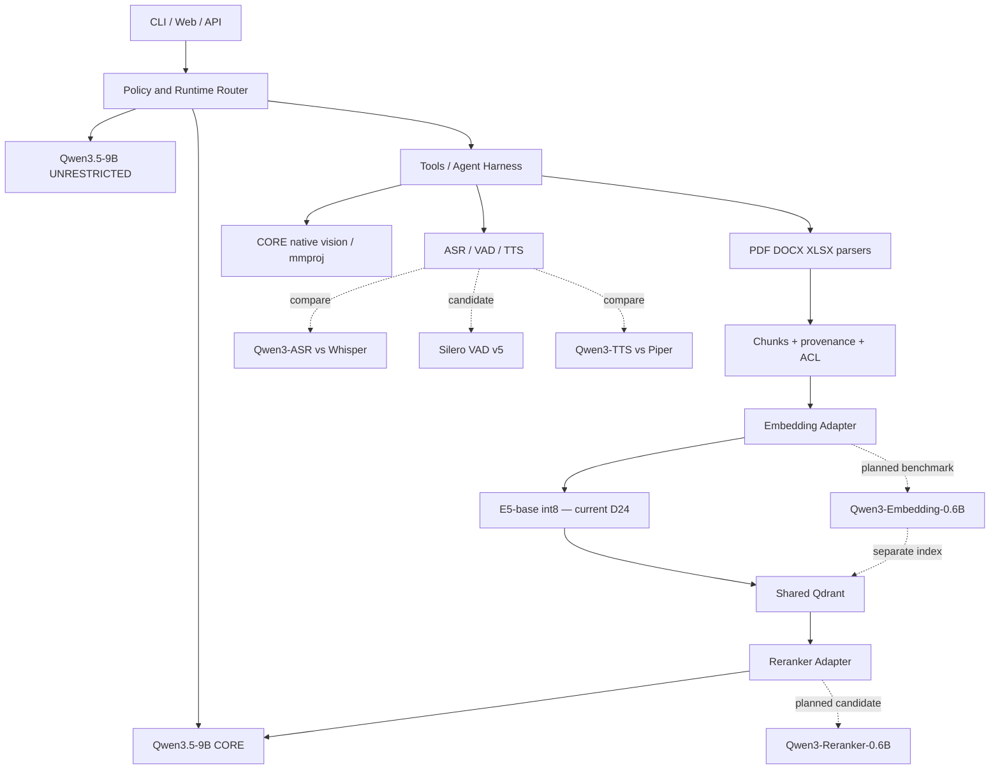

# LOCAL ASSISTANT — MODEL REGISTRY & D24 RECONCILIATION

> Version 1.0 — 2026-10-18. Place at `docs/MODEL_REGISTRY.md` in the **current** repository. Do not replace the repository's updated master roadmap with the stale D15 snapshot.

## 1. Previously discussed model lineup

| Role | Original selection / candidate | Decision status | Implementation note |
|---|---|---|---|
| CORE LLM | `Qwen/Qwen3.5-9B`, `bartowski/Qwen_Qwen3.5-9B-GGUF`, Q6_K | Established baseline | llama.cpp; runtime presets; 32K context; native vision/mmproj validated in earlier work |
| UNRESTRICTED LLM | `HauhauCS/Qwen3.5-9B-Uncensored-HauhauCS-Aggressive`, Q6_K | Established isolated profile | No automatic extra tools/privileges; quality gate distinct from inference smoke |
| Embedding | **`Qwen3-Embedding-0.6B`** | **Originally nominated P1 candidate** | Must be evaluated fairly before declaring another model superior |
| Reranker | **`Qwen3-Reranker-0.6B`** | **Originally nominated P1 candidate** | Evaluate retrieval quality, latency and hardware cost |
| Vision | CORE Qwen3.5-9B native vision + compatible projector | Default strategy | `Qwen3-VL-4B/8B` optional only if evidence warrants |
| ASR | **`Qwen3-ASR-0.6B`** vs Whisper/faster-whisper | Planned comparison | Benchmark Vietnamese/English accuracy, latency, memory |
| VAD | Silero VAD v5 | Discussed candidate | Not proven deployed by D24 evidence |
| TTS | **`Qwen3-TTS-0.6B`** vs Piper | Planned comparison | Verify Vietnamese output, latency, licensing |
| OCR | Native PDF parsing first; OCR/VLM fallback | Strategy, no fixed model | Do not invent an OCR model decision |
| Coding | CORE + deterministic Git/search/patch/test tools | Initial strategy | Specialist coder model only after benchmark |
| Larger LLM | Qwen3-14B / ~20B / 27B+ options | Optional future comparisons | Not replacements for CORE by default |
| Web | Search/fetch/browser tools + CORE | Tool pipeline | No separate web-search model required |
| Video | FFmpeg frames/timestamps + vision + ASR | Multimodal pipeline | Not one standalone video model |

**Terminology:** An *established implementation* is not the same as a *planned candidate*. The original Qwen3 embedding and reranker were nominated defaults for evaluation, not independently proven winners. Never claim they were deployed or outperformed without actual evidence.

## 2. D24 — verified-by-operator status, not inferred results

The operator reports D24 completed at commit `a88584b`:

- Selected **multilingual-e5-base int8**, vector dimension **768**.
- **Recall@3 = 92.5%** on a trial corpus; remaining errors retained in report.
- **783 PASS, 0 SKIP** using real PostgreSQL, CORE and shared Qdrant.
- Updated development log, roadmap and **ADR-031**; clean working tree.
- Next milestone: **D25 — ingestion**.

These results establish a working E5 candidate and measured recall. They **do not establish** superiority over `Qwen3-Embedding-0.6B` unless the same benchmark evaluated both.

### D24 reconciliation gate

1. Inspect actual `ADR-031`, embedding adapter, test corpus, Qdrant collection and commit `a88584b`. Do not assume filenames or results.
2. Check whether `Qwen3-Embedding-0.6B` was benchmarked. If yes, link evidence. If not, create a comparison task and record **NOT EVALUATED**.
3. Compare E5 int8 and Qwen3-Embedding-0.6B using the same documents, chunks, queries, relevance judgments, metrics (Recall@3, Recall@5/10), and retrieval settings. Include Vietnamese/English subsets, latency, RAM/VRAM, storage and index throughput.
4. Apply each model's documented query/passage formatting and normalization; do not reuse E5-specific prefixes blindly for Qwen.
5. Preserve the existing **E5 768-dimensional Qdrant collection**. Different vector dimensions/embedding spaces require separate collection or named-vector configuration and reindexing. Never mix incompatible embeddings.
6. If E5 is better for the project, keep it and document the comparison/tradeoff in ADR-031 or an addendum. If Qwen wins, propose migration + rollback before changing production retrieval.
7. **Do not revert D24 or delete working data** solely because an earlier candidate was omitted from the later roadmap. D25 can proceed with the currently selected E5 configuration unless the owner explicitly freezes it.

## 3. Model routing architecture

**Hardware:** RTX 4070 Ti SUPER 16GB, RAM 32GB. Do not assume all candidate models can remain resident simultaneously. CORE/UNRESTRICTED are separately loaded by default.

## 4. Codex policy for model changes

- Read `docs/LOCAL_ASSISTANT_MASTER_ROADMAP.md`, `docs/MODEL_REGISTRY.md`, `dev_log/dev_log.md`, and relevant ADRs before implementing model-related tasks.
- Treat this registry as **past decisions plus candidate constraints**, not as instructions to download every model.
- Any replacement proposal must specify old/new model, reason, measured benchmark, memory/latency, compatibility, migration, rollback and explicit approval.
- Never silently change CORE, UNRESTRICTED, embedding, reranker, ASR, TTS, or VLM.
- Never create duplicate PostgreSQL, Vault or Qdrant containers; reuse shared home-server infrastructure.
- Never mix incompatible embedding vectors or overwrite a live Qdrant collection during experiments.
- Missing benchmark evidence = **NOT EVALUATED**, not PASS or FAIL.
- Preserve commit `a88584b` and existing D24 tests unless an explicitly reviewed change is necessary.
- Update the **existing** `docs/LOCAL_ASSISTANT_MASTER_ROADMAP.md` with a link to this registry and D24 reconciliation task; do not create a competing master roadmap.

## 5. Action checklist

- [ ] Save this file as `docs/MODEL_REGISTRY.md` in the actual project.
- [ ] Audit ADR-031 and determine whether Qwen3-Embedding-0.6B was tested.
- [ ] Add fair E5 vs Qwen3 embedding comparison to backlog if missing.
- [ ] Keep E5 as the current D24 implementation pending a deliberate decision; do not force migration.
- [ ] Preserve existing Qdrant data and all 783 passing tests.
- [ ] Continue D25 ingestion against the explicitly selected adapter, with no silent model switch.

## 6. Provenance

Historical plan sources: `PERSONAL-AI-LOCAL-ROADMAP.md`, `PERSONAL-AI-LOCAL-ROADMAP-UPDATED-2026-10-11.md`, and the incomplete model coverage in `LOCAL_ASSISTANT_MASTER_ROADMAP.md` v3.0. Current D24 facts are operator-reported; current repository contents and ADR-031 have **not** been inspected here.
