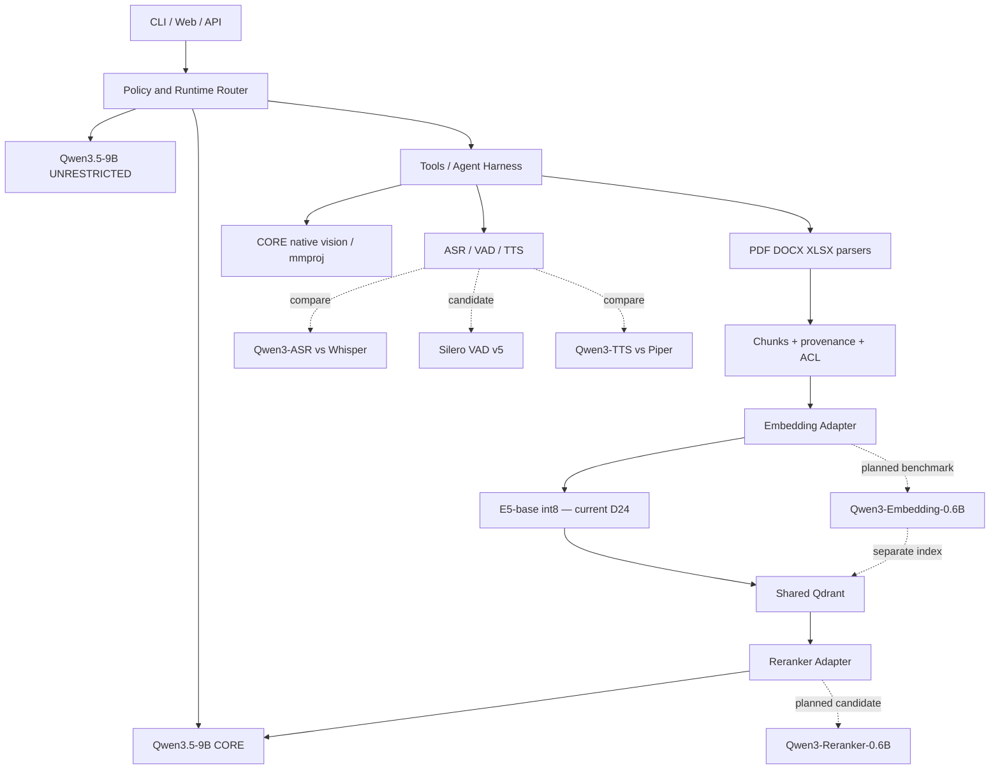

# LOCAL ASSISTANT — MODEL REGISTRY & D24 RECONCILIATION

> Version 1.0 — 2026-10-18. Place at `docs/MODEL_REGISTRY.md` in the **current** repository. Do not replace the repository's updated master roadmap with the stale D15 snapshot.

## 1. Previously discussed model lineup

| Role | Original selection / candidate | Decision status | Implementation note |
|---|---|---|---|
| CORE LLM | `Qwen/Qwen3.5-9B`, `bartowski/Qwen_Qwen3.5-9B-GGUF`, Q6_K | Established baseline | llama.cpp; runtime presets; 32K context; native vision/mmproj validated in earlier work |
| UNRESTRICTED LLM | `HauhauCS/Qwen3.5-9B-Uncensored-HauhauCS-Aggressive`, Q6_K | Established isolated profile | No automatic extra tools/privileges; quality gate distinct from inference smoke |
| Embedding | **`Qwen3-Embedding-0.6B`** | **Originally nominated P1 candidate** | Must be evaluated fairly before declaring another model superior |
| Reranker | **`Qwen3-Reranker-0.6B`** | **Originally nominated P1 candidate** | Evaluate retrieval quality, latency and hardware cost |
| Vision | CORE Qwen3.5-9B native vision + compatible projector | Default strategy | `Qwen3-VL-4B/8B` optional only if evidence warrants |
| ASR | **`Qwen3-ASR-0.6B`** vs Whisper/faster-whisper | Planned comparison | Benchmark Vietnamese/English accuracy, latency, memory |
| VAD | Silero VAD v5 | Discussed candidate | Not proven deployed by D24 evidence |
| TTS | **`Qwen3-TTS-0.6B`** vs Piper | Offline comparison + owner listening24/24 complete; no selection/deployment | [D70owner findings](D70_OWNER_LISTENING_20261103.md): quality limitations, VI-Auto failures, disliked PiperVIvoice; product/rights approval open |
| OCR | Native PDF parsing first; OCR/VLM fallback | Strategy, no fixed model | Do not invent an OCR model decision |
| Coding | CORE + deterministic Git/search/patch/test tools | Initial strategy | Specialist coder model only after benchmark |
| Larger LLM | Qwen3-14B / ~20B / 27B+ options | Optional future comparisons | Not replacements for CORE by default |
| Web | Search/fetch/browser tools + CORE | Tool pipeline | No separate web-search model required |
| Video | FFmpeg frames/timestamps + vision + ASR | Multimodal pipeline | Not one standalone video model |

**Terminology:** An *established implementation* is not the same as a *planned candidate*. The original Qwen3 embedding and reranker were nominated defaults for evaluation, not independently proven winners. Never claim they were deployed or outperformed without actual evidence.

## 2. D24 — verified-by-operator status, not inferred results

The operator reports D24 completed at commit `a88584b`:

- Selected **multilingual-e5-base int8**, vector dimension **768**.
- **Recall@3 = 92.5%** on a trial corpus; remaining errors retained in report.
- **783 PASS, 0 SKIP** using real PostgreSQL, CORE and shared Qdrant.
- Updated development log, roadmap and **ADR-031**; clean working tree.
- Next milestone: **D25 — ingestion**.

These results establish a working E5 candidate and measured recall. They **do not establish** superiority over `Qwen3-Embedding-0.6B` unless the same benchmark evaluated both.

### D24 reconciliation gate

1. Inspect actual `ADR-031`, embedding adapter, test corpus, Qdrant collection and commit `a88584b`. Do not assume filenames or results.
2. Check whether `Qwen3-Embedding-0.6B` was benchmarked. If yes, link evidence. If not, create a comparison task and record **NOT EVALUATED**.
3. Compare E5 int8 and Qwen3-Embedding-0.6B using the same documents, chunks, queries, relevance judgments, metrics (Recall@3, Recall@5/10), and retrieval settings. Include Vietnamese/English subsets, latency, RAM/VRAM, storage and index throughput.
4. Apply each model's documented query/passage formatting and normalization; do not reuse E5-specific prefixes blindly for Qwen.
5. Preserve the existing **E5 768-dimensional Qdrant collection**. Different vector dimensions/embedding spaces require separate collection or named-vector configuration and reindexing. Never mix incompatible embeddings.
6. If E5 is better for the project, keep it and document the comparison/tradeoff in ADR-031 or an addendum. If Qwen wins, propose migration + rollback before changing production retrieval.
7. **Do not revert D24 or delete working data** solely because an earlier candidate was omitted from the later roadmap. D25 can proceed with the currently selected E5 configuration unless the owner explicitly freezes it.

## 3. Model routing architecture

**Hardware:** RTX 4070 Ti SUPER 16GB, RAM 32GB. Do not assume all candidate models can remain resident simultaneously. CORE/UNRESTRICTED are separately loaded by default.

## 4. Codex policy for model changes

- Read `docs/LOCAL_ASSISTANT_MASTER_ROADMAP.md`, `docs/MODEL_REGISTRY.md`, `dev_log/dev_log.md`, and relevant ADRs before implementing model-related tasks.
- Treat this registry as **past decisions plus candidate constraints**, not as instructions to download every model.
- Any replacement proposal must specify old/new model, reason, measured benchmark, memory/latency, compatibility, migration, rollback and explicit approval.
- Never silently change CORE, UNRESTRICTED, embedding, reranker, ASR, TTS, or VLM.
- Never create duplicate PostgreSQL, Vault or Qdrant containers; reuse shared home-server infrastructure.
- Never mix incompatible embedding vectors or overwrite a live Qdrant collection during experiments.
- Missing benchmark evidence = **NOT EVALUATED**, not PASS or FAIL.
- Preserve commit `a88584b` and existing D24 tests unless an explicitly reviewed change is necessary.
- Update the **existing** `docs/LOCAL_ASSISTANT_MASTER_ROADMAP.md` with a link to this registry and D24 reconciliation task; do not create a competing master roadmap.

## 5. Action checklist

- [ ] Save this file as `docs/MODEL_REGISTRY.md` in the actual project.
- [ ] Audit ADR-031 and determine whether Qwen3-Embedding-0.6B was tested.
- [ ] Add fair E5 vs Qwen3 embedding comparison to backlog if missing.
- [ ] Keep E5 as the current D24 implementation pending a deliberate decision; do not force migration.
- [ ] Preserve existing Qdrant data and all 783 passing tests.
- [ ] Continue D25 ingestion against the explicitly selected adapter, with no silent model switch.

## 6. Provenance

Historical plan sources: `PERSONAL-AI-LOCAL-ROADMAP.md`, `PERSONAL-AI-LOCAL-ROADMAP-UPDATED-2026-10-11.md`, and the incomplete model coverage in `LOCAL_ASSISTANT_MASTER_ROADMAP.md` v3.0. Current D24 facts are operator-reported; current repository contents and ADR-031 have **not** been inspected here.

## 2026-10-24 — Existing-profile measured status, no selection change

Owner explicitly requested UNRESTRICTED testing. [Paired text measurement](MODEL_QUALITY_002_UNRESTRICTED_SCORECARD.md) uses exact same30authored cases/references/historicalweights: CORE23/30/52.5of70textpoints; UNRESTRICTED20/30/45of70. Remaining30points unscored/overall100point scorenull. Original profile templates/CPU-versus-GPU/cold-warm conditions differ, so this is descriptive evidence, not causal superiority or a replacement decision. UNRESTRICTEDtemporary CPUsidecar/context32K/wholeprocesspeakRSS RAM7.68GiB/zeroGPUoffload retired; original CORE/models/configs/tool-denial policies unchanged. No candidates/nominations/defaults/deployment/rights approval changes.

## Proposed research addition — 2026-11-03, not selected/deployed

[VIvoice metadata survey](D74_VI_VOICE_CANDIDATE_SURVEY.md) proposes separately evaluating `pnnbao-ump/VieNeu-TTS-v3-Turbo` CPU ONNX FP32 at revision `61b85e3d937fbbacb387714180e8182823512523`, with bundled Northern female presets Trúc Ly/Ngọc Huyền. [ADR154](ADR/154-proposed-isolated-vietnamese-voice-feasibility-campaign.md) is PROPOSED/NOT APPROVED/NOT IMPLEMENTED/NOT EXECUTED; model/codec/preset payloads not downloaded. This is not a replacement of the original Qwen/Piper nominations, selection or migration. Existing benchmarks are preserved; new quality/RAM/first-audible latency remain unmeasured. Owner benchmark/resource/rights/migration/rollback approval rules still apply.

## Approved research addendum — 2026-11-03

VieNeu-TTS v3 Turbo CPU ONNX FP32 is an owner-approved isolated research candidate under ADR-154, not a replacement/default or selected voice. [Actual partial trial](D74_VI_VOICE_CAMPAIGN_RESULT.md) retains24 standalone outputs and a failed research workflow; new voice listening/physical latency/rights and model selection remain open. Original Qwen3-TTS versus Piper registry nominations and all historical results remain unchanged. [Proposed ADR-155](ADR/155-proposed-workflow-recovery-after-caller-metadata-failure.md) requires new approval for replacement workflow execution; no additional candidate is admitted.

Owner [group listening feedback](D74_OWNER_VOICE_FEEDBACK_20261103.md) now prefers Trúc Ly and Ngọc Huyền over the Piper comparison voice, while reporting mechanical prosody and incorrect time/date/Python/API reading. This preference does not select a product model/voice or authorize ADR155 recovery. Original registry nominations and first outcomes remain unchanged; reading/prosody investigation is assessed backlog only.

The later owner instruction “Làm đi” authorizes [ADR156 isolated speech-quality work](D74_SPEECH_READING_QUALITY_RESULT.md) on those same weights/presets:48 paired TTS outputs and221scoped tests, no new model/default. Experimental text/phoneme policy changes are separate variants, not a model replacement or validated acoustic fix. New listening is pending and ADR155workflow remains unapproved.

**Latest scoped owner assessment:** [English/API follow-up](D74_ENGLISH_READING_FOLLOWUP.md) records reviewed date/time correct and `clauses` preferred best/most natural. Python must sound English and API buzz/tremble in both voices remain unresolved quality gates. Eight new English-preserving candidates/236final scoped software PASS are ready for listening, using the exact same model/voices/accepted prosody and original17research files. Earlier one decoder regression failure is retained separately/cause unconfirmed. No product/voice/model selection, physical4second or ADR155workflow approval is inferred.

## API reference diagnostic — 2026-11-04

[Actual result and eight paired listening clips](D74_API_REFERENCE_DIAGNOSTIC_RESULT.md): first16-slot diagnostic remains stopped at Ngọc Huyền isolated-A13frames/EOSfalse (4complete/1failed/11unattempted); no retry or raised cap. A separately declared8-slot full-carrier cohort completes all4exact phoneme/token/speaker/anchor pairs with reference-code on/off; combined13actualTTS≤16, not original16PASS. Final257scoped software PASS/0FAIL/ERROR/SKIP4.29s, RuffPASS;250initialPASS. Exact token roundtrip/zero unknowns do not establish acoustic Ei or absence of APIbuzz.

VOICE-ENGLISH-READING-001/VOICE-API-ARTIFACT-001 remain P1. Subsequent owner feedback reports the new set worse; diagnostic quality NOT ACCEPTED (see current disposition below). No automatic reference-off/model/voice/default selection; weights/SDK/presets unchanged. Python not re-evaluated; reviewed date/time and preferred `clauses` retained. All750application/210protected/19prior research files and prior audio unchanged. No new downloads, ASR/CORE/Brave calls, shared service changes or ADR155workflow execution. Physical4second/rights/no-speech/product/D90release remain open; D60owner-deferred. Full5889/earlier236scoped counts remain historical, not new full runs.

**Current owner disposition, 2026-11-04:** [Exact feedback](evidence/d74-api-reference-owner-rejection.json): “Còn tệ hơn cả bản trước nữa”. Reject adoption of this diagnostic and preserve the earlier `clauses` path/date/time acceptance. No separate clip, ref-on/off or Ei/buzz/timbre ratings are inferred. API quality remains open; Python not reassessed. Different texts/direct-phoneme preparation prevent causal attribution of the old-to-new regression. Next engineering step is a source-backed minimal same-text/same-voice comparison design on the retained clauses path; no new native trial scheduled or remaining slots consumed.257scoped PASS is historical software evidence only. No model/default/workflow activation or new source/config/model/provider calls.

## Same-text API stress follow-up — 2026-11-04

[ADR159 actual result and four same-text pairs](D74_API_STRESS_COMPARISON_RESULT.md): latest owner “Làm đi” continues narrowly on the old english-01/04 sentences and both retained voices.4newTTS/6innerchunks complete/EOS/exit0/no retry; four exact ADR157baselines reused. Only API stress marks change at the old ProsodyAdapter phonemizer dependency, preserving text/date/clauses/question/Pythoninput/referenceON/sampling/frame caps. Two first date chunks match old audio byte-for-byte.267scoped software PASS4.78s/RuffPASS; two initial test-fixture failures retained.

Ei/APIbuzz/whole-sentence naturalness remain unaccepted pending owner listening; unchanged Python phones do not certify its waveform. The rejected carrier trial remains OWNER_REPORTED_WORSE_NOT_ACCEPTED; no ref-off or model/voice/default/policy adoption.25prior research/750application/210protected/SDK/model/audio preserved, no ASR/CORE/provider/download/service change. ADR155workflow unapproved/unexecuted; physical4second/rights/no-speech/product/D90release open, D60owner-deferred;5889full remains historical.

## API owner acceptance and Roman context check — 2026-11-04

[Exact owner feedback](evidence/d74-api-python-roman-owner-feedback.json) confirms API pronunciation correct on the reviewed ADR159panel; Python remains unacceptable. Preserve that API operator/audio. No per-clip or separate APIbuzz/timbre acceptance, voice/model/default/product approval is inferred.

[Roman/Python context result](D74_ROMAN_CONTEXT_RESULT.md): original SDK verifies5of5fixed unambiguous targets, preserving vi in vi phạm/VI PHẠM and reading Chương VI as sáu, including both meanings in one sentence; IV/IX frontend-only. Identifier VI is observation-only. Bare/tagged Python phones identical, not a fix.8Roman-word+2EnglishPython native controls complete10TTS/10chunks/EOS/exit0/no retry;2oldmixed references unchanged, new acoustic listening pending.275scoped software PASS5.03s/RuffPASS. No normalization/pronunciation rule or model/SDK/acceptedAPI change;29oldresearch/750application/210protected and previous audio preserved. VOICE-CONTEXT-READING-001 P1 frontend corpus complete, acoustic gate open; Python P1 remains open. ADR155workflow/physical4second/rights/no-speech/product/D90release unaccepted; D60deferred.
