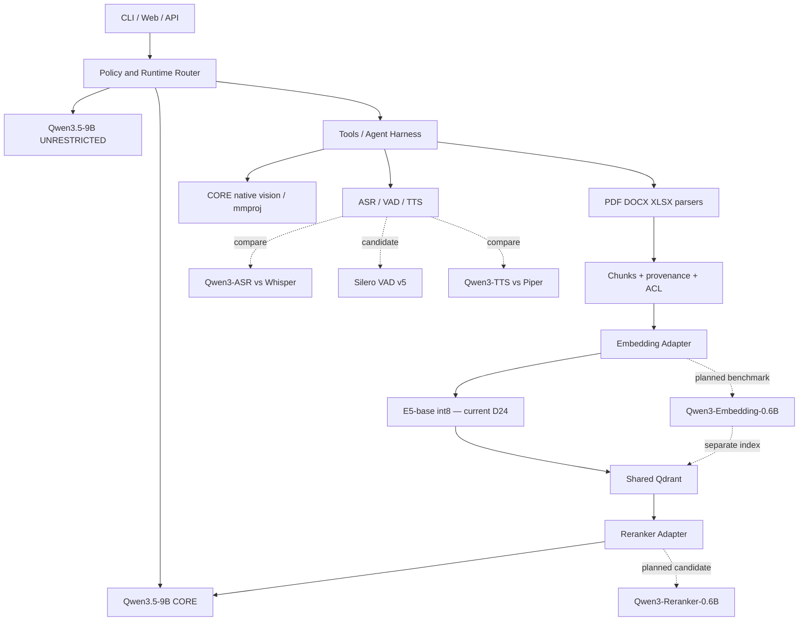

# LOCAL ASSISTANT — MODEL REGISTRY & D24 RECONCILIATION

**Current review — 2026-11-05:** [Exact-lane rights review](D74_VOICE_RIGHTS_REVIEW.md) and [main-app proposal](D74_VOICE_INTEGRATION_REVIEW.md) are ready for owner review. Model roles, pins, voices, profiles and adoption status are unchanged. Published Turbo preset assurances are distinguished from redistribution obligations; no new checkpoint or model selection. Physical timing and final product/default approval remain open.
## Trang thử voice đã chạy — 2026-11-05

**URL trên cùng máy: [http://127.0.0.1:8092](http://127.0.0.1:8092)**. [Cách mở/ghi/dừng/gửi/nghe và kiểm chứng](D74_VOICE_BROWSER_TRIAL_GUIDE.md), [kết quả và receipt](D74_VOICE_BROWSER_TRIAL_RESULT.md). Thêm optional loopback research surface riêng; recorder cũ/750application baseline giữ nguyên, không chọn model/default sản phẩm. Prepare chủ động, không tự thu/nạp/gửi khi mở trang; đúng QwenCUDAFP32/CORE32KFast512/TrúcLyCPU8 đã qualified.

766relatedPythonPASS/20JSPASS, Braveheadless fake-mic/muted/mocked-model UI PASS; browser thật không mock GET/POSTcookie/Origin cũng PASS, không mở microphone. RealHTTPnative6/6:4speech ASR/CORE/playback exactprior, clientroundtrip1.972–3.250s và2negative chặn đúng;6VAD/4ASR/CORE/TTS+1readiness,0retry/guard/runtimefault, toàn bộmodel thu hồi. Lượt Prepare43.843s riêng trướcGửi; không gộp thành cold4secondPASS. Giữ firstCSPfixturefailure/oldresults, không nới policy/model/cap hoặc tải thêm.

**P1 còn lại: chủ dự án kiểm chứng actualmic→Brave→loa/physical4seconds qua URL có thật**, không coi marker “Chuẩn bị phát” là tiếng loa. Web service riêng đangchạy/loopback/4giờ; groupmodel8phút,24attempts/3prepares perwebprocess, RAM-only turnfiles/ephemeral browserresults. Phạm vi userdevice/voice/model/rights/default/product/D74/D90release vẫnOPEN; D60deferred, pronunciationcycles dừng. Full5889là lịch sử, không rerun hoặc tự đóng ngày/gate còn thiếu.

## Checkpoint buffered compute trước trang thử — 2026-11-05

[ADR170–172 / kết quả độ trễ thật](D74_RESIDENT_CUDA_LATENCY_RESULT.md): **LOCAL_BUFFERED_COMPUTE_PASS**, Qwen cùng checkpoint chạy CUDA FP32/eager + CORE32K/Fast512 + Trúc Ly CPU8 đã ready.4/4speech có audio hoàn chỉnh trong2,000–3,334giây;2/2negative chặn trước ASR/CORE/TTS.40/40transcript VI/EN trùng CPU;8native transcript/CORE/audio ở hai lượt PASS trùng byte với CPU8.690relatedPASS/98controls mới; full5889 là lịch sử, không chạy lại.

Sáu nhóm CPU2/4/8 vẫn FAIL maximum4seconds. WhisperCUDA FAIL VI CER253/1984vs248/1984, không chạy native. Lượt CUDA đầu dừng vì mount nhầm bản detector; hash chặn trước inference, giữ nguyên kết quả/code đầu. Bản sửa source-binding đạt6/6 (max3,543s); đã sửa thêm disk-budget polling trỏ nhầm root cũ và xác nhận riêng6/6 (max3,334s), root/guard hiện tại đúng. Giữ cả hai lượt PASS và phiên bản đã chạy; không retry chất lượng, relabel hoặc che lỗi. Chỉ thêm SDK CUDA cô lập, không tải weights/thay model/default/voice/app/config hoặc dịch vụ dùng chung.750application/210protected/14ASRartifacts và runtime cũ giữ nguyên.

**VOICE-LATENCY-AC-001 còn OPEN cho first-audible vật lý:** complete PCM chỉ là gate xử lý cục bộ, không phải tiếng từ loa trong4giây. App recorder chưa nối research runner này. P1 tiếp theo: contract/kiểm thử rồi endpoint nghiên cứu có xác thực và browser playback/đo thực trên Brave/PC; dependency gate hiện tại/explicit-submit/ready/cancel/retention, effort một milestone contract/control+tích hợp cô lập+lượt thiết bị, rủi ro khoảng dư<0,67giây/mạng/autoplay/co-memory/cold-start/cleanup. Chưa yêu cầu owner test một URL workflow chưa có. Model/voice/rights/default/product và D74/D90release vẫn OPEN; D60deferred, pronunciation cycles dừng.

> Version 1.0 — 2026-10-18. Place at `docs/MODEL_REGISTRY.md` in the **current** repository. Do not replace the repository's updated master roadmap with the stale D15 snapshot.

## 1. Previously discussed model lineup

| Role | Original selection / candidate | Decision status | Implementation note |
|---|---|---|---|
| CORE LLM | `Qwen/Qwen3.5-9B`, `bartowski/Qwen_Qwen3.5-9B-GGUF`, Q6_K | Established baseline | llama.cpp; runtime presets; 32K context; native vision/mmproj validated in earlier work |
| UNRESTRICTED LLM | `HauhauCS/Qwen3.5-9B-Uncensored-HauhauCS-Aggressive`, Q6_K | Established isolated profile | No automatic extra tools/privileges; quality gate distinct from inference smoke |
| Embedding | **`Qwen3-Embedding-0.6B`** | **Originally nominated P1 candidate** | Must be evaluated fairly before declaring another model superior |
| Reranker | **`Qwen3-Reranker-0.6B`** | **Originally nominated P1 candidate** | Evaluate retrieval quality, latency and hardware cost |
| Vision | CORE Qwen3.5-9B native vision + compatible projector | Default strategy | `Qwen3-VL-4B/8B` optional only if evidence warrants |
| ASR | **`Qwen3-ASR-0.6B`** vs Whisper/faster-whisper | Planned comparison | Benchmark Vietnamese/English accuracy, latency, memory |
| VAD | Silero VAD v5 | Discussed candidate | Not proven deployed by D24 evidence |
| TTS | **`Qwen3-TTS-0.6B`** vs Piper | Offline comparison + owner listening24/24 complete; no selection/deployment | [D70owner findings](D70_OWNER_LISTENING_20261103.md): quality limitations, VI-Auto failures, disliked PiperVIvoice; product/rights approval open |
| OCR | Native PDF parsing first; OCR/VLM fallback | Strategy, no fixed model | Do not invent an OCR model decision |
| Coding | CORE + deterministic Git/search/patch/test tools | Initial strategy | Specialist coder model only after benchmark |
| Larger LLM | Qwen3-14B / ~20B / 27B+ options | Optional future comparisons | Not replacements for CORE by default |
| Web | Search/fetch/browser tools + CORE | Tool pipeline | No separate web-search model required |
| Video | FFmpeg frames/timestamps + vision + ASR | Multimodal pipeline | Not one standalone video model |

**Terminology:** An *established implementation* is not the same as a *planned candidate*. The original Qwen3 embedding and reranker were nominated defaults for evaluation, not independently proven winners. Never claim they were deployed or outperformed without actual evidence.

## 2. D24 — verified-by-operator status, not inferred results

The operator reports D24 completed at commit `a88584b`:

- Selected **multilingual-e5-base int8**, vector dimension **768**.
- **Recall@3 = 92.5%** on a trial corpus; remaining errors retained in report.
- **783 PASS, 0 SKIP** using real PostgreSQL, CORE and shared Qdrant.
- Updated development log, roadmap and **ADR-031**; clean working tree.
- Next milestone: **D25 — ingestion**.

These results establish a working E5 candidate and measured recall. They **do not establish** superiority over `Qwen3-Embedding-0.6B` unless the same benchmark evaluated both.

### D24 reconciliation gate

1. Inspect actual `ADR-031`, embedding adapter, test corpus, Qdrant collection and commit `a88584b`. Do not assume filenames or results.
2. Check whether `Qwen3-Embedding-0.6B` was benchmarked. If yes, link evidence. If not, create a comparison task and record **NOT EVALUATED**.
3. Compare E5 int8 and Qwen3-Embedding-0.6B using the same documents, chunks, queries, relevance judgments, metrics (Recall@3, Recall@5/10), and retrieval settings. Include Vietnamese/English subsets, latency, RAM/VRAM, storage and index throughput.
4. Apply each model's documented query/passage formatting and normalization; do not reuse E5-specific prefixes blindly for Qwen.
5. Preserve the existing **E5 768-dimensional Qdrant collection**. Different vector dimensions/embedding spaces require separate collection or named-vector configuration and reindexing. Never mix incompatible embeddings.
6. If E5 is better for the project, keep it and document the comparison/tradeoff in ADR-031 or an addendum. If Qwen wins, propose migration + rollback before changing production retrieval.
7. **Do not revert D24 or delete working data** solely because an earlier candidate was omitted from the later roadmap. D25 can proceed with the currently selected E5 configuration unless the owner explicitly freezes it.

## 3. Model routing architecture

**Hardware:** RTX 4070 Ti SUPER 16GB, RAM 32GB. Do not assume all candidate models can remain resident simultaneously. CORE/UNRESTRICTED are separately loaded by default.

## 4. Codex policy for model changes

- Read `docs/LOCAL_ASSISTANT_MASTER_ROADMAP.md`, `docs/MODEL_REGISTRY.md`, `dev_log/dev_log.md`, and relevant ADRs before implementing model-related tasks.
- Treat this registry as **past decisions plus candidate constraints**, not as instructions to download every model.
- Any replacement proposal must specify old/new model, reason, measured benchmark, memory/latency, compatibility, migration, rollback and explicit approval.
- Never silently change CORE, UNRESTRICTED, embedding, reranker, ASR, TTS, or VLM.
- Never create duplicate PostgreSQL, Vault or Qdrant containers; reuse shared home-server infrastructure.
- Never mix incompatible embedding vectors or overwrite a live Qdrant collection during experiments.
- Missing benchmark evidence = **NOT EVALUATED**, not PASS or FAIL.
- Preserve commit `a88584b` and existing D24 tests unless an explicitly reviewed change is necessary.
- Update the **existing** `docs/LOCAL_ASSISTANT_MASTER_ROADMAP.md` with a link to this registry and D24 reconciliation task; do not create a competing master roadmap.

## 5. Action checklist

- [ ] Save this file as `docs/MODEL_REGISTRY.md` in the actual project.
- [ ] Audit ADR-031 and determine whether Qwen3-Embedding-0.6B was tested.
- [ ] Add fair E5 vs Qwen3 embedding comparison to backlog if missing.
- [ ] Keep E5 as the current D24 implementation pending a deliberate decision; do not force migration.
- [ ] Preserve existing Qdrant data and all 783 passing tests.
- [ ] Continue D25 ingestion against the explicitly selected adapter, with no silent model switch.

## 6. Provenance

Historical plan sources: `PERSONAL-AI-LOCAL-ROADMAP.md`, `PERSONAL-AI-LOCAL-ROADMAP-UPDATED-2026-10-11.md`, and the incomplete model coverage in `LOCAL_ASSISTANT_MASTER_ROADMAP.md` v3.0. Current D24 facts are operator-reported; current repository contents and ADR-031 have **not** been inspected here.

## 2026-10-24 — Existing-profile measured status, no selection change

Owner explicitly requested UNRESTRICTED testing. [Paired text measurement](MODEL_QUALITY_002_UNRESTRICTED_SCORECARD.md) uses exact same30authored cases/references/historicalweights: CORE23/30/52.5of70textpoints; UNRESTRICTED20/30/45of70. Remaining30points unscored/overall100point scorenull. Original profile templates/CPU-versus-GPU/cold-warm conditions differ, so this is descriptive evidence, not causal superiority or a replacement decision. UNRESTRICTEDtemporary CPUsidecar/context32K/wholeprocesspeakRSS RAM7.68GiB/zeroGPUoffload retired; original CORE/models/configs/tool-denial policies unchanged. No candidates/nominations/defaults/deployment/rights approval changes.

## Proposed research addition — 2026-11-03, not selected/deployed

[VIvoice metadata survey](D74_VI_VOICE_CANDIDATE_SURVEY.md) proposes separately evaluating `pnnbao-ump/VieNeu-TTS-v3-Turbo` CPU ONNX FP32 at revision `61b85e3d937fbbacb387714180e8182823512523`, with bundled Northern female presets Trúc Ly/Ngọc Huyền. [ADR154](../ADR/154-proposed-isolated-vietnamese-voice-feasibility-campaign.md) is PROPOSED/NOT APPROVED/NOT IMPLEMENTED/NOT EXECUTED; model/codec/preset payloads not downloaded. This is not a replacement of the original Qwen/Piper nominations, selection or migration. Existing benchmarks are preserved; new quality/RAM/first-audible latency remain unmeasured. Owner benchmark/resource/rights/migration/rollback approval rules still apply.

## Approved research addendum — 2026-11-03

VieNeu-TTS v3 Turbo CPU ONNX FP32 is an owner-approved isolated research candidate under ADR-154, not a replacement/default or selected voice. [Actual partial trial](D74_VI_VOICE_CAMPAIGN_RESULT.md) retains24 standalone outputs and a failed research workflow; new voice listening/physical latency/rights and model selection remain open. Original Qwen3-TTS versus Piper registry nominations and all historical results remain unchanged. [Proposed ADR-155](../ADR/155-proposed-workflow-recovery-after-caller-metadata-failure.md) requires new approval for replacement workflow execution; no additional candidate is admitted.

Owner [group listening feedback](D74_OWNER_VOICE_FEEDBACK_20261103.md) now prefers Trúc Ly and Ngọc Huyền over the Piper comparison voice, while reporting mechanical prosody and incorrect time/date/Python/API reading. This preference does not select a product model/voice or authorize ADR155 recovery. Original registry nominations and first outcomes remain unchanged; reading/prosody investigation is assessed backlog only.

The later owner instruction “Làm đi” authorizes [ADR156 isolated speech-quality work](D74_SPEECH_READING_QUALITY_RESULT.md) on those same weights/presets:48 paired TTS outputs and221scoped tests, no new model/default. Experimental text/phoneme policy changes are separate variants, not a model replacement or validated acoustic fix. New listening is pending and ADR155workflow remains unapproved.

**Latest scoped owner assessment:** [English/API follow-up](D74_ENGLISH_READING_FOLLOWUP.md) records reviewed date/time correct and `clauses` preferred best/most natural. Python must sound English and API buzz/tremble in both voices remain unresolved quality gates. Eight new English-preserving candidates/236final scoped software PASS are ready for listening, using the exact same model/voices/accepted prosody and original17research files. Earlier one decoder regression failure is retained separately/cause unconfirmed. No product/voice/model selection, physical4second or ADR155workflow approval is inferred.

## API reference diagnostic — 2026-11-04

[Actual result and eight paired listening clips](D74_API_REFERENCE_DIAGNOSTIC_RESULT.md): first16-slot diagnostic remains stopped at Ngọc Huyền isolated-A13frames/EOSfalse (4complete/1failed/11unattempted); no retry or raised cap. A separately declared8-slot full-carrier cohort completes all4exact phoneme/token/speaker/anchor pairs with reference-code on/off; combined13actualTTS≤16, not original16PASS. Final257scoped software PASS/0FAIL/ERROR/SKIP4.29s, RuffPASS;250initialPASS. Exact token roundtrip/zero unknowns do not establish acoustic Ei or absence of APIbuzz.

VOICE-ENGLISH-READING-001/VOICE-API-ARTIFACT-001 remain P1. Subsequent owner feedback reports the new set worse; diagnostic quality NOT ACCEPTED (see current disposition below). No automatic reference-off/model/voice/default selection; weights/SDK/presets unchanged. Python not re-evaluated; reviewed date/time and preferred `clauses` retained. All750application/210protected/19prior research files and prior audio unchanged. No new downloads, ASR/CORE/Brave calls, shared service changes or ADR155workflow execution. Physical4second/rights/no-speech/product/D90release remain open; D60owner-deferred. Full5889/earlier236scoped counts remain historical, not new full runs.

**Current owner disposition, 2026-11-04:** [Exact feedback](../evidence/d74-api-reference-owner-rejection.json): “Còn tệ hơn cả bản trước nữa”. Reject adoption of this diagnostic and preserve the earlier `clauses` path/date/time acceptance. No separate clip, ref-on/off or Ei/buzz/timbre ratings are inferred. API quality remains open; Python not reassessed. Different texts/direct-phoneme preparation prevent causal attribution of the old-to-new regression. Next engineering step is a source-backed minimal same-text/same-voice comparison design on the retained clauses path; no new native trial scheduled or remaining slots consumed.257scoped PASS is historical software evidence only. No model/default/workflow activation or new source/config/model/provider calls.

## Same-text API stress follow-up — 2026-11-04

[ADR159 actual result and four same-text pairs](D74_API_STRESS_COMPARISON_RESULT.md): latest owner “Làm đi” continues narrowly on the old english-01/04 sentences and both retained voices.4newTTS/6innerchunks complete/EOS/exit0/no retry; four exact ADR157baselines reused. Only API stress marks change at the old ProsodyAdapter phonemizer dependency, preserving text/date/clauses/question/Pythoninput/referenceON/sampling/frame caps. Two first date chunks match old audio byte-for-byte.267scoped software PASS4.78s/RuffPASS; two initial test-fixture failures retained.

Ei/APIbuzz/whole-sentence naturalness remain unaccepted pending owner listening; unchanged Python phones do not certify its waveform. The rejected carrier trial remains OWNER_REPORTED_WORSE_NOT_ACCEPTED; no ref-off or model/voice/default/policy adoption.25prior research/750application/210protected/SDK/model/audio preserved, no ASR/CORE/provider/download/service change. ADR155workflow unapproved/unexecuted; physical4second/rights/no-speech/product/D90release open, D60owner-deferred;5889full remains historical.

## API owner acceptance and Roman context check — 2026-11-04

[Exact owner feedback](../evidence/d74-api-python-roman-owner-feedback.json) confirms API pronunciation correct on the reviewed ADR159panel; Python remains unacceptable. Preserve that API operator/audio. No per-clip or separate APIbuzz/timbre acceptance, voice/model/default/product approval is inferred.

[Roman/Python context result](D74_ROMAN_CONTEXT_RESULT.md): original SDK verifies5of5fixed unambiguous targets, preserving vi in vi phạm/VI PHẠM and reading Chương VI as sáu, including both meanings in one sentence; IV/IX frontend-only. Identifier VI is observation-only. Bare/tagged Python phones identical, not a fix.8Roman-word+2EnglishPython native controls complete10TTS/10chunks/EOS/exit0/no retry;2oldmixed references unchanged, new acoustic listening pending.275scoped software PASS5.03s/RuffPASS. No normalization/pronunciation rule or model/SDK/acceptedAPI change;29oldresearch/750application/210protected and previous audio preserved. VOICE-CONTEXT-READING-001 P1 frontend corpus complete, acoustic gate open; Python P1 remains open. ADR155workflow/physical4second/rights/no-speech/product/D90release unaccepted; D60deferred.

## XI context and same-voice American English — 2026-11-04

[Owner feedback](../evidence/d74-vi-xi-bilingual-owner-feedback.json) accepts reviewed VI/vi, reports Vietnamese-accented English not acceptable, and asks XI/xi măng. [Explicit preference](../evidence/d74-owner-en-us-preference.json): en-US, retaining the same voice identity. API pronunciation/date/prosody accepted-scope preserved; no per-clip labels, new voice/model or deployment approval.

[XI and bilingual result](D74_XI_BILINGUAL_RESULT.md): existing frontend5of5fixed targets correct, including XI MĂNG and mixed Roman/word usage;6nativeXIcontrols/6chunks complete/EOS/exit0/no retry, listening pending.282scoped software PASS5.25s/RuffPASS.31oldresearch/750application/210protected/SDK/model/audio preserved, no reading-rule/source-policy change or ASR/CORE/Brave/new model/reference/training.

P1VOICE-BILINGUAL-IDENTITY-001 assessed, not executed: same-identity VI/EN-US pronunciation/accent/voice-similarity rubric, source-backed PythonUS frontend comparison as next design step; broader bilingual reference/adaptation proposals need data/rights/resource/migration/rollback review and explicit owner approval. Existing bilingual support is not acoustic acceptance; pinned infer has no accent/language parameter and ignores style. No guaranteed preset accent fix established. D60deferred/ADR155workflowunapproved; physical4second/rights/no-speech/model/voice/product/D90release open.

## Same-voice US term comparison — 2026-11-04

[ADR160 actual result and paired listening pages](D74_US_TERMS_COMPARISON_RESULT.md): owner explicitly continues PythonUS plus other words. Six exact sentences/two retained voices; change only Python US vowel, GitHub whole-word dictionary form and server rhotic hypothesis. Docker/browser/database input phones unchanged, accepted API function and clause path retained. Shared min(original) frame budgets never increased; GitHub fresh baseline allowance conservatively reduced140→136.

16newTTS/16chunks/EOS/exit0/no retry +4oldPythonbaselines +4sharedunchangedcontrols =24logicalobservations/12pairs,20actualplayers split into two voice pages. Eight changed pairs differ in waveform; no acoustic PASS inferred. Four fresh GitHub/server pairs match measuredspeaker/reference hashes; oldPython provenance bound to retained source/audio without retrospective measurements.295scoped software PASS5.31s/RuffPASS;4newsource/test,33oldresearch/750application/210protected/SDK/model/audio preserved,baseline restored. No model/reference/training/app/config/ASR/CORE/Brave changes.

VOICE-ENGLISH-READING-001/VOICE-BILINGUAL-IDENTITY-001 now have a real paired word panel; en-US pronunciation/accent, perceived voice similarity, naturalness and API inside new mixed audio await listening. Accepted prior API/VI/date/clauses remain scoped, XI review pending. No model/voice/default/policy adoption; D60deferred/ADR155workflowunapproved, physical4second/rights/no-speech/product/D90releaseopen;5889full historical.

## Owner assessment by voice — 2026-11-04

[Exact feedback and retained I traces](../evidence/d74-us-terms-owner-voice-assessment.json): Trúc Ly pronunciation accepted as en-US on the reviewed word panel; Ngọc Huyền English not acceptable, with I heard as i. Exact clip/role ratings and full-playback confirmation were not supplied. Both voices' retained baseline/candidate I sentence inputs already beginˈaɪ, so no frontend I→/i/ conversion is demonstrated; a specific model/reference/decoder cause remains unknown.

[Current disposition](D74_US_TERMS_COMPARISON_RESULT.md) prioritizes preserved Trúc Ly for wider same-voice VI/en-US validation. Ngọc Huyền is unqualified for English under this panel; Vietnamese findings remain intact. Broader pronunciation/accent, naturalness, perceived identity and API in new mixed audio remain separate; no per-clip scores, universal quality claim or product voice/model/default selection. Next validation depends on a declared broader corpus and tested bounded protocol; effort one milestone, risk authored-panel overfit/regression, no new native run scheduled. Documentation only/0new inference/source/config/model actions; old panel/source/audio and295softwarePASS retained. ADR155workflow unapproved, D60deferred, XI listening/physical4second/rights/no-speech/product/D90release open.

## Trúc Ly broader-context validation — 2026-11-04

[ADR161 actual result and grouped listening pages](D74_TRUC_LY_VALIDATION_RESULT.md): ten new sentences, only retained Trúc Ly, four EN/three mixed/three VI. All10TTS/12original chunks complete/EOS,0retry,worker exit0/baseline restored. Same API/date/clause/US-term policy and measured speaker/reference binding, no new lexicon/model/reference/training/default.306related software PASS/0FAIL/ERROR/SKIP5.39s;37oldresearch/750application/210protected/4295SDKentries preserved. Prior Trúc Ly en-US panel acceptance and Ngọc Huyền English rejection remain scoped and intact.

VOICE-ENGLISH-READING-001/VOICE-BILINGUAL-IDENTITY-001: broader native corpus complete, acoustic review OPEN. Hear I/ship-sheep/right-light, terms, mixed API, date/amount and VI/XI; score pronunciation/accent separately from naturalness/perceived identity and artifacts. Dependency owner listening, effort one review milestone, risk authored-panel overfit/regression; no further tuning run scheduled. Physical first-audible4seconds remains unverified despite TTS-only0.781–2.214s; prior XI review/rights/no-speech/product/release stay open. ADR155workflow NOT APPROVED/NOT EXECUTED; D60deferred, no product voice/model selection.

## Owner accepts current Trúc Ly quality; refinement stopped — 2026-11-04

[Exact feedback](../evidence/d74-truc-validation-owner-acceptance.json) accepts the latest broader Trúc Ly panel as sufficient and asks to stop this refinement cycle. Known English articulation limitation retained: final sounds unclear, “this” heard as “dít”. No perfect-pronunciation claim, per-clip labels, separate naturalness/identity scores or product voice/model selection inferred. [Current report](D74_TRUC_LY_VALIDATION_RESULT.md) supersedes its earlier pending-listening status; old native results remain immutable.

Ngọc Huyền has NOT run this new10-sentence corpus; its earlier US-term panel was tested and owner-rejected, including I→i, which remains historical evidence. New-corpus evaluation PENDING separately: same corpus/policy/model and retained first failures, tested bounded voice-specific runner required because ADR161 is Trúc Ly-only; effort one evaluation milestone, risk articulation/identity/cap failure, no new run or fix claimed.0new inference/code/config/model/download changes or software tests in this feedback update;306scoped/5889full remain historical. ADR155workflow unapproved, D60deferred; physical4second/rights/no-speech/product/D90release remain open.

## Ngọc Huyền matched-context evaluation — 2026-11-04

[ADR162 result and grouped listening pages](D74_NGOC_HUYEN_VALIDATION_RESULT.md): owner “Làm đi” authorizes one Ngọc Huyền-only evaluation on exactly the same ten source/rendered sentences and twelve phone/chunk plans as Trúc Ly. Explicitly reuse the original no-weights frontend observations; no new probe/tuning/model/reference/lexicon changes.10TTS/12chunks complete/EOS,0retry/0unattempted,worker exit0/baseline restored; measured reference/speaker binding matches prior Ngọc Huyền and differs from Trúc Ly.317related PASS/0FAIL/ERROR/SKIP5.34s;40oldresearch/750application/210protected/4295SDKentries and accepted Trúc Ly audio preserved.

Ngọc Huyền new-corpus status: NATIVE COMPLETE / OWNER REPORTS API PRONUNCIATION WRONG; [feedback/input audit](../evidence/d74-ngoc-api-owner-feedback.json) confirms both actual API plans/phones match Trúc Ly, so no frontend-policy drift is shown. Owner subsequently specifies [E - Pe-I / A - Pe - I](../evidence/d74-ngoc-api-exact-owner-feedback.json); specific internal cause/per-clip mapping remain unknown, other ratings absent. [ADR163 one-pair boundary trial](D74_NGOC_API_BOUNDARY_RESULT.md) now completes1newTTS/1chunk with1retained baseline, samecap172/voice/reference and only2APIspaces removed according to pinned native dictionary;328relatedPASS. Owner now reports [improved but still incorrect; stop refinement](../evidence/d74-ngoc-api-owner-stop.json). Both Ngọc Huyền and Trúc Ly pronunciation refinement cycles are stopped; preserve API limitation/old scores/audio, no candidate adoption. [Next D74 work](D74_NEXT_WORKFLOW_VALIDATION.md): audit recovery integration and accepted reading policy, prepare full-workflow/latency validation; ADR155 native approval remains separate. Earlier English/I→i rejection remains intact; no acoustic fix, universal quality or product/default choice inferred. No further pronunciation trial scheduled; other unscored properties remain unscored. Next priority is one recovery-integration/test preparation milestone, then a separately approved workflow benchmark; risks small-corpus limits, ASR latency/negative errors and incomplete wiring. Trúc Ly accepted with known limitations and refinement stopped; ADR155workflowunapproved/D60deferred/physical4second/rights/no-speech/product/D90releaseopen.0ASR/CORE/Brave/download/shared-service changes;5889full remains historical.

## D74 reading workflow integration — 2026-11-04

[ADR164 implementation/software result](D74_WORKFLOW_READING_BRIDGE_RESULT.md): optional research bridge now preserves original CORE answer while binding/auditing separately rendered speech, verifies reading-profile/native provenance and reuses original VoicePipeline/gateway/playback conversion.386related PASS/0FAIL/ERROR/SKIP6.09s including58new controls; original SDK probe20/20planned/0unknown, all10accepted Trúc Ly controls exact phone/chunk/gap/cap parity.46priorresearch/750application/210protected/4295SDKentries unchanged;0newnative model/provider/download/product actions. This is software/frontend proof, not native workflow/physical4second acceptance.

Next bounded work is the exact reading-aware workflow operator/scope and real measurements; ADR155 old plan stays immutable/locked. Arbitrary CORE text remains subject to declared protected-input/ambiguous-mapping/chunk/token bounds, with no truncation or hidden fallback. Both pronunciation refinement cycles remain stopped; no new model/voice/default selection. Native/full-product/rights/no-speech/device/4second/D90release gates open; D60deferred.

## D74 real-model reading workflow — 2026-11-04

[ADR165 measured result](D74_NATIVE_READING_WORKFLOW_RESULT.md): owner “Chay để xác nhận đi” authorizes a new fixed reading-aware cohort;48/48observed,48ASR/48CORE/48TTS,0retry/0unattempted/0runtime-or-guard failure.32speech trials produce complete native/playback audio; all16negative trials (2old sources×8combinations) incorrectly produce text and spoken answers. Buffered≤4s only6/32speech, Trúc Ly1/16; warm Whisper–Trúc Ly3.335–6.363s, warm Qwen–Trúc Ly4.264–11.122s. Physical first-audible remains UNVERIFIED; max4second/no-speech gates NOT ACCEPTED, not a D74/product PASS.

398related software PASS/0FAIL/ERROR/SKIP6.11s; actual48chain/24reading mapping/56workers+COREretirement/source/archive/14ASRcheckpoint/4295SDK/23475TTSruntime/52oldresearch/750application/210protected preservation verified, baseline restored. All24COREanswers required zero text/term edits: native wiring is verified, complex-edit runtime coverage is not invented. Original answer semantics/acoustic quality not rescored; all first observations retained. New Trúc Ly/Piper/bothASR research comparison does not choose a model/default; both pronunciation refinement cycles remain stopped. Old ADR155raw stays unexecuted/unchanged; new ADR165completed separately.

Next P1 work: AUDIO-VAD-ASR-001 follow-up on16no-speech failures, preserving quiet/EN speech/clocks; one design/control milestone then bounded measurement, risk false speech rejection/known old concatenation regressions. VOICE-LATENCY-AC-001 needs stage-based ASR/TTS profiling and separately scoped optimization; resident helps but does not satisfy max4s for Trúc Ly. No model/GPU/context/cap/gate changes or new campaign scheduled. Device/auth/retention/rights/default/product/D90release remain open; D60owner-deferred.

## D74 whole-clip presence follow-up — 2026-11-04

[ADR166 prototype and actual results](D74_WHOLE_CLIP_PRESENCE_RESULT.md): the optional research gate admits the identical full PCM/clock when original Silero v5 finds speech, otherwise the original pipeline refuses before downstream ASR/CORE/TTS. Existing application/models/thresholds/defaults stay unchanged; no concatenation or product activation. 524 related PASS/0FAIL/ERROR/SKIP in 6.47s, including 61 new controls.

100 actual VAD observations / 7 clean workers cover 40 unique original VI/EN speech recordings (40 admitted), 2 padded repeats (2 admitted), 5 authored negatives (5 refused) and 6 derived quiet controls (4 admitted, 2 EN refused). The panel is reused, quiet controls have inherited coarse labels and downstream calls are explicit software sentinels, not native ASR/CORE/TTS. Six original D74 ASR input hashes match; 1903 prior code/evidence files plus the 750-application/210-protected baseline and native/container state remain preserved. Original ADR165 16/16 erroneous negative replies and latency failures are not overwritten; no max4second/device/product PASS.

AUDIO-VAD-ASR-002 P1 is assessed as the next research candidate: detector-only amplitude-normalized view while ASR keeps original PCM, with separately fixed bilingual/quiet/negative controls, source/view provenance, one design/control and bounded comparison milestone. Risks are noise/DC/clipping amplification and overfit; no algorithm/gain/model switch, new measurement or activation is chosen here. Short/quiet-word sensitivity, native full-workflow integration, physical timing/rights/default/product/D90release remain OPEN; D60 deferred and both pronunciation cycles stopped.

## D74 local detector/native gate verified — 2026-11-04

[Actual gate result](D74_DETECTOR_PEAK_GATE_RESULT.md): AUDIO-VAD-ASR-002 local detector and native no-speech checks PASS. Fixed detector-only peak0.5 normalization preserves original ASR PCM/clock; original Silero/settings/model/voice/default remain unchanged. Gain32candidate99/100 remains FAIL; v2records147/147correct (80original speech/46quiet derivatives/6padded repeats admitted,15negative rows refused),288actual VAD observations.20utterances are fresh relative to fix selection; inherited quiet labels and repeated signals are not independent acoustic acceptance.

Conditional ADR168native scope is now8/8PASS:4complete speech outputs and4correct early no-speech refusals, exactly4ASR/4CORE/4TTS plus8VADcalls,0retry/guard/runtime failure and restored baseline. This repeats2VI speech/2negative sources across2ASRs; it is not native quiet-ASR/semantic quality or a repaired original48turn score.592relatedPASS/0FAIL/ERROR/SKIP7.67s; all first failures/source snapshots and original750application/210protected/14post-verified ASR artifacts preserved. No model/package download or shared-service/provider/Vault/database/Docker mutation; product gate remains unactivated.

Next assessed P1 VOICE-LATENCY-AC-001: residency/stage profiling with unchanged quality/models/resource guards, one design/control milestone then separately bounded measurement. Dependency: qualified local gate and retained timing/endpoint/playback contracts; risks co-residency RAM, cancellation/TTL and PCM-versus-speaker timing. Current cold buffered speech11.211–17.857s is NOT max4second PASS. Real mic/short/quiet-word/noise/rights/model/default/product and physical timing remain OPEN; D60 deferred, pronunciation cycles stopped, D90 NOT RELEASED.
